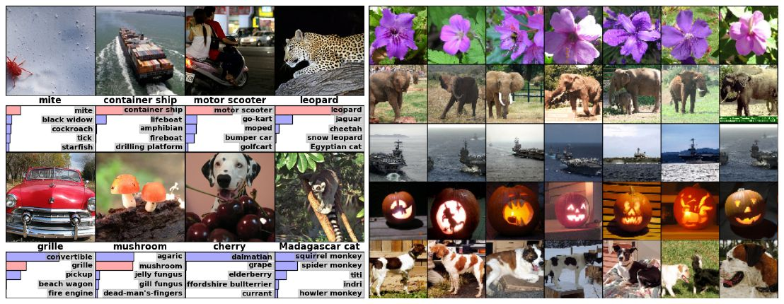
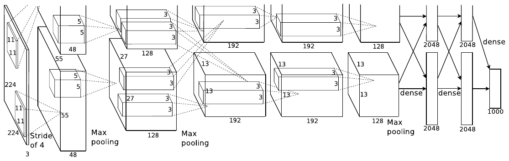

<!-- paginate: true -->

<!--
  DECK BRIEF
  Subject: Krizhevsky, Sutskever & Hinton, ImageNet Classification with Deep
  Convolutional Neural Networks (NIPS 2012) -- AlexNet.
  Audience: ML engineers in 2026 who know modern CNNs and have never read this paper.
  Reader promise: by the end they can say why the net is split across two GPUs and
  exactly which layers cross, what LRN computes and why it is gone, which ingredient
  deltas are trustworthy and which are not, and which number is the actual result.
  Source of truth: the frozen NIPS PDF.
  Figure 2 of the source PDF is CROPPED -- the top of the upper GPU stream runs off
  the page. Every architecture visual here is hand-authored SVG, never the original.
-->

<!-- HOVER TOOLKIT — body-level tooltip card + affordance styles. Keep this block;
     it is inert until an element carries data-tip. -->

<!-- _class: title paper -->

Paper deep dive

# **Krizhevsky et al. (2012):** ImageNet Classification with Deep Convolutional Neural Networks

## Train one CNN bigger than a single GPU could hold — two cards were the price of that size, not the goal — and win at **15.3%** top-5 error against the runner-up's 26.2%

<strong>Krizhevsky, Sutskever &amp; Hinton</strong> · University of Toronto · NIPS 2012, winner of ILSVRC-2012

<a href="https://papers.nips.cc/paper_files/paper/2012/file/c399862d3b9d6b76c8436e924a68c45b-Paper.pdf">paper (PDF)</a><a href="https://papers.nips.cc/paper_files/paper/2012/hash/c399862d3b9d6b76c8436e924a68c45b-Abstract.html">NIPS page</a><a href="https://code.google.com/archive/p/cuda-convnet/">code</a><a class="website" href="https://www.image-net.org/challenges/LSVRC/2012/">ILSVRC 2012</a><a href="https://github.com/pytorch/vision/blob/main/torchvision/models/alexnet.py">torchvision port</a>

<em>Underlines in review mode are fact-checked against the paper — click one to open the passage.</em>

---

<!-- _class: fs-sm -->

## TL;DR

- **One eight-layer CNN** — five conv, three fully-connected — trained end to end on **1.2M photographs** for a **1000-way** choice.
- The bet: **a net too big for one card** — 60M parameters, split across **two GTX 580 3 GB GPUs** because one could not hold them — with non-saturating **ReLUs** so it trains in days.
- The stabiliser: **dropout at 0.5** (half the units of the two big layers silenced at random on every step), **2048× crop-and-reflect** augmentation (32 × 32 positions of a 224×224 window in the 256×256 image, each also mirrored) and PCA colour jitter (one random shift of each image's overall colour) — without dropout or the crops it **overfits substantially**.
- **37.5% / 17.0%** top-1/top-5 *error* — lower is better — on ILSVRC-2010 against **45.7% / 25.7%** best published, for one net **averaging ten test crops** (four corners, centre, and their mirrors); the contest entry, a seven-net ensemble, won 2012 at **15.3%** vs **26.2%**.
- **ReLU, dropout, augmentation and GPU training are still defaults**; LRN, the hand-split topology, overlapping pooling (bar one 3×3/2 max-pool in some network stems) and ten-crop testing are not (slide 22).

---

<!-- _class: fs-sm -->

## The result, before any of the method — a photograph in, a ranked list out

<svg xmlns="http://www.w3.org/2000/svg" viewBox="0 0 1160 600" width="800" height="414" style="max-width:100%" font-family="Inter, sans-serif">
<defs>
<marker id="taskarrow" markerWidth="10" markerHeight="10" refX="8" refY="4" orient="auto"><path d="M0,0 L9,4 L0,8 z" fill="#3b82f6"/></marker>
</defs>

<rect width="1160" height="600" fill="#111111"/>
<text x="24" y="32" fill="#f0f0f0" font-size="21" font-weight="700">The task: one photograph in, one ranked list of 1000 classes out</text>
<text x="24" y="58" class="task-tk-cap">Labels follow the leopard example the paper singles out in Figure 4. Bar lengths are illustrative; the error rates are not.</text>
<!-- ── INPUT ───────────────────────────────────────────────────────────── -->
<g data-tiphead="The input" data-tip="Variable-resolution web photo, shorter side rescaled to 256 and centre-cropped to 256×256. The only other pre-processing is subtracting the training-set mean pixel; the net sees centred raw RGB.">
<rect x="24" y="80" width="268" height="440" rx="12" fill="#0d1117" stroke="#3b82f6" stroke-width="1.5"/>
<g>
  <rect x="62" y="152" width="192" height="192" rx="6" fill="#1c2430"/>
  <ellipse cx="158" cy="330" rx="96" ry="30" fill="#263040"/>
  <path d="M112,214 L108,182 L136,200 Z" fill="#8a6a32"/>
  <path d="M204,214 L208,182 L180,200 Z" fill="#8a6a32"/>
  <ellipse cx="158" cy="252" rx="58" ry="52" fill="#a07c3c"/>
  <ellipse cx="158" cy="316" rx="46" ry="34" fill="#8a6a32"/>
  <ellipse cx="140" cy="246" rx="9" ry="11" fill="#0f1218"/>
  <ellipse cx="176" cy="246" rx="9" ry="11" fill="#0f1218"/>
  <ellipse cx="158" cy="276" rx="18" ry="12" fill="#d8c39a"/>
  <path d="M150,270 L166,270 L158,278 Z" fill="#4a3a1c"/>
  <circle cx="120" cy="222" r="6" fill="#5a4520"/><circle cx="196" cy="222" r="6" fill="#5a4520"/>
  <circle cx="112" cy="256" r="6" fill="#5a4520"/><circle cx="204" cy="256" r="6" fill="#5a4520"/>
  <circle cx="124" cy="288" r="6" fill="#5a4520"/><circle cx="192" cy="288" r="6" fill="#5a4520"/>
  <circle cx="158" cy="216" r="6" fill="#5a4520"/><circle cx="136" cy="318" r="6" fill="#5a4520"/>
  <circle cx="180" cy="318" r="6" fill="#5a4520"/>
  <rect x="82" y="172" width="152" height="152" rx="4" fill="none" stroke="#3b82f6" stroke-width="2" stroke-dasharray="6 5"/>
</g>
<text x="46" y="112" class="task-tk-hd">INPUT — one image</text>
<text x="46" y="134" class="task-tk-cap">an ILSVRC test photograph</text>
<text x="46" y="368" class="task-tk-sm">dashed = the 224×224 crop</text>
<text x="46" y="410" class="task-tk-lb">256×256, mean removed</text>
<text x="46" y="432" class="task-tk-cap">no other pre-processing</text>
<text x="46" y="470" class="task-tk-lb">150,528 numbers</text>
<text x="46" y="492" class="task-tk-cap">224 × 224 × 3 raw values</text>
</g>
<path d="M300,300 L336,300" fill="none" stroke="#3b82f6" stroke-width="2.5" marker-end="url(#taskarrow)"/>
<!-- ── THE NETWORK ─────────────────────────────────────────────────────── -->
<g data-tiphead="The network, in one block" data-tip="Eight learned layers — five conv, three fully-connected — ending in a 1000-way softmax. 60 million parameters, 650,000 neurons, plain supervised backprop, no unsupervised pre-training.">
<rect x="348" y="80" width="404" height="440" rx="12" fill="#0d1117" stroke="#2a2a2a" stroke-width="1.5"/>
<g>
  <rect x="372" y="160" width="54" height="118" rx="5" fill="#141c2a" stroke="#3b82f6" stroke-width="1.3"/>
  <rect x="434" y="168" width="50" height="102" rx="5" fill="#141c2a" stroke="#3b82f6" stroke-width="1.3"/>
  <rect x="492" y="176" width="46" height="86" rx="5" fill="#141c2a" stroke="#3b82f6" stroke-width="1.3"/>
  <rect x="546" y="176" width="46" height="86" rx="5" fill="#141c2a" stroke="#3b82f6" stroke-width="1.3"/>
  <rect x="600" y="180" width="42" height="78" rx="5" fill="#141c2a" stroke="#3b82f6" stroke-width="1.3"/>
  <rect x="656" y="188" width="20" height="62" rx="4" fill="#2a2a2a" stroke="#8a8a8a" stroke-width="1.2"/>
  <rect x="684" y="188" width="20" height="62" rx="4" fill="#2a2a2a" stroke="#8a8a8a" stroke-width="1.2"/>
  <rect x="712" y="200" width="14" height="38" rx="4" fill="#20304a" stroke="#3b82f6" stroke-width="1.2"/>
</g>
<text x="370" y="112" class="task-tk-hd">ONE NETWORK — eight learned layers</text>
<text x="370" y="134" class="task-tk-cap">five convolutional, then three fully-connected</text>
<text x="370" y="296" class="task-tk-cap">conv 1 – 5 in green · fc 6, 7, 8 in grey</text>
<text x="370" y="336" class="task-tk-lb">60 million parameters · 650,000 neurons</text>
<text x="370" y="358" class="task-tk-cap">purely supervised, no pre-training</text>
<text x="370" y="396" class="task-tk-lb">two NVIDIA GTX 580, 3 GB each</text>
<text x="370" y="418" class="task-tk-cap">that memory limit is why the net is cut in half</text>
<text x="370" y="456" class="task-tk-lb">five to six days, about 90 epochs</text>
<text x="370" y="478" class="task-tk-cap">over the 1.2 million training images</text>
</g>
<path d="M760,300 L796,300" fill="none" stroke="#3b82f6" stroke-width="2.5" marker-end="url(#taskarrow)"/>
<!-- ── OUTPUT ──────────────────────────────────────────────────────────── -->
<g data-tiphead="The output, and how it is graded" data-tip="A probability for each of the 1000 classes. Top-1 counts an image wrong when the argmax is not the true class; top-5 only when the true class is absent from the five most probable.">
<rect x="808" y="80" width="328" height="440" rx="12" fill="#0d1117" stroke="#f0883e" stroke-width="1.5"/>
<g>
  <rect x="830" y="182" width="242" height="18" rx="4" fill="#3b82f6"/>
  <rect x="830" y="266" width="120" height="14" rx="4" fill="#3a3a3a"/>
  <rect x="830" y="314" width="86" height="14" rx="4" fill="#3a3a3a"/>
  <rect x="830" y="362" width="58" height="14" rx="4" fill="#3a3a3a"/>
  <rect x="830" y="410" width="36" height="14" rx="4" fill="#3a3a3a"/>
</g>
<path d="M830,440 L1114,440" stroke="#2a2a2a" stroke-width="1.5"/>
<text x="830" y="112" fill="#f0883e" font-size="15" font-weight="700">OUTPUT — 1000-way softmax</text>
<text x="830" y="134" class="task-tk-cap">the five most probable labels</text>
<text x="830" y="172" class="task-tk-lb">leopard</text>
<text x="830" y="220" class="task-tk-sm">the correct label — inside the top five</text>
<text x="830" y="256" class="task-tk-cap">jaguar</text>
<text x="830" y="304" class="task-tk-cap">cheetah</text>
<text x="830" y="352" class="task-tk-cap">snow leopard</text>
<text x="830" y="400" class="task-tk-cap">Egyptian cat</text>
<text x="830" y="468" class="task-tk-lb">top-5 error — true label absent</text>
<text x="830" y="492" class="task-tk-val">17.0%<tspan class="task-tk-cap" font-weight="400" dx="8">this CNN, ILSVRC-2010</tspan></text>
<text x="830" y="512" class="task-tk-cap">25.7% for the best published result</text>
</g>
</svg>

*One 224×224 crop of the 256×256 image in — a random one during training — and a probability over **1000 classes** out. On ILSVRC-2010 this single network reaches **17.0% top-5 error** where the best published result was **25.7%** — a number that already averages the softmax over **ten test crops** (four corners and the centre, each also mirrored); without that averaging it is 18.3%. The contest variant won ILSVRC-2012 at **15.3%** against the runner-up's **26.2%** — after **five to six days on two GTX 580 3 GB cards**.*

---

<!-- _class: fs-sm -->

## The paper's own test images: the ranked list is sensible, and the features behind it are semantic

Figure 4 from <a href="https://papers.nips.cc/paper/2012/hash/c399862d3b9d6b76c8436e924a68c45b-Abstract.html" target="_blank">Krizhevsky et al. 2012</a>, p. 8 — left: eight ILSVRC-2010 test images with the model's top-5; right: five test images and their six nearest training images in the last hidden layer.

- **Red bar = the correct label** whenever it makes the top five — and the off-centre **mite** is still found
- Neighbours are nearest in **4096-d feature space, not pixel space** — the elephants and dogs come back **across poses**. Qualitative only: selected examples, no retrieval metric

---

## The core idea — buy scale instead of designing features

- **Why care:** the 2010 winner averaged **six sparse-coding models** over hand-designed features, and still missed **28.2%** (top-5 error).
- **Prior work:** CNNs worked, but were **"prohibitively expensive to apply in large scale to high-resolution images"**.
- **This paper instead:** trains **one very large CNN end to end on raw RGB**, purely supervised, **across two 3 GB cards**.
- **The enabling fact:** ImageNet's **15 million labelled images** — its **1.2M-image** contest subset is enough to train **a net too big for one card** without severe overfitting — and GPUs fast enough to train it.
- **Borrowed:** the rectifier (Nair & Hinton), dropout ([2012 preprint](https://arxiv.org/abs/1207.0580)), a columnar layout ([Cireşan et al.](https://arxiv.org/abs/1102.0183))

---

## The five Cs, in one look

Five Cs — a standard first-pass checklist for a paper: Category, Context, Correctness, Contributions, Clarity.

| | |
|---|---|
| **Category** | an **empirical systems paper** — one architecture, one dataset, choices each carrying a measured delta |
| **Context** | displaces **hand-engineered features** (sparse coding, Fisher vectors) and extends the columnar CNN of [Cireşan et al.](https://arxiv.org/abs/1102.0183); [VGG](https://arxiv.org/abs/1409.1556) and [ResNet](https://arxiv.org/abs/1512.03385) answered what it left open |
| **Correctness** | headline is a **contest test-set score** — the 2012 test labels were never public, so the organisers scored the submission (background); the *explanations* rest on **per-ingredient deltas against different baselines** |
| **Contributions** | the result; a **public GPU convolution implementation** (cuda-convnet, every training operation on the GPU); a checklist — ReLU, LRN, pooling, dropout, augmentation — the field mined for years |
| **Clarity** | plain prose, **one broken figure**: Figure 2 is cropped in the proceedings PDF |

---

## Should you read further?

- **Read the paper if** you train vision models and want a case study of a hardware limit shaping an architecture: §3 is the architecture (the two-GPU split is §3.2), §4 the fight against overfitting (augmentation, dropout). The evidence for that reading is on slides 9–10 and 20.
- **Skim §3.2, §6 and Table 2 if** you only need which layers cross between the GPUs (§3.2) and what the winning 15.3% is made of (§6 is the results; Table 2 lists the ILSVRC-2012 single nets and ensembles) — slides 10 and 17.
- **Skip it if** you want a modern recipe — slides 16–22 show which ingredients survived; go to [VGG](https://arxiv.org/abs/1409.1556) for the depth study, [batch normalization](https://arxiv.org/abs/1502.03167) for what replaced LRN, [ResNet](https://arxiv.org/abs/1512.03385) for what replaced the rest.

---

## Background — 1000 classes, and only one year with public test labels

| | |
|---|---|
| ImageNet, all of it | over 15 million labelled images, roughly 22,000 categories — its Fall 2011 release is the extra pre-training data on slide 17 |
| the ILSVRC subset | 1000 categories, about 1000 images each |
| splits | 1.2M train · 50,000 validation · 150,000 test |
| pre-processing | down-sample to 256×256, subtract the mean pixel, nothing else |

- Top-5 error is the fraction of images whose correct label is **not among the five most probable** — every number in this deck is an **error rate, so lower is better**
- **ILSVRC-2010 is the only version with public test labels** — which is why almost every experiment lives there. For 2012 the paper mostly reports validation error and uses it interchangeably with test error, which "in our experience" differ by no more than 0.1% — Table 2 has two such pairs (16.4 / 16.4, 15.4 / 15.3)

---

<!-- _class: fs-sm -->

## Eight layers, their shapes, and the two places the GPUs talk

<svg xmlns="http://www.w3.org/2000/svg" viewBox="0 0 1160 600" width="800" height="414" style="max-width:100%" font-family="Inter, sans-serif">
<defs>
<marker id="ag" markerWidth="10" markerHeight="10" refX="8" refY="4" orient="auto"><path d="M0,0 L9,4 L0,8 z" fill="#3b82f6"/></marker>
<marker id="ab" markerWidth="10" markerHeight="10" refX="8" refY="4" orient="auto"><path d="M0,0 L9,4 L0,8 z" fill="#3fb950"/></marker>
<marker id="ao" markerWidth="10" markerHeight="10" refX="8" refY="4" orient="auto"><path d="M0,0 L9,4 L0,8 z" fill="#f0883e"/></marker>
</defs>

<rect width="1160" height="600" fill="#111111"/>
<text x="24" y="30" fill="#f0f0f0" font-size="21" font-weight="700">Per-layer tensor shapes and the exact cross-GPU connectivity</text>
<text x="24" y="54" class="arch-ar-cap">Top lane and bottom lane are the two halves of the same network. Orange is the only place they talk.</text>
<text x="24" y="162" fill="#3b82f6" font-size="15" font-weight="700">GPU 1</text>
<text x="24" y="302" fill="#3fb950" font-size="15" font-weight="700">GPU 2</text>
<text x="126" y="76" class="arch-ar-h" text-anchor="middle">input</text>
<text x="242" y="76" class="arch-ar-h" text-anchor="middle">conv 1</text>
<text x="356" y="76" class="arch-ar-h" text-anchor="middle">conv 2</text>
<text x="498" y="76" class="arch-ar-h" text-anchor="middle">conv 3</text>
<text x="612" y="76" class="arch-ar-h" text-anchor="middle">conv 4</text>
<text x="726" y="76" class="arch-ar-h" text-anchor="middle">conv 5</text>
<text x="860" y="76" class="arch-ar-h" text-anchor="middle">fc 6</text>
<text x="980" y="76" class="arch-ar-h" text-anchor="middle">fc 7</text>
<text x="1090" y="76" class="arch-ar-h" text-anchor="middle">fc 8</text>
<text x="242" y="98" class="arch-ar-s" text-anchor="middle">55×55×96</text>
<text x="356" y="98" class="arch-ar-s" text-anchor="middle">27×27×256</text>
<text x="498" y="98" class="arch-ar-s" text-anchor="middle">13×13×384</text>
<text x="612" y="98" class="arch-ar-s" text-anchor="middle">13×13×384</text>
<text x="726" y="98" class="arch-ar-s" text-anchor="middle">13×13×256</text>
<text x="860" y="98" class="arch-ar-s" text-anchor="middle">4096</text>
<text x="980" y="98" class="arch-ar-s" text-anchor="middle">4096</text>
<text x="1090" y="98" class="arch-ar-s" text-anchor="middle">1000</text>
<g data-tiphead="Input crop" data-tip="A random 224×224 crop of a 256×256 image, mean-subtracted raw RGB. Both GPUs read the same crop; the split starts one layer later.">
<rect x="88" y="178" width="76" height="96" rx="10" fill="#1a1a1a" stroke="#2a2a2a" stroke-width="2"/>
<text x="126" y="216" class="arch-ar-m" text-anchor="middle">224×224</text>
<text x="126" y="240" class="arch-ar-d" text-anchor="middle">×3 RGB</text>
</g>
<g data-tiphead="conv 1 — GPU 1 half" data-tip="96 kernels of 11×11×3 at stride 4, split 48 per GPU. Kernel depth 3 means each half reads the whole RGB image, so nothing is shared yet.">
<rect x="196" y="108" width="92" height="96" rx="10" fill="#10141a" stroke="#3b82f6" stroke-width="2"/>
<text x="242" y="132" class="arch-ar-t" text-anchor="middle">48 maps</text>
<text x="242" y="154" class="arch-ar-m" text-anchor="middle">11×11×3</text>
<text x="242" y="176" class="arch-ar-d" text-anchor="middle">55×55×48</text>
<text x="242" y="196" class="arch-ar-d" text-anchor="middle">stride 4</text>
</g>
<g data-tiphead="conv 1 — GPU 2 half" data-tip="The mirror half. Figure 3 shows these two halves reliably specialise: one learns colour-agnostic edges, the other colour blobs.">
<rect x="196" y="248" width="92" height="96" rx="10" fill="#0f1620" stroke="#3fb950" stroke-width="2"/>
<text x="242" y="272" class="arch-ar-t" text-anchor="middle">48 maps</text>
<text x="242" y="294" class="arch-ar-m" text-anchor="middle">11×11×3</text>
<text x="242" y="316" class="arch-ar-d" text-anchor="middle">55×55×48</text>
<text x="242" y="336" class="arch-ar-d" text-anchor="middle">stride 4</text>
</g>
<g data-tiphead="conv 2 — GPU 1 half" data-tip="256 kernels of 5×5×48, split 128 per GPU. Depth 48 is exactly half of conv 1's 96 maps, so this layer reads only its own GPU.">
<rect x="310" y="108" width="92" height="96" rx="10" fill="#10141a" stroke="#3b82f6" stroke-width="2"/>
<text x="356" y="132" class="arch-ar-t" text-anchor="middle">128 maps</text>
<text x="356" y="154" class="arch-ar-m" text-anchor="middle">5×5×48</text>
<text x="356" y="176" class="arch-ar-d" text-anchor="middle">27×27×128</text>
</g>
<g data-tiphead="conv 2 — GPU 2 half" data-tip="Same shape on the other card. No cross edge enters conv 2, so the two halves have not exchanged a single activation yet.">
<rect x="310" y="248" width="92" height="96" rx="10" fill="#0f1620" stroke="#3fb950" stroke-width="2"/>
<text x="356" y="272" class="arch-ar-t" text-anchor="middle">128 maps</text>
<text x="356" y="294" class="arch-ar-m" text-anchor="middle">5×5×48</text>
<text x="356" y="316" class="arch-ar-d" text-anchor="middle">27×27×128</text>
</g>
<g data-tiphead="conv 3 — the one cross-connected layer" data-tip="384 kernels of 3×3×256, split 192 per GPU. Depth 256 is ALL of conv 2's maps, so every conv 3 kernel reads across both cards. The single cross-GPU convolution in the network.">
<rect x="452" y="108" width="92" height="96" rx="10" fill="#1d1710" stroke="#f0883e" stroke-width="2.5"/>
<text x="498" y="132" class="arch-ar-t" text-anchor="middle">192 maps</text>
<text x="498" y="154" class="arch-ar-mo" text-anchor="middle">3×3×256</text>
<text x="498" y="176" class="arch-ar-d" text-anchor="middle">13×13×192</text>
</g>
<g data-tiphead="conv 3 — GPU 2 half" data-tip="Also reads all 256 conv 2 maps. Cross-GPU traffic happens exactly here, and the paper says the connectivity pattern was picked by cross-validation to keep it cheap.">
<rect x="452" y="248" width="92" height="96" rx="10" fill="#1d1710" stroke="#f0883e" stroke-width="2.5"/>
<text x="498" y="272" class="arch-ar-t" text-anchor="middle">192 maps</text>
<text x="498" y="294" class="arch-ar-mo" text-anchor="middle">3×3×256</text>
<text x="498" y="316" class="arch-ar-d" text-anchor="middle">13×13×192</text>
</g>
<g data-tiphead="conv 4" data-tip="384 kernels of 3×3×192, split 192 per GPU. Depth 192 is half of conv 3's 384 maps, so the streams separate again immediately after conv 3.">
<rect x="566" y="108" width="92" height="96" rx="10" fill="#10141a" stroke="#3b82f6" stroke-width="2"/>
<text x="612" y="132" class="arch-ar-t" text-anchor="middle">192 maps</text>
<text x="612" y="154" class="arch-ar-m" text-anchor="middle">3×3×192</text>
<text x="612" y="176" class="arch-ar-d" text-anchor="middle">13×13×192</text>
</g>
<g data-tiphead="conv 4 — GPU 2 half" data-tip="Same-GPU only. conv 3, 4 and 5 run back to back with no pooling or normalisation between them.">
<rect x="566" y="248" width="92" height="96" rx="10" fill="#0f1620" stroke="#3fb950" stroke-width="2"/>
<text x="612" y="272" class="arch-ar-t" text-anchor="middle">192 maps</text>
<text x="612" y="294" class="arch-ar-m" text-anchor="middle">3×3×192</text>
<text x="612" y="316" class="arch-ar-d" text-anchor="middle">13×13×192</text>
</g>
<g data-tiphead="conv 5" data-tip="256 kernels of 3×3×192, split 128 per GPU. Depth 192 is half of conv 4's 384 maps: same GPU. Its output is max-pooled before the fully-connected stack.">
<rect x="680" y="108" width="92" height="96" rx="10" fill="#10141a" stroke="#3b82f6" stroke-width="2"/>
<text x="726" y="132" class="arch-ar-t" text-anchor="middle">128 maps</text>
<text x="726" y="154" class="arch-ar-m" text-anchor="middle">3×3×192</text>
<text x="726" y="176" class="arch-ar-d" text-anchor="middle">13×13×128</text>
</g>
<g data-tiphead="conv 5 — GPU 2 half" data-tip="The last convolutional layer. After its max-pool the representation is small enough that the fully-connected layers can afford to be all-to-all.">
<rect x="680" y="248" width="92" height="96" rx="10" fill="#0f1620" stroke="#3fb950" stroke-width="2"/>
<text x="726" y="272" class="arch-ar-t" text-anchor="middle">128 maps</text>
<text x="726" y="294" class="arch-ar-m" text-anchor="middle">3×3×192</text>
<text x="726" y="316" class="arch-ar-d" text-anchor="middle">13×13×128</text>
</g>
<g data-tiphead="fc 6" data-tip="4096 neurons, drawn in Figure 2 as 2048 per GPU. Fully connected to every neuron of the previous layer, so it reads across both cards. Dropout at 0.5 applies here.">
<rect x="822" y="108" width="76" height="96" rx="10" fill="#1d1710" stroke="#f0883e" stroke-width="2.5"/>
<text x="860" y="132" class="arch-ar-t" text-anchor="middle">2048</text>
<text x="860" y="154" class="arch-ar-d" text-anchor="middle">dropout</text>
<text x="860" y="176" class="arch-ar-m" text-anchor="middle">p = 0.5</text>
</g>
<g data-tiphead="fc 6 — GPU 2 half" data-tip="The second 2048. Most of the 60 million parameters sit in this layer and its neighbours, which is also why dropout is applied here and nowhere else.">
<rect x="822" y="248" width="76" height="96" rx="10" fill="#1d1710" stroke="#f0883e" stroke-width="2.5"/>
<text x="860" y="272" class="arch-ar-t" text-anchor="middle">2048</text>
<text x="860" y="294" class="arch-ar-d" text-anchor="middle">dropout</text>
<text x="860" y="316" class="arch-ar-m" text-anchor="middle">p = 0.5</text>
</g>
<g data-tiphead="fc 7" data-tip="The second 4096-wide layer, also with dropout at 0.5. Its activations are the 4096-dimensional feature vector used for nearest-neighbour retrieval in Figure 4.">
<rect x="942" y="108" width="76" height="96" rx="10" fill="#1d1710" stroke="#f0883e" stroke-width="2.5"/>
<text x="980" y="132" class="arch-ar-t" text-anchor="middle">2048</text>
<text x="980" y="154" class="arch-ar-d" text-anchor="middle">dropout</text>
<text x="980" y="176" class="arch-ar-m" text-anchor="middle">p = 0.5</text>
</g>
<g data-tiphead="fc 7 — GPU 2 half" data-tip="Dropout covers the first two fully-connected layers only. The final classifier layer is left untouched.">
<rect x="942" y="248" width="76" height="96" rx="10" fill="#1d1710" stroke="#f0883e" stroke-width="2.5"/>
<text x="980" y="272" class="arch-ar-t" text-anchor="middle">2048</text>
<text x="980" y="294" class="arch-ar-d" text-anchor="middle">dropout</text>
<text x="980" y="316" class="arch-ar-m" text-anchor="middle">p = 0.5</text>
</g>
<g data-tiphead="fc 8 — the classifier" data-tip="1000 outputs feeding a 1000-way softmax, trained by maximising the multinomial logistic regression objective. One output per ILSVRC class.">
<rect x="1042" y="182" width="96" height="88" rx="10" fill="#1a1a1a" stroke="#f0f0f0" stroke-width="2"/>
<text x="1090" y="214" class="arch-ar-t" text-anchor="middle">1000-way</text>
<text x="1090" y="240" class="arch-ar-d" text-anchor="middle">softmax</text>
</g>
<path d="M164,206 C182,206 180,156 194,156" fill="none" stroke="#3b82f6" stroke-width="2.2" marker-end="url(#ag)"/>
<path d="M164,246 C182,246 180,296 194,296" fill="none" stroke="#3fb950" stroke-width="2.2" marker-end="url(#ab)"/>
<path d="M288,156 L308,156" fill="none" stroke="#3b82f6" stroke-width="2.2" marker-end="url(#ag)"/>
<path d="M288,296 L308,296" fill="none" stroke="#3fb950" stroke-width="2.2" marker-end="url(#ab)"/>
<path d="M402,150 L450,150" fill="none" stroke="#3b82f6" stroke-width="2.2" marker-end="url(#ag)"/>
<path d="M402,302 L450,302" fill="none" stroke="#3fb950" stroke-width="2.2" marker-end="url(#ab)"/>
<path class="an-arch-x3" d="M402,172 C426,200 428,254 450,284" fill="none" stroke="#f0883e" stroke-width="2.2" marker-end="url(#ao)"/>
<path class="an-arch-x3" d="M402,280 C426,252 428,198 450,168" fill="none" stroke="#f0883e" stroke-width="2.2" marker-end="url(#ao)"/>
<path d="M544,156 L564,156" fill="none" stroke="#3b82f6" stroke-width="2.2" marker-end="url(#ag)"/>
<path d="M544,296 L564,296" fill="none" stroke="#3fb950" stroke-width="2.2" marker-end="url(#ab)"/>
<path d="M658,156 L678,156" fill="none" stroke="#3b82f6" stroke-width="2.2" marker-end="url(#ag)"/>
<path d="M658,296 L678,296" fill="none" stroke="#3fb950" stroke-width="2.2" marker-end="url(#ab)"/>
<path d="M772,150 L820,150" fill="none" stroke="#3b82f6" stroke-width="2.2" marker-end="url(#ag)"/>
<path d="M772,302 L820,302" fill="none" stroke="#3fb950" stroke-width="2.2" marker-end="url(#ab)"/>
<path class="an-arch-x6" d="M772,172 C796,200 798,254 820,284" fill="none" stroke="#f0883e" stroke-width="2.2" marker-end="url(#ao)"/>
<path class="an-arch-x6" d="M772,280 C796,252 798,198 820,168" fill="none" stroke="#f0883e" stroke-width="2.2" marker-end="url(#ao)"/>
<path class="an-arch-x7" d="M898,150 L940,150" fill="none" stroke="#f0883e" stroke-width="2.2" marker-end="url(#ao)"/>
<path class="an-arch-x7" d="M898,302 L940,302" fill="none" stroke="#f0883e" stroke-width="2.2" marker-end="url(#ao)"/>
<path class="an-arch-x7" d="M898,172 C918,200 920,254 940,284" fill="none" stroke="#f0883e" stroke-width="2.2" marker-end="url(#ao)"/>
<path class="an-arch-x7" d="M898,280 C918,252 920,198 940,168" fill="none" stroke="#f0883e" stroke-width="2.2" marker-end="url(#ao)"/>
<path class="an-arch-x7" d="M1018,160 C1032,180 1028,192 1040,204" fill="none" stroke="#f0883e" stroke-width="2.2" marker-end="url(#ao)"/>
<path class="an-arch-x7" d="M1018,292 C1032,272 1028,260 1040,248" fill="none" stroke="#f0883e" stroke-width="2.2" marker-end="url(#ao)"/>
<text x="299" y="374" class="arch-ar-cap" text-anchor="middle">LRN → pool</text>
<text x="427" y="374" class="arch-ar-cap" text-anchor="middle">LRN → pool</text>
<text x="797" y="374" class="arch-ar-cap" text-anchor="middle">max-pool</text>
<path d="M96,410 L136,410" fill="none" stroke="#3b82f6" stroke-width="2.2"/>
<path d="M96,424 L136,424" fill="none" stroke="#3fb950" stroke-width="2.2"/>
<text x="148" y="422" class="arch-ar-cap">parallel pair — each GPU reads only its own half (conv 2, 4, 5)</text>
<path class="an-arch-x5" d="M600,408 C614,414 622,420 636,426" fill="none" stroke="#f0883e" stroke-width="2.2"/>
<path class="an-arch-x5" d="M600,426 C614,420 622,414 636,408" fill="none" stroke="#f0883e" stroke-width="2.2"/>
<text x="650" y="422" class="arch-ar-cap">crossing bundle — reads every map on both GPUs (conv 3, fc 6/7/8)</text>
<text x="24" y="456" class="arch-ar-cap">Every max-pool is overlapping: window z = 3, stride s = 2. Spatial sizes assume a 227×227 input: with the paper's 224, conv 1 does not divide evenly.</text>
<rect x="24" y="478" width="1112" height="92" rx="12" fill="#0d1117" stroke="#2a2a2a" stroke-width="1.5"/>
<text x="46" y="508" fill="#f0883e" font-size="15" font-weight="700">The split is a memory workaround, not an architectural idea</text>
<text x="46" y="534" class="arch-ar-cap">1.2 million examples could train, without severe overfitting, a net bigger than one 3 GB GTX 580 could hold — so it was split, not shrunk.</text>
<text x="46" y="558" class="arch-ar-cap">Redrawn from Figure 2, p. 5 — whose upper GPU stream is clipped off the top of the page in the published PDF.</text>
<rect class="an-arch-s0" opacity="0" x="88" y="178" width="76" height="96" rx="10" fill="#ffffff" pointer-events="none"/>
<rect class="an-arch-s1" opacity="0" x="196" y="108" width="92" height="96" rx="10" fill="#ffffff" pointer-events="none"/>
<rect class="an-arch-s1" opacity="0" x="196" y="248" width="92" height="96" rx="10" fill="#ffffff" pointer-events="none"/>
<rect class="an-arch-s2" opacity="0" x="310" y="108" width="92" height="96" rx="10" fill="#ffffff" pointer-events="none"/>
<rect class="an-arch-s2" opacity="0" x="310" y="248" width="92" height="96" rx="10" fill="#ffffff" pointer-events="none"/>
<rect class="an-arch-s3" opacity="0" x="452" y="108" width="92" height="96" rx="10" fill="#ffffff" pointer-events="none"/>
<rect class="an-arch-s3" opacity="0" x="452" y="248" width="92" height="96" rx="10" fill="#ffffff" pointer-events="none"/>
<rect class="an-arch-s4" opacity="0" x="566" y="108" width="92" height="96" rx="10" fill="#ffffff" pointer-events="none"/>
<rect class="an-arch-s4" opacity="0" x="566" y="248" width="92" height="96" rx="10" fill="#ffffff" pointer-events="none"/>
<rect class="an-arch-s5" opacity="0" x="680" y="108" width="92" height="96" rx="10" fill="#ffffff" pointer-events="none"/>
<rect class="an-arch-s5" opacity="0" x="680" y="248" width="92" height="96" rx="10" fill="#ffffff" pointer-events="none"/>
<rect class="an-arch-s6" opacity="0" x="822" y="108" width="76" height="96" rx="10" fill="#ffffff" pointer-events="none"/>
<rect class="an-arch-s6" opacity="0" x="822" y="248" width="76" height="96" rx="10" fill="#ffffff" pointer-events="none"/>
<rect class="an-arch-s7" opacity="0" x="942" y="108" width="76" height="96" rx="10" fill="#ffffff" pointer-events="none"/>
<rect class="an-arch-s7" opacity="0" x="942" y="248" width="76" height="96" rx="10" fill="#ffffff" pointer-events="none"/>
</svg>

- **Redrawn: the published Figure 2 is cropped** (original: slide 27). ReLU follows every layer; LRN then max-pooling follow conv 1 and conv 2, and max-pooling follows conv 5
- **The shapes do not derive cleanly**: (224 − 11)/4 + 1 = 54.25, so 55×55 needs a 227×227 input or 2 pixels of padding. **For reimplementers (later practice):** common ports crop 227 or pad; torchvision keeps 224 with padding 2. Trust **55×55×96 = 290,400** conv 1 neurons: the caption's 253,440 cannot be reproduced from the printed shapes (its other counts check out)

---

<!-- _class: fs-sm -->

## Kernel depth shows why only conv 3 and the fc layers cross GPUs

<svg xmlns="http://www.w3.org/2000/svg" viewBox="0 0 1160 600" width="800" height="414" style="max-width:100%" font-family="Inter, sans-serif">

<rect width="1160" height="600" fill="#111111"/>
<text x="24" y="32" fill="#f0f0f0" font-size="21" font-weight="700">Kernel depth, layer by layer — the receipt for the split</text>
<text x="24" y="58" class="spli-sr-cap">A kernel that is only half as deep as the previous layer can physically see only its own GPU. Read the third column and the split reads itself.</text>
<text x="40" y="104" class="spli-sr-hd">LAYER</text>
<text x="196" y="104" class="spli-sr-hd">KERNELS</text>
<text x="376" y="104" class="spli-sr-hd">DEPTH</text>
<text x="496" y="104" class="spli-sr-hd">MAPS AVAILABLE UPSTREAM</text>
<text x="886" y="104" class="spli-sr-hd">CROSSES GPUs?</text>
<path d="M24,116 L1136,116" stroke="#2a2a2a" stroke-width="1.5"/>
<g data-tiphead="conv 1" data-tip="Kernel depth 3 is the full RGB image, so both halves see the same input. The 96 kernels are simply dealt 48 to each card.">
<rect x="24" y="125" width="1112" height="36" rx="7" fill="#161616"/>
<text x="40" y="150" class="spli-sr-l">conv 1</text>
<text x="196" y="150" class="spli-sr-m">96 of 11×11</text>
<text x="376" y="150" class="spli-sr-m">× 3</text>
<text x="496" y="150" class="spli-sr-d">3 RGB channels of the input</text>
<text x="886" y="150" class="spli-sr-no">not split yet</text>
</g>
<g data-tiphead="conv 2" data-tip="Depth 48 is exactly half of conv 1's 96 maps. The kernel cannot reach the other card's half even in principle.">
<rect x="24" y="167" width="1112" height="36" rx="7" fill="#141414"/>
<text x="40" y="192" class="spli-sr-l">conv 2</text>
<text x="196" y="192" class="spli-sr-m">256 of 5×5</text>
<text x="376" y="192" class="spli-sr-m">× 48</text>
<text x="496" y="192" class="spli-sr-d">conv 1 has 96 maps, 48 per GPU</text>
<text x="886" y="192" class="spli-sr-no">no — its own half only</text>
</g>
<g data-tiphead="conv 3 — the exception" data-tip="Depth 256 is every conv 2 map on both cards. The only convolutional layer whose kernels read across the link, and the paper calls the choice of pattern a problem for cross-validation.">
<rect x="24" y="209" width="1112" height="36" rx="7" fill="#241a10" stroke="#f0883e" stroke-width="1.5"/>
<text x="40" y="234" class="spli-sr-l">conv 3</text>
<text x="196" y="234" class="spli-sr-m">384 of 3×3</text>
<text x="376" y="234" class="spli-sr-mo">× 256</text>
<text x="496" y="234" class="spli-sr-d">conv 2 has 256 maps, 128 per GPU</text>
<text x="886" y="234" class="spli-sr-yes">YES — the one cross-GPU conv</text>
</g>
<g data-tiphead="conv 4" data-tip="Back to half depth: 192 of conv 3's 384 maps. The streams separate again one layer after they met.">
<rect x="24" y="251" width="1112" height="36" rx="7" fill="#141414"/>
<text x="40" y="276" class="spli-sr-l">conv 4</text>
<text x="196" y="276" class="spli-sr-m">384 of 3×3</text>
<text x="376" y="276" class="spli-sr-m">× 192</text>
<text x="496" y="276" class="spli-sr-d">conv 3 has 384 maps, 192 per GPU</text>
<text x="886" y="276" class="spli-sr-no">no — its own half only</text>
</g>
<g data-tiphead="conv 5" data-tip="Half depth again: 192 of conv 4's 384 maps. conv 3, 4 and 5 run back to back with no pooling or normalisation between them.">
<rect x="24" y="293" width="1112" height="36" rx="7" fill="#161616"/>
<text x="40" y="318" class="spli-sr-l">conv 5</text>
<text x="196" y="318" class="spli-sr-m">256 of 3×3</text>
<text x="376" y="318" class="spli-sr-m">× 192</text>
<text x="496" y="318" class="spli-sr-d">conv 4 has 384 maps, 192 per GPU</text>
<text x="886" y="318" class="spli-sr-no">no — its own half only</text>
</g>
<g data-tiphead="fc 6, fc 7, fc 8" data-tip="Fully connected means connected to all neurons of the previous layer, so all three classifier layers exchange activations across both cards every forward and backward pass.">
<rect x="24" y="335" width="1112" height="36" rx="7" fill="#241a10" stroke="#f0883e" stroke-width="1.5"/>
<text x="40" y="360" class="spli-sr-l">fc 6 · 7 · 8</text>
<text x="196" y="360" class="spli-sr-m">4096 / 4096 / 1000</text>
<text x="376" y="360" class="spli-sr-mo">all</text>
<text x="496" y="360" class="spli-sr-d">every neuron of the layer before</text>
<text x="886" y="360" class="spli-sr-yes">YES — all-to-all</text>
</g>
<rect x="24" y="404" width="1112" height="182" rx="12" fill="#0d1117" stroke="#2a2a2a" stroke-width="1.5"/>
<text x="46" y="436" fill="#3b82f6" font-size="16" font-weight="700">Why two cards at all — and what the split was worth</text>
<text x="46" y="462" class="spli-sr-cap">More data lets a bigger net train without severe overfitting; 1.2M examples sufficed for nets too big for one 3 GB GTX 580.</text>
<text x="46" y="488" class="spli-sr-cap">Half the kernels live on each card. At conv 3 and fc 6–8 the GPUs read one another's memory directly, without going through host memory.</text>
<text x="46" y="514" class="spli-sr-cap">Reported gain: 1.7% top-1 / 1.2% top-5 vs a one-GPU net with half the kernels per conv layer, except its last conv and fc layers (footnote 2).</text>
<text x="46" y="540" fill="#d6d9dc" font-size="14">Two biases pull opposite ways: the larger-than-half baseline makes 1.7% understate the two-GPU net's gain, while twice the kernels</text>
<text x="46" y="566" fill="#d6d9dc" font-size="14">make it overstate what the split itself buys. Net reading: 1.7% is the gain of a bigger net, not of the split topology.</text>
</svg>

- A kernel of depth 48 can only see 48 kernel maps, which is exactly **one GPU's half of conv 1**. Depth 256 is **every conv 2 map on both cards**
- **Why two cards:** 1.2M examples were enough to train a net too big for one **GTX 580's 3 GB**. The paper gives **no memory breakdown**; illustratively, 60M float32 weights are 240 MB, tripled by gradients and momentum, plus a 128-image batch's activations kept for backprop
- **Where to cross** was **chosen by cross-validation**, until communication was "an acceptable fraction of the amount of computation". Patterns tried and traffic cost are not reported; the two-GPU net trains slightly faster than the one-GPU baseline

---

<!-- _class: fs-sm -->

## ReLU trains six times faster — not six times better

<svg xmlns="http://www.w3.org/2000/svg" viewBox="0 0 1160 600" width="800" height="414" style="max-width:100%" font-family="Inter, sans-serif">
<defs>
<marker id="ra" markerWidth="10" markerHeight="10" refX="8" refY="4" orient="auto"><path d="M0,0 L9,4 L0,8 z" fill="#f0883e"/></marker>
<marker id="rb" markerWidth="10" markerHeight="10" refX="1" refY="4" orient="auto"><path d="M9,0 L0,4 L9,8 z" fill="#f0883e"/></marker>
</defs>

<rect width="1160" height="600" fill="#111111"/>
<text x="24" y="32" fill="#f0f0f0" font-size="21" font-weight="700">ReLU's evidence is a stopwatch, not a scoreboard</text>
<text x="24" y="58" class="relu-rl-cap">Figure 1 redrawn. Left: the curves redrawn schematically — only the 25% threshold and the six-fold gap are measured. Right: the paper’s own Figure 1.</text>
<path d="M90,86 L90,420 L700,420" fill="none" stroke="#3a3a3a" stroke-width="2"/>
<path d="M90,340 L700,340" fill="none" stroke="#4a4a4a" stroke-width="1.5" stroke-dasharray="5 5"/>
<text x="596" y="330" class="relu-rl-ax">25% training error</text>
<text x="110" y="411" class="relu-rl-ax" font-size="12">both curves schematic, not traced from the paper</text>
<text x="90" y="76" class="relu-rl-ax">training error, high at the top</text>
<text x="596" y="440" class="relu-rl-ax">training epochs →</text>
<path class="an-relu-c" pathLength="1000" stroke-dashoffset="0" d="M90,112 C122,286 152,330 182,340 C310,366 520,388 700,398" fill="none" stroke="#3b82f6" stroke-width="3"/>
<path class="an-relu-c" pathLength="1000" stroke-dashoffset="0" d="M90,112 C210,178 310,252 404,302 C474,328 524,336 562,340 C622,346 662,350 700,354" fill="none" stroke="#8a8a8a" stroke-width="2.5"/>
<circle class="an-relu-p1" opacity="1" cx="182" cy="340" r="6" fill="#3b82f6"/>
<circle class="an-relu-p2" opacity="1" cx="562" cy="340" r="6" fill="#8a8a8a"/>
<path d="M400,116 L444,116" stroke="#3b82f6" stroke-width="3"/>
<text x="456" y="121" class="relu-rl-g">ReLU  f(x) = max(0, x)</text>
<path d="M400,146 L444,146" stroke="#8a8a8a" stroke-width="2.5"/>
<text x="456" y="151" class="relu-rl-ax">tanh — saturating, the 2012 default</text>
<g class="an-relu-l" opacity="1"><path d="M190,378 L554,378" fill="none" stroke="#f0883e" stroke-width="2" marker-end="url(#ra)" marker-start="url(#rb)"/>
<text x="372" y="402" fill="#f0883e" font-size="15" font-weight="700" text-anchor="middle">six times fewer epochs</text></g>
<rect x="740" y="86" width="396" height="334" rx="12" fill="#0d1117" stroke="#2a2a2a" stroke-width="1.5"/>
<a href="https://papers.nips.cc/paper/2012/hash/c399862d3b9d6b76c8436e924a68c45b-Abstract.html" target="_blank" data-tiphead="What Figure 1 actually measures" data-tip="Epochs to reach 25% training error on CIFAR-10 with a four-layer conv net. Not ImageNet, not test accuracy. Learning rates were tuned separately for each network to make training as fast as possible, and no regularisation of any kind was used. One curve per condition, no seeds, no error bars; the paper concedes the size of the effect varies with architecture.">
<text x="762" y="118" fill="#3b82f6" font-size="15" font-weight="700">Figure 1 from Krizhevsky et al. 2012</text>
<rect x="766" y="130" width="344" height="258" rx="6" fill="#ffffff"/>
<image href="images/paper/fig1-relu-vs-tanh.png" x="770" y="134" width="336" height="250" preserveAspectRatio="xMidYMid meet"/>
<text x="762" y="408" class="relu-rl-cap" font-size="12">solid ReLU · dashed tanh · epochs vs training error</text>
</a>
<rect x="24" y="452" width="1112" height="124" rx="12" fill="#0d1117" stroke="#2a2a2a" stroke-width="1.5"/>
<text x="46" y="482" fill="#3b82f6" font-size="16" font-weight="700">Why it mattered in 2012, and why it is still used in 2026</text>
<text x="46" y="512" class="relu-rl-cap">Then: the argument was purely wall-clock. The authors say outright they could not have experimented with networks this large using saturating units.</text>
<text x="46" y="538" class="relu-rl-cap">Now: rectifiers and their smooth descendants are the default, but for a reason this paper never tests — gradients that survive many layers of depth.</text>
<text x="46" y="564" class="relu-rl-cap">The 2012 speed argument has largely been absorbed by better hardware; the optimisation argument is what kept the unit alive.</text>
</svg>

- The measurement is **epochs to 25% training error on CIFAR-10** with a four-layer net, **ReLU against tanh only**: about 6 against about 36, read off Figure 1 — no printed numbers, runs or seeds
- **No accuracy is measured**. The authors' own framing: without non-saturating units they **could not have experimented with networks this large** — a claim about the schedule, not the score

---

<!-- _class: fs-sm -->

## LRN divides each unit by how loudly its neighbouring kernels fired

<svg xmlns="http://www.w3.org/2000/svg" viewBox="0 0 1160 600" width="800" height="414" style="max-width:100%" font-family="Inter, sans-serif">
<defs>
<marker id="la" markerWidth="9" markerHeight="9" refX="8" refY="4" orient="auto"><path d="M0,0 L8,4 L0,8 z" fill="#8a8a8a"/></marker>
</defs>

<rect width="1160" height="600" fill="#111111"/>
<text x="24" y="32" fill="#f0f0f0" font-size="21" font-weight="700">One unit, a window of five adjacent kernel maps, and one division</text>
<text x="24" y="58" class="lrn-ln-cap">a: post-ReLU activity of kernel map i at pixel (x, y). b: its normalised value. j: the neighbouring maps, by an index order fixed arbitrarily before training.</text>
<rect x="24" y="86" width="316" height="314" rx="12" fill="#0d1117" stroke="#2a2a2a" stroke-width="1.5"/>
<text x="46" y="118" fill="#3b82f6" font-size="15" font-weight="700">The neighbourhood</text>
<rect x="90" y="140" width="26" height="22" rx="4" fill="#1a1a1a" stroke="#3a3a3a" stroke-width="1.5"/>
<rect x="90" y="168" width="26" height="22" rx="4" fill="#1a1a1a" stroke="#3a3a3a" stroke-width="1.5"/>
<rect x="90" y="196" width="26" height="22" rx="4" fill="#111824" stroke="#3b82f6" stroke-width="1.8"/>
<rect x="90" y="224" width="26" height="22" rx="4" fill="#111824" stroke="#3b82f6" stroke-width="1.8"/>
<rect x="90" y="252" width="26" height="22" rx="4" fill="#3b82f6" stroke="#93c5fd" stroke-width="1.8"/>
<rect x="90" y="280" width="26" height="22" rx="4" fill="#111824" stroke="#3b82f6" stroke-width="1.8"/>
<rect x="90" y="308" width="26" height="22" rx="4" fill="#111824" stroke="#3b82f6" stroke-width="1.8"/>
<rect x="90" y="336" width="26" height="22" rx="4" fill="#1a1a1a" stroke="#3a3a3a" stroke-width="1.5"/>
<text x="40" y="269" class="lrn-ln-cap">map i</text>
<path d="M76,264 L86,264" fill="none" stroke="#8a8a8a" stroke-width="1.5" marker-end="url(#la)"/>
<path d="M128,196 L136,196 L136,330 L128,330" fill="none" stroke="#3b82f6" stroke-width="1.8"/>
<text x="148" y="252" class="lrn-ln-lbl">n = 5 adjacent</text>
<text x="148" y="274" class="lrn-ln-lbl">kernel maps</text>
<text x="46" y="384" class="lrn-ln-cap">all at the very same pixel (x, y)</text>
<text x="378" y="196" class="lrn-ln-f">b  =</text>
<text x="631" y="172" class="lrn-ln-f" text-anchor="middle">a</text>
<path d="M470,184 L792,184" stroke="#f0f0f0" stroke-width="2"/>
<text x="478" y="222" class="lrn-ln-f">(</text>
<text x="506" y="222" class="lrn-ln-f" fill="#3b82f6">k</text>
<text x="534" y="222" class="lrn-ln-f">+</text>
<text x="566" y="222" class="lrn-ln-f" fill="#3fb950">α</text>
<text x="606" y="222" class="lrn-ln-f" fill="#f0883e">Σ</text>
<text x="642" y="222" class="lrn-ln-f" fill="#f0883e">a(j)²</text>
<text x="736" y="222" class="lrn-ln-f">)</text>
<text x="764" y="206" font-family="'JetBrains Mono',monospace" font-size="19" fill="#bc8cff" font-weight="700">β</text>
<text x="380" y="286" class="lrn-ln-sym" fill="#3b82f6">k = 2</text>
<text x="560" y="286" class="lrn-ln-cap">a floor, so the divisor stays positive when the neighbours are silent</text>
<text x="380" y="316" class="lrn-ln-sym" fill="#3fb950">α = 10⁻⁴</text>
<text x="560" y="316" class="lrn-ln-cap">how hard the neighbours are allowed to suppress this unit</text>
<text x="380" y="346" class="lrn-ln-sym" fill="#f0883e">Σ over n = 5</text>
<text x="560" y="346" class="lrn-ln-cap">squared activations of the 5 adjacent kernel maps at the same pixel</text>
<text x="380" y="376" class="lrn-ln-sym" fill="#bc8cff">β = 0.75</text>
<text x="560" y="376" class="lrn-ln-cap">compresses the divisor — at 1 it would be plain division</text>
<rect x="24" y="400" width="1112" height="176" rx="12" fill="#0d1117" stroke="#f0883e" stroke-width="1.5"/>
<text x="46" y="432" fill="#f0883e" font-size="16" font-weight="700">Reported gain, and why nobody computes this in 2026</text>
<text x="46" y="464" class="lrn-ln-cap">Paper's claim: 1.4 and 1.2 points lower top-1 / top-5 error than the same net without LRN, plus a four-layer CIFAR-10 net going from 13% to 11% test error.</text>
<text x="46" y="492" class="lrn-ln-cap">Caveat: k, n, α and β were themselves tuned on a validation set, and the gain is reported from single runs, with no seeds or error bars.</text>
<text x="46" y="520" class="lrn-ln-cap">Since then: the VGG authors report the same normalisation gives no improvement on ILSVRC while costing memory and compute, and later</text>
<text x="46" y="548" class="lrn-ln-cap">normalisation layers such as batch norm replaced it (background) — data statistics, not a hand-tuned divisor over neighbouring kernels.</text>
</svg>

- A hand-built form of lateral inhibition — competition for big activations among kernels at the **same pixel**: **bⁱ = aⁱ / (k + α · Σⱼ (aʲ)²)^β**, j from max(0, i − n/2) to min(N − 1, i + n/2) of the layer's N maps — so at the first and last maps the window is **clipped**, not wrapped. The map order is "arbitrary and determined before training": adjacency is consistent, but means nothing
- Applied after the ReLU of **conv 1 and conv 2** only: **1.4 / 1.2 points lower top-1 / top-5 error** than without it. [VGG](https://arxiv.org/abs/1409.1556) found it gives **no improvement on ILSVRC**; later normalisation layers such as [batch normalization](https://arxiv.org/abs/1502.03167) replaced it (background)

---

<!-- _class: fs-sm -->

## Overlapping pooling is one hyper-parameter: make the window wider than the step

<svg xmlns="http://www.w3.org/2000/svg" viewBox="0 0 1160 600" width="800" height="414" style="max-width:100%" font-family="Inter, sans-serif">

<rect width="1160" height="600" fill="#111111"/>
<text x="24" y="32" fill="#f0f0f0" font-size="21" font-weight="700">Same stride, wider window — and one shared column per pair</text>
<text x="24" y="58" class="pool-po-cap">A pooling layer is a grid of units spaced s pixels apart, each summarising a z × z neighbourhood. Set s &lt; z and consecutive windows share input.</text>
<text x="80" y="100" class="pool-po-h">s = 2, z = 2 — the traditional choice</text>
<rect x="80" y="124" width="44" height="44" fill="#1a1a1a" stroke="#2a2a2a"/>
<rect x="124" y="124" width="44" height="44" fill="#1a1a1a" stroke="#2a2a2a"/>
<rect x="168" y="124" width="44" height="44" fill="#1a1a1a" stroke="#2a2a2a"/>
<rect x="212" y="124" width="44" height="44" fill="#1a1a1a" stroke="#2a2a2a"/>
<rect x="256" y="124" width="44" height="44" fill="#1a1a1a" stroke="#2a2a2a"/>
<rect x="300" y="124" width="44" height="44" fill="#1a1a1a" stroke="#2a2a2a"/>
<rect x="344" y="124" width="44" height="44" fill="#1a1a1a" stroke="#2a2a2a"/>
<rect x="388" y="124" width="44" height="44" fill="#1a1a1a" stroke="#2a2a2a"/>
<rect x="432" y="124" width="44" height="44" fill="#1a1a1a" stroke="#2a2a2a"/>
<rect x="80" y="190" width="88" height="32" rx="6" fill="#111824" stroke="#3b82f6" stroke-width="2"/>
<rect x="168" y="232" width="88" height="32" rx="6" fill="#111824" stroke="#3b82f6" stroke-width="2"/>
<rect x="256" y="274" width="88" height="32" rx="6" fill="#111824" stroke="#3b82f6" stroke-width="2"/>
<rect x="344" y="316" width="88" height="32" rx="6" fill="#111824" stroke="#3b82f6" stroke-width="2"/>
<text x="124" y="212" class="pool-po-w" fill="#93c5fd" text-anchor="middle">z = 2</text>
<text x="80" y="382" class="pool-po-cap">Four windows, eight columns read, no column read twice.</text>
<path d="M558,96 L558,392" stroke="#2a2a2a" stroke-width="1.5"/>
<text x="640" y="100" class="pool-po-h">s = 2, z = 3 — what AlexNet uses</text>
<rect x="640" y="124" width="44" height="44" fill="#1a1a1a" stroke="#2a2a2a"/>
<rect x="684" y="124" width="44" height="44" fill="#1a1a1a" stroke="#2a2a2a"/>
<rect x="728" y="124" width="44" height="44" fill="#1a1a1a" stroke="#2a2a2a"/>
<rect x="772" y="124" width="44" height="44" fill="#1a1a1a" stroke="#2a2a2a"/>
<rect x="816" y="124" width="44" height="44" fill="#1a1a1a" stroke="#2a2a2a"/>
<rect x="860" y="124" width="44" height="44" fill="#1a1a1a" stroke="#2a2a2a"/>
<rect x="904" y="124" width="44" height="44" fill="#1a1a1a" stroke="#2a2a2a"/>
<rect x="948" y="124" width="44" height="44" fill="#1a1a1a" stroke="#2a2a2a"/>
<rect x="992" y="124" width="44" height="44" fill="#1a1a1a" stroke="#2a2a2a"/>
<rect x="640" y="190" width="132" height="32" rx="6" fill="#241a10" stroke="#f0883e" stroke-width="2"/>
<rect x="728" y="232" width="132" height="32" rx="6" fill="#241a10" stroke="#f0883e" stroke-width="2"/>
<rect x="816" y="274" width="132" height="32" rx="6" fill="#241a10" stroke="#f0883e" stroke-width="2"/>
<rect x="904" y="316" width="132" height="32" rx="6" fill="#241a10" stroke="#f0883e" stroke-width="2"/>
<text x="706" y="212" class="pool-po-w" fill="#f0883e" text-anchor="middle">z = 3</text>
<path d="M728,178 L728,352" stroke="#f0883e" stroke-width="1.2" stroke-dasharray="4 5" opacity="0.6"/>
<path d="M772,178 L772,352" stroke="#f0883e" stroke-width="1.2" stroke-dasharray="4 5" opacity="0.6"/>
<text x="640" y="382" class="pool-po-cap">Four windows, nine columns read, every neighbouring pair shares one.</text>
<rect x="24" y="414" width="1112" height="158" rx="12" fill="#0d1117" stroke="#2a2a2a" stroke-width="1.5"/>
<text x="46" y="446" fill="#3b82f6" font-size="16" font-weight="700">What the overlap bought, and what happened to it</text>
<text x="46" y="478" class="pool-po-cap">Reported: 0.4% top-1 and 0.3% top-5 lower error than s = 2, z = 2 — a clean comparison, because both settings produce output of equivalent dimensions.</text>
<text x="46" y="506" class="pool-po-cap">The authors also note, without a number, that models with overlapping pooling were slightly harder to overfit.</text>
<text x="46" y="534" class="pool-po-cap">It is the smallest reported gain of any ingredient in the paper, and the one nobody argues about today: strided convolutions and global average</text>
<text x="46" y="560" class="pool-po-cap">pooling took over most of the job; one overlapping 3×3/2 max-pool survives mainly as a downsampling step in some stems, e.g. ResNet (background).</text>
</svg>

- Pooling units `s = 2` pixels apart over `z × z = 3 × 3` windows, instead of `s = z = 2`, everywhere in the network: **0.4% top-1 / 0.3% top-5**
- It is the **cleanest comparison in the paper** — both settings produce output of equivalent dimensions, so nothing else moves — and also the **smallest gain**

---

<!-- _class: fs-sm -->

## Dropout on two layers roughly doubles the iterations

<svg xmlns="http://www.w3.org/2000/svg" viewBox="0 0 1160 600" width="800" height="414" style="max-width:100%" font-family="Inter, sans-serif">

<rect width="1160" height="600" fill="#111111"/>
<text x="24" y="32" fill="#f0f0f0" font-size="21" font-weight="700">Two layers get dropout, and the bill arrives twice</text>
<text x="24" y="58" class="drop-dr-cap">Each pass zeroes half of fc 6 and fc 7: a different sampled net per input, one shared set of weights. (Dropped units illustrative; rate 0.5 per the paper.)</text>
<rect x="24" y="86" width="544" height="318" rx="12" fill="#0d1117" stroke="#2a2a2a" stroke-width="1.5"/>
<text x="46" y="114" fill="#3b82f6" font-size="15" font-weight="700">TRAINING — half of each layer zeroed, resampled</text>
<rect x="48" y="213" width="88" height="60" rx="8" fill="#1a1a1a" stroke="#3a3a3a" stroke-width="1.5"/>
<text x="92" y="239" class="drop-dr-cl" text-anchor="middle">conv 5</text>
<text x="92" y="261" class="drop-dr-cl" text-anchor="middle">pooled</text>
<path d="M136,243 L191,168" stroke="#3b82f6" stroke-width="1.2" opacity="0.5" fill="none"/>
<path d="M136,243 L191,228" stroke="#3b82f6" stroke-width="1.2" opacity="0.5" fill="none"/>
<path d="M136,243 L191,288" stroke="#3b82f6" stroke-width="1.2" opacity="0.5" fill="none"/>
<path d="M209,168 L301,198" stroke="#3b82f6" stroke-width="1.2" opacity="0.5" fill="none"/>
<path d="M209,168 L301,258" stroke="#3b82f6" stroke-width="1.2" opacity="0.5" fill="none"/>
<path d="M209,168 L301,318" stroke="#3b82f6" stroke-width="1.2" opacity="0.5" fill="none"/>
<path d="M209,228 L301,198" stroke="#3b82f6" stroke-width="1.2" opacity="0.5" fill="none"/>
<path d="M209,228 L301,258" stroke="#3b82f6" stroke-width="1.2" opacity="0.5" fill="none"/>
<path d="M209,228 L301,318" stroke="#3b82f6" stroke-width="1.2" opacity="0.5" fill="none"/>
<path d="M209,288 L301,198" stroke="#3b82f6" stroke-width="1.2" opacity="0.5" fill="none"/>
<path d="M209,288 L301,258" stroke="#3b82f6" stroke-width="1.2" opacity="0.5" fill="none"/>
<path d="M209,288 L301,318" stroke="#3b82f6" stroke-width="1.2" opacity="0.5" fill="none"/>
<path d="M319,198 L411,183" stroke="#3b82f6" stroke-width="1.2" opacity="0.5" fill="none"/>
<path d="M319,198 L411,228" stroke="#3b82f6" stroke-width="1.2" opacity="0.5" fill="none"/>
<path d="M319,198 L411,273" stroke="#3b82f6" stroke-width="1.2" opacity="0.5" fill="none"/>
<path d="M319,198 L411,318" stroke="#3b82f6" stroke-width="1.2" opacity="0.5" fill="none"/>
<path d="M319,258 L411,183" stroke="#3b82f6" stroke-width="1.2" opacity="0.5" fill="none"/>
<path d="M319,258 L411,228" stroke="#3b82f6" stroke-width="1.2" opacity="0.5" fill="none"/>
<path d="M319,258 L411,273" stroke="#3b82f6" stroke-width="1.2" opacity="0.5" fill="none"/>
<path d="M319,258 L411,318" stroke="#3b82f6" stroke-width="1.2" opacity="0.5" fill="none"/>
<path d="M319,318 L411,183" stroke="#3b82f6" stroke-width="1.2" opacity="0.5" fill="none"/>
<path d="M319,318 L411,228" stroke="#3b82f6" stroke-width="1.2" opacity="0.5" fill="none"/>
<path d="M319,318 L411,273" stroke="#3b82f6" stroke-width="1.2" opacity="0.5" fill="none"/>
<path d="M319,318 L411,318" stroke="#3b82f6" stroke-width="1.2" opacity="0.5" fill="none"/>
<circle class="an-drop-k101" opacity="1" cx="200" cy="168" r="9" fill="#3b82f6" stroke="#f0f0f0" stroke-width="1.5"/>
<g class="an-drop-k010" opacity="0"><circle cx="200" cy="168" r="9" fill="#1a1a1a" stroke="#444444" stroke-width="1.5"/><path d="M196,164 L204,172 M204,164 L196,172" stroke="#666666" stroke-width="1.6"/></g>
<circle class="an-drop-k001" opacity="0" cx="200" cy="198" r="9" fill="#3b82f6" stroke="#f0f0f0" stroke-width="1.5"/>
<g class="an-drop-k110" opacity="1"><circle cx="200" cy="198" r="9" fill="#1a1a1a" stroke="#444444" stroke-width="1.5"/><path d="M196,194 L204,202 M204,194 L196,202" stroke="#666666" stroke-width="1.6"/></g>
<circle class="an-drop-k110" opacity="1" cx="200" cy="228" r="9" fill="#3b82f6" stroke="#f0f0f0" stroke-width="1.5"/>
<g class="an-drop-k001" opacity="0"><circle cx="200" cy="228" r="9" fill="#1a1a1a" stroke="#444444" stroke-width="1.5"/><path d="M196,224 L204,232 M204,224 L196,232" stroke="#666666" stroke-width="1.6"/></g>
<circle class="an-drop-k010" opacity="0" cx="200" cy="258" r="9" fill="#3b82f6" stroke="#f0f0f0" stroke-width="1.5"/>
<g class="an-drop-k101" opacity="1"><circle cx="200" cy="258" r="9" fill="#1a1a1a" stroke="#444444" stroke-width="1.5"/><path d="M196,254 L204,262 M204,254 L196,262" stroke="#666666" stroke-width="1.6"/></g>
<circle class="an-drop-k101" opacity="1" cx="200" cy="288" r="9" fill="#3b82f6" stroke="#f0f0f0" stroke-width="1.5"/>
<g class="an-drop-k010" opacity="0"><circle cx="200" cy="288" r="9" fill="#1a1a1a" stroke="#444444" stroke-width="1.5"/><path d="M196,284 L204,292 M204,284 L196,292" stroke="#666666" stroke-width="1.6"/></g>
<circle class="an-drop-k010" opacity="0" cx="200" cy="318" r="9" fill="#3b82f6" stroke="#f0f0f0" stroke-width="1.5"/>
<g class="an-drop-k101" opacity="1"><circle cx="200" cy="318" r="9" fill="#1a1a1a" stroke="#444444" stroke-width="1.5"/><path d="M196,314 L204,322 M204,314 L196,322" stroke="#666666" stroke-width="1.6"/></g>
<circle class="an-drop-k010" opacity="0" cx="310" cy="168" r="9" fill="#3b82f6" stroke="#f0f0f0" stroke-width="1.5"/>
<g class="an-drop-k101" opacity="1"><circle cx="310" cy="168" r="9" fill="#1a1a1a" stroke="#444444" stroke-width="1.5"/><path d="M306,164 L314,172 M314,164 L306,172" stroke="#666666" stroke-width="1.6"/></g>
<circle class="an-drop-k101" opacity="1" cx="310" cy="198" r="9" fill="#3b82f6" stroke="#f0f0f0" stroke-width="1.5"/>
<g class="an-drop-k010" opacity="0"><circle cx="310" cy="198" r="9" fill="#1a1a1a" stroke="#444444" stroke-width="1.5"/><path d="M306,194 L314,202 M314,194 L306,202" stroke="#666666" stroke-width="1.6"/></g>
<circle class="an-drop-k001" opacity="0" cx="310" cy="228" r="9" fill="#3b82f6" stroke="#f0f0f0" stroke-width="1.5"/>
<g class="an-drop-k110" opacity="1"><circle cx="310" cy="228" r="9" fill="#1a1a1a" stroke="#444444" stroke-width="1.5"/><path d="M306,224 L314,232 M314,224 L306,232" stroke="#666666" stroke-width="1.6"/></g>
<circle class="an-drop-k110" opacity="1" cx="310" cy="258" r="9" fill="#3b82f6" stroke="#f0f0f0" stroke-width="1.5"/>
<g class="an-drop-k001" opacity="0"><circle cx="310" cy="258" r="9" fill="#1a1a1a" stroke="#444444" stroke-width="1.5"/><path d="M306,254 L314,262 M314,254 L306,262" stroke="#666666" stroke-width="1.6"/></g>
<circle class="an-drop-k010" opacity="0" cx="310" cy="288" r="9" fill="#3b82f6" stroke="#f0f0f0" stroke-width="1.5"/>
<g class="an-drop-k101" opacity="1"><circle cx="310" cy="288" r="9" fill="#1a1a1a" stroke="#444444" stroke-width="1.5"/><path d="M306,284 L314,292 M314,284 L306,292" stroke="#666666" stroke-width="1.6"/></g>
<circle class="an-drop-k101" opacity="1" cx="310" cy="318" r="9" fill="#3b82f6" stroke="#f0f0f0" stroke-width="1.5"/>
<g class="an-drop-k010" opacity="0"><circle cx="310" cy="318" r="9" fill="#1a1a1a" stroke="#444444" stroke-width="1.5"/><path d="M306,314 L314,322 M314,314 L306,322" stroke="#666666" stroke-width="1.6"/></g>
<circle cx="420" cy="183" r="9" fill="#1a1a1a" stroke="#f0f0f0" stroke-width="1.5"/>
<circle cx="420" cy="228" r="9" fill="#1a1a1a" stroke="#f0f0f0" stroke-width="1.5"/>
<circle cx="420" cy="273" r="9" fill="#1a1a1a" stroke="#f0f0f0" stroke-width="1.5"/>
<circle cx="420" cy="318" r="9" fill="#1a1a1a" stroke="#f0f0f0" stroke-width="1.5"/>
<text x="200" y="352" class="drop-dr-cl" text-anchor="middle">fc 6</text>
<text x="310" y="352" class="drop-dr-cl" text-anchor="middle">fc 7</text>
<text x="420" y="352" class="drop-dr-cl" text-anchor="middle">fc 8</text>
<rect x="158" y="128" width="84" height="26" rx="13" fill="#10141a" stroke="#3b82f6" stroke-width="1.5"/>
<text x="200" y="146" fill="#3b82f6" font-size="14" font-weight="700" text-anchor="middle">drop 0.5</text>
<rect x="268" y="128" width="84" height="26" rx="13" fill="#10141a" stroke="#3b82f6" stroke-width="1.5"/>
<text x="310" y="146" fill="#3b82f6" font-size="14" font-weight="700" text-anchor="middle">drop 0.5</text>
<text class="an-drop-k100" opacity="1" x="200" y="384" fill="#3b82f6" font-size="14" font-weight="700" text-anchor="middle">pass 1 — one sampled net</text>
<text class="an-drop-k010" opacity="0" x="200" y="384" fill="#3b82f6" font-size="14" font-weight="700" text-anchor="middle">pass 2 — a different half</text>
<text class="an-drop-k001" opacity="0" x="200" y="384" fill="#3b82f6" font-size="14" font-weight="700" text-anchor="middle">pass 3 — resampled again</text>
<text x="420" y="384" class="drop-dr-cap" text-anchor="middle">fc 8 is never dropped</text>
<rect x="592" y="86" width="544" height="318" rx="12" fill="#0d1117" stroke="#2a2a2a" stroke-width="1.5"/>
<text x="614" y="114" fill="#3fb950" font-size="15" font-weight="700">TEST — nothing is dropped; every output is halved</text>
<rect x="616" y="213" width="88" height="60" rx="8" fill="#1a1a1a" stroke="#3a3a3a" stroke-width="1.5"/>
<text x="660" y="239" class="drop-dr-cl" text-anchor="middle">conv 5</text>
<text x="660" y="261" class="drop-dr-cl" text-anchor="middle">pooled</text>
<path d="M704,243 L759,168" stroke="#3fb950" stroke-width="1.2" opacity="0.2" fill="none"/>
<path d="M704,243 L759,198" stroke="#3fb950" stroke-width="1.2" opacity="0.2" fill="none"/>
<path d="M704,243 L759,228" stroke="#3fb950" stroke-width="1.2" opacity="0.2" fill="none"/>
<path d="M704,243 L759,258" stroke="#3fb950" stroke-width="1.2" opacity="0.2" fill="none"/>
<path d="M704,243 L759,288" stroke="#3fb950" stroke-width="1.2" opacity="0.2" fill="none"/>
<path d="M704,243 L759,318" stroke="#3fb950" stroke-width="1.2" opacity="0.2" fill="none"/>
<path d="M777,168 L869,168" stroke="#3fb950" stroke-width="1.2" opacity="0.2" fill="none"/>
<path d="M777,168 L869,198" stroke="#3fb950" stroke-width="1.2" opacity="0.2" fill="none"/>
<path d="M777,168 L869,228" stroke="#3fb950" stroke-width="1.2" opacity="0.2" fill="none"/>
<path d="M777,168 L869,258" stroke="#3fb950" stroke-width="1.2" opacity="0.2" fill="none"/>
<path d="M777,168 L869,288" stroke="#3fb950" stroke-width="1.2" opacity="0.2" fill="none"/>
<path d="M777,168 L869,318" stroke="#3fb950" stroke-width="1.2" opacity="0.2" fill="none"/>
<path d="M777,198 L869,168" stroke="#3fb950" stroke-width="1.2" opacity="0.2" fill="none"/>
<path d="M777,198 L869,198" stroke="#3fb950" stroke-width="1.2" opacity="0.2" fill="none"/>
<path d="M777,198 L869,228" stroke="#3fb950" stroke-width="1.2" opacity="0.2" fill="none"/>
<path d="M777,198 L869,258" stroke="#3fb950" stroke-width="1.2" opacity="0.2" fill="none"/>
<path d="M777,198 L869,288" stroke="#3fb950" stroke-width="1.2" opacity="0.2" fill="none"/>
<path d="M777,198 L869,318" stroke="#3fb950" stroke-width="1.2" opacity="0.2" fill="none"/>
<path d="M777,228 L869,168" stroke="#3fb950" stroke-width="1.2" opacity="0.2" fill="none"/>
<path d="M777,228 L869,198" stroke="#3fb950" stroke-width="1.2" opacity="0.2" fill="none"/>
<path d="M777,228 L869,228" stroke="#3fb950" stroke-width="1.2" opacity="0.2" fill="none"/>
<path d="M777,228 L869,258" stroke="#3fb950" stroke-width="1.2" opacity="0.2" fill="none"/>
<path d="M777,228 L869,288" stroke="#3fb950" stroke-width="1.2" opacity="0.2" fill="none"/>
<path d="M777,228 L869,318" stroke="#3fb950" stroke-width="1.2" opacity="0.2" fill="none"/>
<path d="M777,258 L869,168" stroke="#3fb950" stroke-width="1.2" opacity="0.2" fill="none"/>
<path d="M777,258 L869,198" stroke="#3fb950" stroke-width="1.2" opacity="0.2" fill="none"/>
<path d="M777,258 L869,228" stroke="#3fb950" stroke-width="1.2" opacity="0.2" fill="none"/>
<path d="M777,258 L869,258" stroke="#3fb950" stroke-width="1.2" opacity="0.2" fill="none"/>
<path d="M777,258 L869,288" stroke="#3fb950" stroke-width="1.2" opacity="0.2" fill="none"/>
<path d="M777,258 L869,318" stroke="#3fb950" stroke-width="1.2" opacity="0.2" fill="none"/>
<path d="M777,288 L869,168" stroke="#3fb950" stroke-width="1.2" opacity="0.2" fill="none"/>
<path d="M777,288 L869,198" stroke="#3fb950" stroke-width="1.2" opacity="0.2" fill="none"/>
<path d="M777,288 L869,228" stroke="#3fb950" stroke-width="1.2" opacity="0.2" fill="none"/>
<path d="M777,288 L869,258" stroke="#3fb950" stroke-width="1.2" opacity="0.2" fill="none"/>
<path d="M777,288 L869,288" stroke="#3fb950" stroke-width="1.2" opacity="0.2" fill="none"/>
<path d="M777,288 L869,318" stroke="#3fb950" stroke-width="1.2" opacity="0.2" fill="none"/>
<path d="M777,318 L869,168" stroke="#3fb950" stroke-width="1.2" opacity="0.2" fill="none"/>
<path d="M777,318 L869,198" stroke="#3fb950" stroke-width="1.2" opacity="0.2" fill="none"/>
<path d="M777,318 L869,228" stroke="#3fb950" stroke-width="1.2" opacity="0.2" fill="none"/>
<path d="M777,318 L869,258" stroke="#3fb950" stroke-width="1.2" opacity="0.2" fill="none"/>
<path d="M777,318 L869,288" stroke="#3fb950" stroke-width="1.2" opacity="0.2" fill="none"/>
<path d="M777,318 L869,318" stroke="#3fb950" stroke-width="1.2" opacity="0.2" fill="none"/>
<path d="M887,168 L979,183" stroke="#3fb950" stroke-width="1.2" opacity="0.2" fill="none"/>
<path d="M887,168 L979,228" stroke="#3fb950" stroke-width="1.2" opacity="0.2" fill="none"/>
<path d="M887,168 L979,273" stroke="#3fb950" stroke-width="1.2" opacity="0.2" fill="none"/>
<path d="M887,168 L979,318" stroke="#3fb950" stroke-width="1.2" opacity="0.2" fill="none"/>
<path d="M887,198 L979,183" stroke="#3fb950" stroke-width="1.2" opacity="0.2" fill="none"/>
<path d="M887,198 L979,228" stroke="#3fb950" stroke-width="1.2" opacity="0.2" fill="none"/>
<path d="M887,198 L979,273" stroke="#3fb950" stroke-width="1.2" opacity="0.2" fill="none"/>
<path d="M887,198 L979,318" stroke="#3fb950" stroke-width="1.2" opacity="0.2" fill="none"/>
<path d="M887,228 L979,183" stroke="#3fb950" stroke-width="1.2" opacity="0.2" fill="none"/>
<path d="M887,228 L979,228" stroke="#3fb950" stroke-width="1.2" opacity="0.2" fill="none"/>
<path d="M887,228 L979,273" stroke="#3fb950" stroke-width="1.2" opacity="0.2" fill="none"/>
<path d="M887,228 L979,318" stroke="#3fb950" stroke-width="1.2" opacity="0.2" fill="none"/>
<path d="M887,258 L979,183" stroke="#3fb950" stroke-width="1.2" opacity="0.2" fill="none"/>
<path d="M887,258 L979,228" stroke="#3fb950" stroke-width="1.2" opacity="0.2" fill="none"/>
<path d="M887,258 L979,273" stroke="#3fb950" stroke-width="1.2" opacity="0.2" fill="none"/>
<path d="M887,258 L979,318" stroke="#3fb950" stroke-width="1.2" opacity="0.2" fill="none"/>
<path d="M887,288 L979,183" stroke="#3fb950" stroke-width="1.2" opacity="0.2" fill="none"/>
<path d="M887,288 L979,228" stroke="#3fb950" stroke-width="1.2" opacity="0.2" fill="none"/>
<path d="M887,288 L979,273" stroke="#3fb950" stroke-width="1.2" opacity="0.2" fill="none"/>
<path d="M887,288 L979,318" stroke="#3fb950" stroke-width="1.2" opacity="0.2" fill="none"/>
<path d="M887,318 L979,183" stroke="#3fb950" stroke-width="1.2" opacity="0.2" fill="none"/>
<path d="M887,318 L979,228" stroke="#3fb950" stroke-width="1.2" opacity="0.2" fill="none"/>
<path d="M887,318 L979,273" stroke="#3fb950" stroke-width="1.2" opacity="0.2" fill="none"/>
<path d="M887,318 L979,318" stroke="#3fb950" stroke-width="1.2" opacity="0.2" fill="none"/>
<circle cx="768" cy="168" r="9" fill="#3fb950" stroke="#f0f0f0" stroke-width="1.5"/>
<circle cx="768" cy="198" r="9" fill="#3fb950" stroke="#f0f0f0" stroke-width="1.5"/>
<circle cx="768" cy="228" r="9" fill="#3fb950" stroke="#f0f0f0" stroke-width="1.5"/>
<circle cx="768" cy="258" r="9" fill="#3fb950" stroke="#f0f0f0" stroke-width="1.5"/>
<circle cx="768" cy="288" r="9" fill="#3fb950" stroke="#f0f0f0" stroke-width="1.5"/>
<circle cx="768" cy="318" r="9" fill="#3fb950" stroke="#f0f0f0" stroke-width="1.5"/>
<circle cx="878" cy="168" r="9" fill="#3fb950" stroke="#f0f0f0" stroke-width="1.5"/>
<circle cx="878" cy="198" r="9" fill="#3fb950" stroke="#f0f0f0" stroke-width="1.5"/>
<circle cx="878" cy="228" r="9" fill="#3fb950" stroke="#f0f0f0" stroke-width="1.5"/>
<circle cx="878" cy="258" r="9" fill="#3fb950" stroke="#f0f0f0" stroke-width="1.5"/>
<circle cx="878" cy="288" r="9" fill="#3fb950" stroke="#f0f0f0" stroke-width="1.5"/>
<circle cx="878" cy="318" r="9" fill="#3fb950" stroke="#f0f0f0" stroke-width="1.5"/>
<circle cx="988" cy="183" r="9" fill="#1a1a1a" stroke="#f0f0f0" stroke-width="1.5"/>
<circle cx="988" cy="228" r="9" fill="#1a1a1a" stroke="#f0f0f0" stroke-width="1.5"/>
<circle cx="988" cy="273" r="9" fill="#1a1a1a" stroke="#f0f0f0" stroke-width="1.5"/>
<circle cx="988" cy="318" r="9" fill="#1a1a1a" stroke="#f0f0f0" stroke-width="1.5"/>
<text x="768" y="352" class="drop-dr-cl" text-anchor="middle">fc 6</text>
<text x="878" y="352" class="drop-dr-cl" text-anchor="middle">fc 7</text>
<text x="988" y="352" class="drop-dr-cl" text-anchor="middle">fc 8</text>
<rect x="726" y="128" width="84" height="26" rx="13" fill="#0f1620" stroke="#3fb950" stroke-width="1.5"/>
<text x="768" y="146" fill="#3fb950" font-size="14" font-weight="700" text-anchor="middle">× 0.5</text>
<rect x="836" y="128" width="84" height="26" rx="13" fill="#0f1620" stroke="#3fb950" stroke-width="1.5"/>
<text x="878" y="146" fill="#3fb950" font-size="14" font-weight="700" text-anchor="middle">× 0.5</text>
<text x="878" y="384" class="drop-dr-cap" text-anchor="middle">approximates the geometric mean over all sampled nets</text>
<rect x="24" y="416" width="1112" height="160" rx="12" fill="#0d1117" stroke="#2a2a2a" stroke-width="1.5"/>
<text x="46" y="448" fill="#3b82f6" font-size="16" font-weight="700">Where it is applied, what it costs, and where it stands now</text>
<text x="46" y="478" class="drop-dr-cap">Placement: the first two fully-connected layers only. Those layers hold the bulk of the 60 million parameters, which is where the overfitting was.</text>
<text x="46" y="504" class="drop-dr-cap">Cost: dropout roughly doubles the number of iterations required to converge — the half of the trade that summaries usually drop.</text>
<text x="46" y="530" class="drop-dr-cap">Evidence: qualitative only. The paper says that without dropout the network exhibits substantial overfitting, and never quantifies the gain.</text>
<text x="46" y="556" class="drop-dr-cap">Later practice: inverted dropout doubles the kept units in training, so the test network runs unchanged; vision now leans on augmentation and normalisation.</text>
</svg>

- **First two fully-connected layers only**, where most of the 60M parameters and the overfitting sit. Cost: **dropout roughly doubles the iterations to converge**
- At test time **every output is multiplied by 0.5** — its expected value under dropout — which the paper calls a reasonable approximation to the **geometric mean** of all sampled nets' predictive distributions (multiply their class probabilities, take the root, renormalise)
- **Later practice:** inverted dropout (PyTorch's `nn.Dropout(0.5)`) scales kept units ×2 in training instead, so the test net runs unscaled

---

<!-- _class: fs-sm -->

## Free augmentations — and one is in the headline

<svg xmlns="http://www.w3.org/2000/svg" viewBox="0 0 1160 600" width="800" height="414" style="max-width:100%" font-family="Inter, sans-serif">
<defs>
<marker id="ga" markerWidth="10" markerHeight="10" refX="8" refY="4" orient="auto"><path d="M0,0 L9,4 L0,8 z" fill="#3b82f6"/></marker>
</defs>

<rect width="1160" height="600" fill="#111111"/>
<text x="24" y="32" fill="#f0f0f0" font-size="21" font-weight="700">Crops and reflections on the left, colour jitter on the right</text>
<text x="24" y="58" class="augm-au-cap">Transformed images are produced in Python on the CPU while the GPU trains on the previous batch, so nothing is written to disk.</text>
<rect x="24" y="86" width="366" height="348" rx="12" fill="#0d1117" stroke="#2a2a2a" stroke-width="1.5"/>
<text x="46" y="118" class="augm-au-hh" fill="#3b82f6">1 · translations and reflections</text>
<rect x="64" y="140" width="196" height="196" rx="4" fill="#1a1a1a" stroke="#4a4a4a" stroke-width="1.5"/>
<rect x="78" y="158" width="171" height="171" rx="4" fill="#111824" stroke="#3b82f6" stroke-width="2"/>
<text x="163" y="250" class="augm-au-lb" text-anchor="middle">224 × 224</text>
<text x="163" y="272" class="augm-au-cap" text-anchor="middle">random position</text>
<text x="64" y="356" class="augm-au-cap">256 × 256 source image</text>
<path d="M268,232 L292,232" fill="none" stroke="#3b82f6" stroke-width="2" marker-end="url(#ga)"/>
<text x="298" y="226" fill="#3b82f6" font-size="20" font-weight="700">×2048</text>
<text x="298" y="250" class="augm-au-cap">bigger</text>
<text x="46" y="384" class="augm-au-cap">32 × 32 offsets × 2 mirror images = 2048.</text>
<text x="46" y="402" class="augm-au-cap">Crops of one photo share most pixels and</text>
<text x="46" y="420" class="augm-au-cap">their label, so they are highly interdependent.</text>
<rect x="410" y="86" width="366" height="348" rx="12" fill="#0d1117" stroke="#2a2a2a" stroke-width="1.5"/>
<text x="432" y="118" class="augm-au-hh" fill="#3fb950">at test time, ten patches</text>
<rect x="450" y="140" width="196" height="196" rx="4" fill="#1a1a1a" stroke="#4a4a4a" stroke-width="1.5"/>
<rect x="455" y="145" width="60" height="60" rx="3" fill="#0f1620" stroke="#3fb950" stroke-width="2"/>
<rect x="581" y="145" width="60" height="60" rx="3" fill="#0f1620" stroke="#3fb950" stroke-width="2"/>
<rect x="455" y="271" width="60" height="60" rx="3" fill="#0f1620" stroke="#3fb950" stroke-width="2"/>
<rect x="581" y="271" width="60" height="60" rx="3" fill="#0f1620" stroke="#3fb950" stroke-width="2"/>
<rect x="518" y="208" width="60" height="60" rx="3" fill="#0f1620" stroke="#3fb950" stroke-width="2"/>
<text x="548" y="356" class="augm-au-cap" text-anchor="middle">four corners plus the centre</text>
<text x="432" y="384" class="augm-au-cap">Five positions × two reflections = ten.</text>
<text x="432" y="402" class="augm-au-cap">The softmax outputs of all ten patches</text>
<text x="432" y="420" class="augm-au-cap">are averaged into one prediction.</text>
<rect x="796" y="86" width="340" height="348" rx="12" fill="#0d1117" stroke="#2a2a2a" stroke-width="1.5"/>
<text x="818" y="118" class="augm-au-hh" fill="#bc8cff">2 · PCA colour jitter</text>
<rect x="820" y="150" width="90" height="90" rx="6" fill="#6a5f3c" stroke="#3a3a3a" stroke-width="1.5"/>
<rect x="920" y="150" width="90" height="90" rx="6" fill="#4c586a" stroke="#3a3a3a" stroke-width="1.5"/>
<rect x="1020" y="150" width="90" height="90" rx="6" fill="#4c5f6a" stroke="#3a3a3a" stroke-width="1.5"/>
<text x="865" y="262" class="augm-au-cap" text-anchor="middle">−α</text>
<text x="965" y="262" class="augm-au-cap" text-anchor="middle">0</text>
<text x="1065" y="262" class="augm-au-cap" text-anchor="middle">+α</text>
<text x="818" y="296" class="augm-au-cap">Once: PCA of the 3×3 covariance of all</text>
<text x="818" y="316" class="augm-au-cap">training-set RGB values → pᵢ, λᵢ.</text>
<text x="818" y="336" class="augm-au-cap">Per image: add Σ αᵢλᵢpᵢ — one RGB offset,</text>
<text x="818" y="356" class="augm-au-cap">the same for every pixel.</text>
<text x="818" y="384" class="augm-au-cap">αᵢ ~ Gaussian, mean 0, std 0.1,</text>
<text x="818" y="402" class="augm-au-cap">redrawn each time the image is used.</text>
<text x="818" y="420" fill="#bc8cff" font-size="15" font-weight="700">Over 1% top-1 on its own.</text>
<rect x="24" y="450" width="1112" height="128" rx="12" fill="#0d1117" stroke="#f0883e" stroke-width="1.5"/>
<text x="46" y="480" fill="#f0883e" font-size="16" font-weight="700">How much of the headline rests on augmentation</text>
<text x="46" y="506" class="augm-au-cap">By the authors' own account the crop scheme is necessary: without it the network suffers substantial overfitting, forcing much smaller networks.</text>
<text x="46" y="530" class="augm-au-cap">Only the colour scheme carries a number — over 1% top-1. The crop scheme is justified qualitatively and never ablated.</text>
<text x="46" y="554" class="augm-au-cap">And the headline is itself augmented: drop the ten-patch averaging and the ILSVRC-2010 result moves from 37.5% / 17.0% to 39.0% / 18.3%.</text>
</svg>

- Random 224×224 crops and their reflections enlarge the training set by **2048 = 32 × 32 positions × 2 mirror images**, counting 256 − 224 = 32 shifts per axis (strictly 33 fit). Crops are drawn at random on the fly, and crops of one photo share most pixels and their label — **highly interdependent**, so the effective data grows far less than 2048×
- PCA colour jitter adds **one random RGB offset per image**, Σ αᵢλᵢpᵢ, with pᵢ, λᵢ the eigenvectors and eigenvalues of the 3×3 covariance of training-set RGB pixel values and αᵢ a unitless Gaussian factor, std 0.1 — pixel units unstated: **over 1% top-1**

---

<!-- _class: fs-sm -->

## Each gain has its own baseline ⓘ forensics

<svg xmlns="http://www.w3.org/2000/svg" viewBox="0 0 1160 600" width="800" height="414" style="max-width:100%" font-family="Inter, sans-serif">
<defs>
<pattern id="hatch" width="8" height="8" patternTransform="rotate(45)" patternUnits="userSpaceOnUse"><rect width="8" height="8" fill="#141414"/><line x1="0" y1="0" x2="0" y2="8" stroke="#333333" stroke-width="3"/></pattern>
<marker id="more" markerWidth="9" markerHeight="9" refX="8" refY="4" orient="auto"><path d="M0,0 L8,4 L0,8 z" fill="#bc8cff"/></marker>
</defs>

<rect width="1160" height="600" fill="#111111"/>
<text x="24" y="32" fill="#f0f0f0" font-size="21" font-weight="700">Reported top-1 reduction, in the order the paper presents the ingredients — not a ranking</text>
<text x="24" y="58" class="rank-rk-cap">Bar length is the top-1 error reduction, in percentage points, reported for that ingredient alone. Hatched rows: called necessary, never measured.</text>
<text x="40" y="104" class="rank-rk-hd">INGREDIENT</text>
<text x="340" y="104" class="rank-rk-hd">REPORTED TOP-1 REDUCTION</text>
<text x="670" y="104" class="rank-rk-hd">MEASURED AGAINST WHAT</text>
<path d="M24,114 L1136,114" stroke="#2a2a2a" stroke-width="1.5"/>
<g data-tiphead="ReLU" data-tip="Not on this axis at all. Its evidence is Figure 1: six times fewer epochs to reach 25% training error on CIFAR-10 with a four-layer net. A speed claim, not an accuracy claim.">
<g><rect x="340" y="118" width="240" height="22" rx="4" fill="#151b1f" stroke="#3fb950" stroke-width="1.5" stroke-dasharray="5 4"/></g>
<text x="40" y="134" class="rank-rk-ing">ReLU <tspan fill="#8a8a8a" font-weight="400">§3.1</tspan></text>
<text x="592" y="134" class="rank-rk-val" fill="#3fb950">speed</text>
<text x="670" y="134" class="rank-rk-cap">6× fewer epochs to 25% train error — speed, not accuracy</text>
</g>
<g data-tiphead="Two-GPU split" data-tip="Compared against a one-GPU net with half as many kernels per convolutional layer, except its last conv and fc layers, which footnote 2 says were left full size. Read the 1.7% as the gain of a bigger net, not of the split topology (slide 10).">
<g><rect x="340" y="164" width="204" height="22" rx="4" fill="#3b82f6"/></g>
<text x="40" y="180" class="rank-rk-ing">two-GPU split <tspan fill="#8a8a8a" font-weight="400">§3.2</tspan></text>
<text x="556" y="180" class="rank-rk-val" fill="#93c5fd">1.7%</text>
<text x="670" y="180" class="rank-rk-cap">vs one GPU, half the kernels; fn. 2: baseline not fully halved</text>
</g>
<g data-tiphead="Local response normalization" data-tip="Reported as 1.4% top-1 and 1.2% top-5. Its four hyper-parameters were selected on a validation set, and the gain comes with no seeds or error bars.">
<g><rect x="340" y="210" width="168" height="22" rx="4" fill="#f0883e"/></g>
<text x="40" y="226" class="rank-rk-ing">local response normalization <tspan fill="#8a8a8a" font-weight="400">§3.3</tspan></text>
<text x="520" y="226" class="rank-rk-val" fill="#f0883e">1.4%</text>
<text x="670" y="226" class="rank-rk-cap">vs the same net without it; k, n, α, β tuned on validation</text>
</g>
<g data-tiphead="Overlapping pooling" data-tip="0.4% top-1 and 0.3% top-5 against s = 2, z = 2, which produces output of equivalent dimensions. That equality is what makes it the cleanest comparison in the paper.">
<g><rect x="340" y="256" width="48" height="22" rx="4" fill="#3b82f6"/></g>
<text x="40" y="272" class="rank-rk-ing">overlapping pooling <tspan fill="#8a8a8a" font-weight="400">§3.4</tspan></text>
<text x="400" y="272" class="rank-rk-val" fill="#93c5fd">0.4%</text>
<text x="670" y="272" class="rank-rk-cap">vs s = 2, z = 2 at identical output size — the cleanest one</text>
</g>
<g data-tiphead="Crops and reflections" data-tip="Also unmeasured. The paper says only that without this scheme the network suffers substantial overfitting, which would have forced much smaller networks.">
<g><rect x="340" y="302" width="240" height="22" rx="4" fill="url(#hatch)" stroke="#444444" stroke-width="1.2"/></g>
<text x="40" y="318" class="rank-rk-ing">crops + reflections <tspan fill="#8a8a8a" font-weight="400">§4.1</tspan></text>
<text x="592" y="318" class="rank-rk-val" fill="#7f8a99">none</text>
<text x="670" y="318" class="rank-rk-cap">no number — without it, substantial overfitting</text>
</g>
<g data-tiphead="PCA colour jitter" data-tip="The paper says this scheme reduces the top-1 error rate by over 1%. It is the only augmentation number in the paper, and the bound is one-sided.">
<g><rect x="340" y="348" width="120" height="22" rx="4" fill="#3b82f6"/></g>
<path d="M462,359 L494,359" stroke="#bc8cff" stroke-width="2.5" marker-end="url(#more)"/>
<text x="40" y="364" class="rank-rk-ing">PCA colour jitter <tspan fill="#8a8a8a" font-weight="400">§4.1</tspan></text>
<text x="506" y="364" class="rank-rk-val" fill="#bc8cff">&gt; 1%</text>
<text x="670" y="364" class="rank-rk-cap">vs no colour jitter — a lower bound, not a measurement</text>
</g>
<g data-tiphead="Dropout" data-tip="No error number is reported. The paper says only that without dropout the network exhibits substantial overfitting, and that dropout roughly doubles the iterations to converge.">
<g><rect x="340" y="394" width="240" height="22" rx="4" fill="url(#hatch)" stroke="#444444" stroke-width="1.2"/></g>
<text x="40" y="410" class="rank-rk-ing">dropout <tspan fill="#8a8a8a" font-weight="400">§4.2</tspan></text>
<text x="592" y="410" class="rank-rk-val" fill="#7f8a99">none</text>
<text x="670" y="410" class="rank-rk-cap">no number — without it, substantial overfitting</text>
</g>
<g data-tiphead="Depth" data-tip="§7 reports that removing any of the middle layers costs about 2% of top-1 performance. One deletion, one number, no seeds and no reported re-tuning.">
<g><rect x="340" y="440" width="240" height="22" rx="4" fill="#3b82f6"/></g>
<text x="40" y="456" class="rank-rk-ing">depth of the stack <tspan fill="#8a8a8a" font-weight="400">§7</tspan></text>
<text x="592" y="456" class="rank-rk-val" fill="#93c5fd">≈ 2%</text>
<text x="670" y="456" class="rank-rk-cap">removing any one middle layer, Sec 7 — a single probe</text>
</g>
<rect x="24" y="478" width="1112" height="100" rx="12" fill="#0d1117" stroke="#f0883e" stroke-width="1.5"/>
<text x="46" y="508" fill="#f0883e" font-size="16" font-weight="700">Why the bar lengths cannot be compared</text>
<text x="46" y="538" class="rank-rk-cap">Each bar has its own baseline, dataset and scope, and no experiment varies two ingredients together — so the bars cannot be added or ordered.</text>
<text x="46" y="562" class="rank-rk-cap">And the two ingredients the authors call necessary — dropout and the crops — are exactly the two with no bar at all.</text>
</svg>

- **Verdict: no ingredient can be ranked from this paper.** The like-for-like deletions — LRN, overlapping pooling, colour jitter, one middle layer — are single runs, each against its own variant of the net; the split's baseline is a smaller net (slide 10)
- Dropout and crop augmentation, which the paper calls **necessary**, carry **no number at all**; the largest bar, depth's ≈ 2%, is a one-sentence deletion probe (slide 19)

---

<!-- _class: fs-sm -->

## The winning 15.3% is not the paper's network ⓘ forensics

<svg xmlns="http://www.w3.org/2000/svg" viewBox="0 0 1160 600" width="800" height="414" style="max-width:100%" font-family="Inter, sans-serif">

<rect width="1160" height="600" fill="#111111"/>
<text x="24" y="32" fill="#f0f0f0" font-size="21" font-weight="700">Which number is the result? Only two bars are the network in Figure 2</text>
<text x="24" y="58" class="resu-rs-cap">Bars are top-5 error, lower is better. Same scale on both sides, so the two competitions can be compared by eye.</text>
<rect x="24" y="80" width="532" height="418" rx="12" fill="#0d1117" stroke="#3b82f6" stroke-width="1.5"/>
<text x="46" y="112" fill="#3b82f6" font-size="15" font-weight="700">ILSVRC-2010 — the clean comparison, all test error</text>
<text x="46" y="134" class="resu-rs-cap">The only year whose test labels are public, so this is where</text>
<text x="46" y="154" class="resu-rs-cap">nearly every experiment in the paper is run.</text>
<text x="46" y="196" class="resu-rs-lb">best entry of the 2010 contest · test</text>
<text x="46" y="216" class="resu-rs-cap">six averaged sparse-coding models · top-1 47.1%</text>
<rect x="46" y="226" width="282" height="24" rx="4" fill="#3a3a3a"/>
<text x="340" y="244" class="resu-rs-val" fill="#a0a0a0">28.2%</text>
<text x="46" y="288" class="resu-rs-lb">best published since</text>
<text x="46" y="308" class="resu-rs-cap">two classifiers on Fisher vectors · top-1 45.7%</text>
<rect x="46" y="318" width="257" height="24" rx="4" fill="#3a3a3a"/>
<text x="315" y="336" class="resu-rs-val" fill="#a0a0a0">25.7%</text>
<text x="46" y="380" class="resu-rs-lb">this CNN — the model in Figure 2</text>
<text x="46" y="400" class="resu-rs-cap">one network, ten-patch test averaging · top-1 37.5%</text>
<rect x="46" y="410" width="170" height="24" rx="4" fill="#3b82f6"/>
<text x="228" y="428" class="resu-rs-val" fill="#93c5fd">17.0%</text>
<text x="46" y="466" class="resu-rs-cap">Without the ten-patch averaging these become 39.0% and 18.3%</text>
<text x="46" y="486" class="resu-rs-cap">— the headline already contains a test-time trick.</text>
<rect x="580" y="80" width="556" height="418" rx="12" fill="#0d1117" stroke="#f0883e" stroke-width="1.5"/>
<text x="602" y="112" fill="#f0883e" font-size="15" font-weight="700">ILSVRC-2012 — what the winning 15.3% is made of</text>
<text x="602" y="134" class="resu-rs-cap">Test labels not public; the paper finds val and test within 0.1%.</text>
<text x="602" y="170" class="resu-rs-lb">second-best entry of the contest · test</text>
<rect x="602" y="180" width="262" height="22" rx="4" fill="#3a3a3a"/>
<text x="876" y="197" class="resu-rs-val" fill="#a0a0a0">26.2%</text>
<text x="602" y="232" class="resu-rs-lb">1 CNN — the model this paper describes · val</text>
<rect x="602" y="242" width="182" height="22" rx="4" fill="#f0883e"/>
<text x="796" y="259" class="resu-rs-val" fill="#f0883e">18.2%</text>
<text x="602" y="294" class="resu-rs-lb">1 CNN* — sixth conv layer, pre-trained · val</text>
<text x="602" y="314" class="resu-rs-cap">on the 15M-image Fall 2011 release, then fine-tuned</text>
<rect x="602" y="324" width="166" height="22" rx="4" fill="#3a3a3a"/>
<text x="780" y="341" class="resu-rs-val" fill="#a0a0a0">16.6%</text>
<text x="602" y="376" class="resu-rs-lb">5 CNNs averaged · val (test also 16.4%)</text>
<rect x="602" y="386" width="164" height="22" rx="4" fill="#3a3a3a"/>
<text x="778" y="403" class="resu-rs-val" fill="#a0a0a0">16.4%</text>
<text x="602" y="438" class="resu-rs-lb">7 CNNs* — the competition entry · test (val 15.4%)</text>
<text x="602" y="458" class="resu-rs-cap">the five above plus two of the pre-trained networks</text>
<rect x="602" y="468" width="153" height="22" rx="4" fill="#3b82f6"/>
<text x="767" y="485" class="resu-rs-val" fill="#93c5fd">15.3%</text>
<rect x="24" y="508" width="1112" height="70" rx="12" fill="#0d1117" stroke="#2a2a2a" stroke-width="1.5"/>
<text x="46" y="538" class="resu-rs-cap">The abstract quotes both. 37.5% / 17.0% (2010 test) belong to the eight-layer network in Figure 2; 15.3% (2012 test) is an ensemble of seven networks,</text>
<text x="46" y="564" class="resu-rs-cap">two with a sixth conv layer and pre-training on about twelve times more images (15M vs 1.2M). The same single network scores 18.2% on 2012 validation.</text>
</svg>

- **37.5% / 17.0%** (2010 **test**, ten-patch averaged) is the eight-layer net in Figure 2; **15.3%** (2012 **test**, scored by the organisers — background) is an ensemble of seven nets, two with a **sixth convolutional layer and pre-training on the 15M-image Fall 2011 release**. One net scores **18.2% (validation)**
- **18.2% (val) beside 26.2% (test) mixes splits**: the paper treats them as interchangeable — "in our experience they do not differ by more than 0.1%", with two val/test pairs in Table 2. The runner-up averages "several" Fisher-vector classifiers; no count is given

---

<!-- _class: fs-sm -->

## The whole training bill fits on one slide

| | |
|---|---|
| hardware | two NVIDIA GTX 580, 3 GB each |
| wall clock | five to six days for "roughly 90 cycles through the training set" — a dropout net, so this already pays dropout's roughly doubled iterations (slide 14) |
| optimiser | SGD · batch 128 · momentum 0.9 · weight decay 0.0005 |
| learning rate | 0.01, divided by 10 **by hand** "when the validation error rate stopped improving" — three times before termination, at epochs the paper does not give |
| initialisation | Gaussian, standard deviation 0.01; bias 1 in conv 2, 4, 5 and the hidden fc layers |

- **Weight decay mattered for training itself**: the paper found this small amount "was important for the model to learn" — it lowered *training* error, so it was not acting purely as a regulariser. No mechanism is offered
- **Bias 1** "accelerates the early stages of learning by providing the ReLUs with positive inputs" — the paper's stated reason. It gives none for which layers get it; all other biases start at 0

---

<!-- _class: fs-sm -->

## Depth: boldest claim, thinnest experiment ⓘ forensics

<svg xmlns="http://www.w3.org/2000/svg" viewBox="0 0 1160 600" width="800" height="414" style="max-width:100%" font-family="Inter, sans-serif">
<defs>
<marker id="da" markerWidth="10" markerHeight="10" refX="8" refY="4" orient="auto"><path d="M0,0 L9,4 L0,8 z" fill="#f0883e"/></marker>
</defs>

<rect width="1160" height="600" fill="#111111"/>
<text x="24" y="32" fill="#f0f0f0" font-size="21" font-weight="700">Delete one middle layer, lose about 2% top-1 — that is the whole study</text>
<text x="24" y="58" class="dept-dp-cap">Section 7: removing any of the middle layers results in a loss of about 2% for the top-1 performance of the network. That is the whole experiment.</text>
<rect x="40" y="100" width="120" height="70" rx="10" fill="#10141a" stroke="#3b82f6" stroke-width="2"/>
<text x="100" y="128" class="dept-dp-bt" text-anchor="middle">conv 1</text>
<text x="100" y="150" class="dept-dp-bs" text-anchor="middle">&lt;1% of params</text>
<rect x="176" y="100" width="120" height="70" rx="10" fill="#10141a" stroke="#3b82f6" stroke-width="2"/>
<text x="236" y="128" class="dept-dp-bt" text-anchor="middle">conv 2</text>
<text x="236" y="150" class="dept-dp-bs" text-anchor="middle">&lt;1% of params</text>
<rect x="312" y="100" width="120" height="70" rx="10" fill="#10141a" stroke="#3b82f6" stroke-width="2"/>
<text x="372" y="128" class="dept-dp-bt" text-anchor="middle">conv 3</text>
<text x="372" y="150" class="dept-dp-bs" text-anchor="middle">&lt;1% of params</text>
<g data-tiphead="The deleted layer" data-tip="The paper says removing ANY middle layer costs about 2% top-1. It does not report which layers were tried, how many, or whether anything was re-tuned afterwards.">
<g><rect x="448" y="100" width="120" height="70" rx="10" fill="#1a1a1a" stroke="#f0883e" stroke-width="2" stroke-dasharray="6 4"/>
<text x="508" y="128" fill="#8a8a8a" font-weight="700" font-size="15" text-anchor="middle">conv 4</text>
<text x="508" y="150" fill="#6a6a6a" font-size="14" text-anchor="middle">&lt;1% of params</text>
<path d="M458,110 L558,160 M558,110 L458,160" stroke="#f0883e" stroke-width="2" opacity="0.7"/></g>
<text x="508" y="188" fill="#f0883e" font-size="14" font-weight="700" text-anchor="middle">removed</text>
</g>
<rect x="584" y="100" width="120" height="70" rx="10" fill="#10141a" stroke="#3b82f6" stroke-width="2"/>
<text x="644" y="128" class="dept-dp-bt" text-anchor="middle">conv 5</text>
<text x="644" y="150" class="dept-dp-bs" text-anchor="middle">&lt;1% of params</text>
<rect x="720" y="100" width="120" height="70" rx="10" fill="#1a1a1a" stroke="#3fb950" stroke-width="2"/>
<text x="780" y="128" class="dept-dp-bt" text-anchor="middle">fc 6</text>
<text x="780" y="150" class="dept-dp-bs" text-anchor="middle">most params</text>
<rect x="856" y="100" width="120" height="70" rx="10" fill="#1a1a1a" stroke="#3fb950" stroke-width="2"/>
<text x="916" y="128" class="dept-dp-bt" text-anchor="middle">fc 7</text>
<text x="916" y="150" class="dept-dp-bs" text-anchor="middle">most params</text>
<rect x="992" y="100" width="120" height="70" rx="10" fill="#1a1a1a" stroke="#f0f0f0" stroke-width="2"/>
<text x="1052" y="128" class="dept-dp-bt" text-anchor="middle">fc 8</text>
<text x="1052" y="150" class="dept-dp-bs" text-anchor="middle">1000-way</text>
<path d="M576,196 L640,222" fill="none" stroke="#f0883e" stroke-width="2" marker-end="url(#da)"/>
<rect x="652" y="196" width="300" height="52" rx="10" fill="#241a10" stroke="#f0883e" stroke-width="1.5"/>
<text x="672" y="228" fill="#f0883e" font-size="17" font-weight="700">about 2% worse top-1</text>
<rect x="24" y="278" width="548" height="164" rx="12" fill="#0d1117" stroke="#3b82f6" stroke-width="1.5"/>
<text x="46" y="310" fill="#3b82f6" font-size="16" font-weight="700">Why the probe carries any weight at all</text>
<text x="46" y="342" class="dept-dp-cap">Each convolutional layer holds no more than 1% of the model's</text>
<text x="46" y="364" class="dept-dp-cap">parameters, so a 2% top-1 drop is not simply lost capacity.</text>
<text x="46" y="396" class="dept-dp-cap">Deleting a layer costs far more than its parameter share —</text>
<text x="46" y="418" class="dept-dp-cap">that asymmetry is the real content of the claim.</text>
<rect x="592" y="278" width="544" height="164" rx="12" fill="#0d1117" stroke="#f0883e" stroke-width="1.5"/>
<text x="614" y="310" fill="#f0883e" font-size="16" font-weight="700">Why it is not a depth study</text>
<text x="614" y="342" class="dept-dp-cap">One layer deleted, one number, no seeds and no error bars.</text>
<text x="614" y="364" class="dept-dp-cap">No re-tuning is reported, and the only deeper nets (§6)</text>
<text x="614" y="386" class="dept-dp-cap">also change the training data — no controlled comparison.</text>
<text x="614" y="418" class="dept-dp-cap">It licenses depth matters, not more depth is better.</text>
<rect x="24" y="460" width="1112" height="118" rx="12" fill="#0d1117" stroke="#2a2a2a" stroke-width="1.5"/>
<text x="46" y="490" fill="#3b82f6" font-size="16" font-weight="700">What settled it afterwards</text>
<text x="46" y="520" class="dept-dp-cap">VGG ran the sweep this paper skipped — depth varied from eleven to nineteen weight layers with everything else fixed — and ResNet showed</text>
<text x="46" y="548" class="dept-dp-cap">that plain stacks stop improving past a point without residual connections. Read the sentence as a hypothesis the field then tested.</text>
</svg>

- The whole evidence: **one deleted middle layer costs about 2% top-1**, split and protocol unstated. A deletion leaves later layers expecting inputs they no longer get, so each probe needs a **retrained** net; the paper does not say how it was trained. Each conv layer holds **under 1% of the parameters**, so what matters is the extra processing stage, not the parameter count
- What it does **not** show: that *more* depth is better. No controlled deeper variant, no reported re-tuning, one number, no seeds — [VGG](https://arxiv.org/abs/1409.1556) and [ResNet](https://arxiv.org/abs/1512.03385) ran that sweep

---

<!-- _class: fs-sm -->

## GPU 1 learned colour-agnostic kernels, GPU 2 colour-specific

<svg xmlns="http://www.w3.org/2000/svg" viewBox="0 0 1160 600" width="800" height="414" style="max-width:100%" font-family="Inter, sans-serif">

<rect width="1160" height="600" fill="#111111"/>
<text x="24" y="32" fill="#f0f0f0" font-size="21" font-weight="700">The two halves reliably learn different things — every single run</text>
<text x="24" y="58" class="gpuk-gk-cap">The paper’s Figure 3: all 96 first-layer kernels, 11 × 11 × 3, as learned. The split between the two halves, not any individual filter, is the point.</text>
<text x="24" y="96" fill="#3b82f6" font-size="15" font-weight="700">GPU 1, rows 1-3: largely colour-agnostic</text><text x="372" y="96" fill="#3fb950" font-size="15" font-weight="700">GPU 2, rows 4-6: largely colour-specific</text>
<a href="https://papers.nips.cc/paper/2012/hash/c399862d3b9d6b76c8436e924a68c45b-Abstract.html" target="_blank">
<rect x="56" y="106" width="708" height="296" rx="6" fill="#0d1117" stroke="#2a2a2a"/>
<image href="images/paper/fig3-kernels.png" x="60" y="110" width="700" height="288" preserveAspectRatio="xMidYMid meet"/>
<g data-tiphead="GPU 1 — rows 1 to 3" data-tip="Frequency- and orientation-selective kernels with almost no colour: oriented edges and gratings at several scales. These 48 kernels were learned on GPU 1 and never read a GPU 2 activation."><rect x="60" y="110" width="700" height="144" fill="#000" opacity="0"/></g>
<g data-tiphead="GPU 2 — rows 4 to 6" data-tip="Colour-specific kernels: coloured blobs and colour-opponent patches, with a few high-frequency gratings. The paper reports this specialisation in every run, independent of the random initialisation, modulo which GPU is which."><rect x="60" y="254" width="700" height="144" fill="#000" opacity="0"/></g>
<text x="60" y="419" class="gpuk-gk-cap" font-size="13">Figure 3 from Krizhevsky et al. 2012 — top three rows GPU 1, bottom three rows GPU 2</text>
</a>
<text x="782" y="326" fill="#3fb950" font-size="14" font-weight="700" transform="rotate(90 782 326)" text-anchor="middle">GPU 2</text>
<text x="782" y="182" fill="#3b82f6" font-size="14" font-weight="700" transform="rotate(90 782 182)" text-anchor="middle">GPU 1</text>
<rect x="800" y="96" width="336" height="316" rx="12" fill="#0d1117" stroke="#2a2a2a" stroke-width="1.5"/>
<text x="822" y="128" fill="#3b82f6" font-size="15" font-weight="700">What you are meant to see</text>
<text x="822" y="160" class="gpuk-gk-cap">Not pretty filters. A division of labour</text>
<text x="822" y="182" class="gpuk-gk-cap">the authors never asked for.</text>
<text x="822" y="216" class="gpuk-gk-cap">GPU 1 learns frequency- and orientation-</text>
<text x="822" y="238" class="gpuk-gk-cap">selective kernels with almost no colour.</text>
<text x="822" y="270" class="gpuk-gk-cap">GPU 2 learns coloured blobs.</text>
<text x="822" y="304" class="gpuk-gk-cap">The paper reports this specialisation</text>
<text x="822" y="326" class="gpuk-gk-cap">occurs during every run and does not</text>
<text x="822" y="348" class="gpuk-gk-cap">depend on the random initialisation,</text>
<text x="822" y="370" class="gpuk-gk-cap">modulo a renumbering of the GPUs.</text>
<rect x="24" y="426" width="1112" height="152" rx="12" fill="#0d1117" stroke="#f0883e" stroke-width="1.5"/>
<text x="46" y="456" fill="#f0883e" font-size="16" font-weight="700">Read it as a side effect of the split — the paper never tests whether it helps or hurts</text>
<text x="46" y="486" class="gpuk-gk-cap">A memory workaround changed what the network learned. Nobody chose to build a colour stream and a shape stream; a 3 GB card did.</text>
<text x="46" y="514" class="gpuk-gk-cap">The paper is honest that the connectivity pattern is a problem for cross-validation — a hyper-parameter tuned until communication was cheap.</text>
<text x="46" y="542" class="gpuk-gk-cap">Later background: once cards were big enough nobody rebuilt the asymmetry on purpose; grouped convolution returned as an efficiency device.</text>
</svg>

- **GPU 1's first-layer kernels come out largely colour-agnostic, GPU 2's largely colour-specific** — judged by eye from Figure 3, no metric — "during every run" (count not given), "modulo a renumbering of the GPUs": which card gets the colour kernels can swap
- Nobody designed a colour stream and a shape stream — **a 3 GB card did**. The paper credits the restricted connectivity but trains **no unsplit control**; read the 1.7% as the gain of a bigger net, not of the split topology (slide 10)

---

<!-- _class: fs-sm -->

## Challenge the assumptions — what the paper asserts, and what it establishes

<svg xmlns="http://www.w3.org/2000/svg" viewBox="0 0 1160 600" width="800" height="414" style="max-width:100%" font-family="Inter, sans-serif">

<rect width="1160" height="600" fill="#111111"/>
<text x="24" y="32" fill="#f0f0f0" font-size="21" font-weight="700">Five claims, and what each one is actually standing on</text>
<text x="24" y="58" class="crit-cr-cap">None of these is wrong. All of them are asserted more strongly than the experiment behind them supports.</text>
<text x="40" y="118" class="crit-cr-hd">THE CLAIM</text>
<text x="350" y="118" class="crit-cr-hd">WHAT IS ACTUALLY SHOWN</text>
<text x="790" y="118" class="crit-cr-hd">WHAT WOULD SETTLE IT</text>
<path d="M24,130 L1136,130" stroke="#2a2a2a" stroke-width="1.5"/>
<g data-tiphead="Depth" data-tip="A deletion experiment shows the layers are not redundant. It is not evidence about the direction of the depth-accuracy curve, which is what the sentence is usually quoted for.">
<text x="40" y="162" class="crit-cr-cl">depth is essential</text>
<text x="350" y="152" class="crit-cr-sh">One middle layer deleted costs about 2% top-1;</text>
<text x="350" y="172" class="crit-cr-sh">each conv layer is under 1% of the parameters.</text>
<text x="790" y="152" class="crit-cr-cap">A depth sweep with re-tuning, seeds and</text>
<text x="790" y="172" class="crit-cr-cap">error bars — VGG and ResNet ran it later.</text>
</g>
<path d="M24,196 L1136,196" stroke="#1e1e1e" stroke-width="1"/>
<g data-tiphead="The two-GPU split" data-tip="The baseline is a net with half as many kernels per conv layer, except the last conv and fc layers, left at full size. That makes 1.7% understate the two-GPU net's gain and overstate the split's own: read it as the gain of a bigger net, not of the split topology (slide 10).">
<text x="40" y="230" class="crit-cr-cl">the two-GPU split helps</text>
<text x="350" y="220" class="crit-cr-sh">1.7% top-1 against a one-GPU net with half</text>
<text x="350" y="240" class="crit-cr-sh">the kernels per convolutional layer.</text>
<text x="790" y="220" class="crit-cr-cap">The same full-width net on one card —</text>
<text x="790" y="240" class="crit-cr-cap">the baseline differs in kernels, not just in topology.</text>
</g>
<path d="M24,264 L1136,264" stroke="#1e1e1e" stroke-width="1"/>
<g data-tiphead="Local response normalization" data-tip="Four hyper-parameters chosen on a validation set, then a gain reported against the version without them. Later work could not reproduce a benefit on ILSVRC at all.">
<text x="40" y="298" class="crit-cr-cl">LRN aids generalization</text>
<text x="350" y="288" class="crit-cr-sh">1.4% top-1, with k, n, α and β themselves</text>
<text x="350" y="308" class="crit-cr-sh">selected on a validation set.</text>
<text x="790" y="288" class="crit-cr-cap">Repeated runs with k, n, α and β</text>
<text x="790" y="308" class="crit-cr-cap">fixed in advance, with error bars.</text>
</g>
<path d="M24,332 L1136,332" stroke="#1e1e1e" stroke-width="1"/>
<g data-tiphead="ReLU" data-tip="The entire ReLU experiment lives on CIFAR-10 with a four-layer network. The paper never measures what the choice of nonlinearity does to ImageNet accuracy.">
<text x="40" y="366" class="crit-cr-cl">ReLU is the better unit</text>
<text x="350" y="356" class="crit-cr-sh">Six times fewer epochs to 25% training error</text>
<text x="350" y="376" class="crit-cr-sh">on a four-layer CIFAR-10 network.</text>
<text x="790" y="356" class="crit-cr-cap">An ImageNet accuracy comparison at</text>
<text x="790" y="376" class="crit-cr-cap">matched compute — never run here.</text>
</g>
<path d="M24,400 L1136,400" stroke="#1e1e1e" stroke-width="1"/>
<g data-tiphead="The headline" data-tip="The abstract puts 15.3% next to the runner-up's 26.2%. Both are ensembles — the runner-up averages several Fisher-vector classifiers — but two of the seven networks also trained on twelve times more data.">
<text x="40" y="434" class="crit-cr-cl">it beat everyone</text>
<text x="350" y="424" class="crit-cr-sh">15.3% top-5 from seven networks, two with</text>
<text x="350" y="444" class="crit-cr-sh">extra data and an extra convolutional layer.</text>
<text x="790" y="424" class="crit-cr-cap">A single CNN at 18.2% (val) still beats the</text>
<text x="790" y="444" class="crit-cr-cap">26.2% (test) runner-up, itself an ensemble.</text>
</g>
<rect x="24" y="474" width="1112" height="104" rx="12" fill="#0d1117" stroke="#f0883e" stroke-width="1.5"/>
<text x="46" y="504" fill="#f0883e" font-size="16" font-weight="700">And the authors' own importance order (§3.1–3.4) has aged badly</text>
<text x="46" y="534" class="crit-cr-cap">Sections 3.1 to 3.4 are sorted, in the authors' words, by their estimation of importance, most important first. The two-GPU split is second, LRN third.</text>
<text x="46" y="560" class="crit-cr-cap">Dropout and the crop augmentation — the two things the paper calls necessary — sit in a later section, and neither is given an error number.</text>
</svg>

- None of these claims is wrong. Each is **asserted more broadly than its experiment supports** — a deletion is read as a depth curve, a CIFAR-10 speed-up as a unit comparison
- The authors' **own importance order has aged badly**: §3.1–3.4 put the hand-split GPUs second and LRN third, and neither was kept

---

<!-- _class: fs-sm -->

## Steal list — five things to keep, five to file under history

<svg xmlns="http://www.w3.org/2000/svg" viewBox="0 0 1160 600" width="800" height="414" style="max-width:100%" font-family="Inter, sans-serif">

<rect width="1160" height="600" fill="#111111"/>
<text x="24" y="32" fill="#f0f0f0" font-size="21" font-weight="700">The 2012 ingredient list, re-sorted by what happened next</text>
<text x="24" y="58" class="surv-sv-cap">The paper orders Sections 3.1 to 3.4 by its own estimate of importance. Fourteen years later only the first of the four survives.</text>
<rect x="24" y="86" width="548" height="470" rx="12" fill="#0d1117" stroke="#3b82f6" stroke-width="1.5"/>
<text x="46" y="122" fill="#3b82f6" font-size="16" font-weight="700">SURVIVED — and why it stayed</text>
<rect x="30" y="150" width="4" height="46" rx="2" fill="#3b82f6"/>
<text x="46" y="164" class="surv-sv-lb">ReLU and its descendants</text>
<text x="46" y="188" class="surv-sv-cap">Rectifiers are the default. The 2012 argument was wall-clock;</text>
<text x="46" y="208" class="surv-sv-cap">what kept them is gradient flow through depth.</text>
<rect x="30" y="226" width="4" height="46" rx="2" fill="#3b82f6"/>
<text x="46" y="240" class="surv-sv-lb">Dropout</text>
<text x="46" y="264" class="surv-sv-cap">Still in transformer blocks and classifier heads. In vision it has</text>
<text x="46" y="284" class="surv-sv-cap">been pushed aside by stronger augmentation and normalisation.</text>
<rect x="30" y="302" width="4" height="46" rx="2" fill="#3b82f6"/>
<text x="46" y="316" class="surv-sv-lb">Aggressive data augmentation</text>
<text x="46" y="340" class="surv-sv-cap">Crops, flips and colour jitter are table stakes, and the modern</text>
<text x="46" y="360" class="surv-sv-cap">recipes are far more aggressive than the two schemes here.</text>
<rect x="30" y="378" width="4" height="46" rx="2" fill="#3b82f6"/>
<text x="46" y="392" class="surv-sv-lb">Betting on GPUs</text>
<text x="46" y="416" class="surv-sv-cap">The most durable sentence in the paper: results can be improved</text>
<text x="46" y="436" class="surv-sv-cap">simply by waiting for faster GPUs and bigger datasets.</text>
<rect x="30" y="454" width="4" height="46" rx="2" fill="#3b82f6"/>
<text x="46" y="468" class="surv-sv-lb">End-to-end supervised depth</text>
<text x="46" y="492" class="surv-sv-cap">No unsupervised pre-training, no hand-designed features. Removing</text>
<text x="46" y="512" class="surv-sv-cap">any middle layer cost about 2% top-1 — depth was the point.</text>
<rect x="592" y="86" width="544" height="470" rx="12" fill="#0d1117" stroke="#f0883e" stroke-width="1.5"/>
<text x="614" y="122" fill="#f0883e" font-size="16" font-weight="700">DID NOT SURVIVE — and what replaced it</text>
<rect x="598" y="150" width="4" height="46" rx="2" fill="#f0883e"/>
<text x="614" y="164" class="surv-sv-lb">Local response normalization</text>
<text x="614" y="188" class="surv-sv-cap">The reported 1.4% top-1 gain did not reproduce in VGG. Later</text>
<text x="614" y="208" class="surv-sv-cap">normalisation layers (batch, layer norm) replaced it.</text>
<rect x="598" y="226" width="4" height="46" rx="2" fill="#f0883e"/>
<text x="614" y="240" class="surv-sv-lb">The hand-split two-GPU topology</text>
<text x="614" y="264" class="surv-sv-cap">A 3 GB memory workaround, not a design. The follow-up work drops</text>
<text x="614" y="284" class="surv-sv-cap">it for data and model parallelism chosen per layer type.</text>
<rect x="598" y="302" width="4" height="46" rx="2" fill="#f0883e"/>
<text x="614" y="316" class="surv-sv-lb">Overlapping pooling, as a design lever</text>
<text x="614" y="340" class="surv-sv-cap">Worth 0.4% top-1 in 2012. Strided convolutions and global average</text>
<text x="614" y="360" class="surv-sv-cap">pooling took over; one 3×3/2 max-pool lingers in some stems.</text>
<rect x="598" y="378" width="4" height="46" rx="2" fill="#f0883e"/>
<text x="614" y="392" class="surv-sv-lb">Hand-driven learning-rate steps</text>
<text x="614" y="416" class="surv-sv-cap">Divide the rate by 10 whenever validation error stalls, manually,</text>
<text x="614" y="436" class="surv-sv-cap">three times. Replaced by warmup plus a schedule fixed in advance.</text>
<rect x="598" y="454" width="4" height="46" rx="2" fill="#f0883e"/>
<text x="614" y="468" class="surv-sv-lb">Ten-crop test-time averaging</text>
<text x="614" y="492" class="surv-sv-cap">Worth more than a point of top-1 here, which makes the headline</text>
<text x="614" y="512" class="surv-sv-cap">hard to compare. Single-crop evaluation is now the convention.</text>
<text x="24" y="582" class="surv-sv-cap">Left column: claims of the paper that later work confirmed. Right column: this deck’s reading of what happened next — the paper itself makes none of these predictions.</text>
</svg>

- **Survived**: rectifiers, dropout, aggressive augmentation, betting on GPUs, end-to-end supervised depth
- **Did not**: local response normalization, the hand-split two-GPU topology, overlapping pooling as a design lever (one 3×3/2 max-pool lingers in some stems), hand-driven learning-rate steps, ten-crop test averaging

---

<!-- _class: fs-lg -->

## Where to check any of this yourself

| claim in this deck | where it lives |
|---|---|
| the split, and which layers cross | [§3.2, p. 3](https://papers.nips.cc/paper_files/paper/2012/file/c399862d3b9d6b76c8436e924a68c45b-Paper.pdf#page=3) · [§3.5, p. 4](https://papers.nips.cc/paper_files/paper/2012/file/c399862d3b9d6b76c8436e924a68c45b-Paper.pdf#page=4) |
| LRN, and its 1.4% / 1.2% | [§3.3, p. 4](https://papers.nips.cc/paper_files/paper/2012/file/c399862d3b9d6b76c8436e924a68c45b-Paper.pdf#page=4) |
| overlapping pooling, 0.4% / 0.3% | [§3.4, p. 4](https://papers.nips.cc/paper_files/paper/2012/file/c399862d3b9d6b76c8436e924a68c45b-Paper.pdf#page=4) |
| augmentation, and the ten-patch footnote | [§4.1, p. 5](https://papers.nips.cc/paper_files/paper/2012/file/c399862d3b9d6b76c8436e924a68c45b-Paper.pdf#page=5) · [footnote 5, p. 7](https://papers.nips.cc/paper_files/paper/2012/file/c399862d3b9d6b76c8436e924a68c45b-Paper.pdf#page=7) |
| dropout, and the doubled iterations | [§4.2, p. 6](https://papers.nips.cc/paper_files/paper/2012/file/c399862d3b9d6b76c8436e924a68c45b-Paper.pdf#page=6) · [dropout preprint](https://arxiv.org/abs/1207.0580) |
| Tables 1 and 2, and the ensemble rows | [§6, p. 7](https://papers.nips.cc/paper_files/paper/2012/file/c399862d3b9d6b76c8436e924a68c45b-Paper.pdf#page=7) |
| the code the authors released | [cuda-convnet](https://code.google.com/archive/p/cuda-convnet/) · successor [cuda-convnet2](https://github.com/akrizhevsky/cuda-convnet2) · modern [torchvision port](https://github.com/pytorch/vision/blob/main/torchvision/models/alexnet.py) |

---

## What to keep from this paper

- **Size the model to the data, and plan the fight against overfitting from the start**: this net only worked because crops, reflections and dropout held its overfitting back (slides 14–15).
- **Ablate against one shared baseline, with repeated runs**: single-run deltas, each against a different baseline, left LRN's value open until VGG re-tested it (slides 12, 16).
- **Treat a hardware-shaped architecture as a workaround, not a design**: the two-GPU split and its colour/shape specialisation came from 3 GB cards (slides 10, 20).
- **Later practice (background): keep ReLU-family units, strong augmentation and GPU-scale training; use normalisation layers instead of LRN, and data or model parallelism instead of a hand split.**

**If you do one thing: quote the number that matches the claim** — 17.0% (one net, 2010 test, ten crops), 18.2% (one net, 2012 validation) and 15.3% (seven nets, extra data, 2012 test) are three different results (slide 17).

---

## Discussion

Open questions for the group — the paper settles none of them.

**Is the two-GPU gain the topology, or just more convolutional kernels?**
The 1.7% / 1.2% is measured against a one-GPU net with half the kernels per conv layer, but full-size last conv and fc layers. Read it as the gain of a bigger net, not of the split topology (slide 10) — what would isolate the topology?

**Would LRN have died sooner under a factorial ablation?**
Ranked third in importance on one 1.4% delta; [VGG](https://arxiv.org/abs/1409.1556) later found no improvement at all on ILSVRC.

**What in today's stack is a memory workaround that nobody has noticed yet?**
AlexNet's hand split was exactly this — a 3 GB workaround that read as architecture. Tensor and pipeline splits, sequence caps, activation checkpointing — which will read in 2040 the way the hand-split topology reads now?

---

<!-- _class: invert -->

# Appendix

Reference for review: every hover note and term, restated in print. Not presented.

---

<!-- _class: fs-sm -->

## Appendix — Figure 2 as printed, with the upper GPU's lane cut off at the top of the page

Figure 2 from <a href="https://papers.nips.cc/paper/2012/hash/c399862d3b9d6b76c8436e924a68c45b-Abstract.html" target="_blank">Krizhevsky et al. 2012</a>, p. 5, as printed — the missing top edge is in the published PDF, not in this crop.

- **Read the dashed lines**: every kernel reaches into its own GPU's maps, except at **conv 3** and the **dense layers**, where the lines cross lanes
- The depths on the boxes (**48, 128, 192, 192, 128**) are per-GPU halves of 96, 256, 384, 384, 256; the caption's neuron counts sum both lanes

---

<!-- _class: fs-xs -->

## Appendix — figure hover notes 1/5: the task, and the architecture to conv 2 (reviewable record)

| hover target | note |
|---|---|
| [s3](#3) **The input** | Variable-resolution web photo, shorter side rescaled to 256 and centre-cropped to 256×256. The only other pre-processing is subtracting the training-set mean pixel; the net sees centred raw RGB. |
| [s3](#3) **The network, in one block** | Eight learned layers — five conv, three fully-connected — ending in a 1000-way softmax. 60 million parameters, 650,000 neurons, plain supervised backprop, no unsupervised pre-training. |
| [s3](#3) **The output, and how it is graded** | A probability for each of the 1000 classes. Top-1 counts an image wrong when the argmax is not the true class; top-5 only when the true class is absent from the five most probable. |
| [s9](#9) **Input crop** | A random 224×224 crop of a 256×256 image, mean-subtracted raw RGB. Both GPUs read the same crop; the split starts one layer later. |
| [s9](#9) **conv 1 — GPU 1 half** | 96 kernels of 11×11×3 at stride 4, split 48 per GPU. Kernel depth 3 means each half reads the whole RGB image, so nothing is shared yet. |
| [s9](#9) **conv 1 — GPU 2 half** | The mirror half. Figure 3 shows these two halves reliably specialise: one learns colour-agnostic edges, the other colour blobs. |
| [s9](#9) **conv 2 — GPU 1 half** | 256 kernels of 5×5×48, split 128 per GPU. Depth 48 is exactly half of conv 1's 96 maps, so this layer reads only its own GPU. |
| [s9](#9) **conv 2 — GPU 2 half** | Same shape on the other card. No cross edge enters conv 2, so the two halves have not exchanged a single activation yet. |

---

<!-- _class: fs-xs -->

## Appendix — figure hover notes 2/5: the architecture, conv 3 to the classifier (reviewable record)

| hover target | note |
|---|---|
| [s9](#9) **conv 3 — the one cross-connected layer** | 384 kernels of 3×3×256, split 192 per GPU. Depth 256 is ALL of conv 2's maps, so every conv 3 kernel reads across both cards. The single cross-GPU convolution in the network. |
| [s9](#9) **conv 3 — GPU 2 half** | Also reads all 256 conv 2 maps. Cross-GPU traffic happens exactly here, and the paper says the connectivity pattern was picked by cross-validation to keep it cheap. |
| [s9](#9) **conv 4** | 384 kernels of 3×3×192, split 192 per GPU. Depth 192 is half of conv 3's 384 maps, so the streams separate again immediately after conv 3. |
| [s9](#9) **conv 4 — GPU 2 half** | Same-GPU only. conv 3, 4 and 5 run back to back with no pooling or normalisation between them. |
| [s9](#9) **conv 5** | 256 kernels of 3×3×192, split 128 per GPU. Depth 192 is half of conv 4's 384 maps: same GPU. Its output is max-pooled before the fully-connected stack. |
| [s9](#9) **conv 5 — GPU 2 half** | The last convolutional layer. After its max-pool the representation is small enough that the fully-connected layers can afford to be all-to-all. |
| [s9](#9) **fc 6** | 4096 neurons, drawn in Figure 2 as 2048 per GPU. Fully connected to every neuron of the previous layer, so it reads across both cards. Dropout at 0.5 applies here. |
| [s9](#9) **fc 6 — GPU 2 half** | The second 2048. Most of the 60 million parameters sit in this layer and its neighbours, which is also why dropout is applied here and nowhere else. |
| [s9](#9) **fc 7** | The second 4096-wide layer, also with dropout at 0.5. Its activations are the 4096-dimensional feature vector used for nearest-neighbour retrieval in Figure 4. |
| [s9](#9) **fc 7 — GPU 2 half** | Dropout covers the first two fully-connected layers only. The final classifier layer is left untouched. |
| [s9](#9) **fc 8 — the classifier** | 1000 outputs feeding a 1000-way softmax, trained by maximising the multinomial logistic regression objective. One output per ILSVRC class. |

---

<!-- _class: fs-xs -->

## Appendix — figure hover notes 3/5: the cross-GPU rule, depth, and the critique (reviewable record)

| hover target | note |
|---|---|
| [s10](#10) **conv 1** | Kernel depth 3 is the full RGB image, so both halves see the same input. The 96 kernels are simply dealt 48 to each card. |
| [s10](#10) **conv 2** | Depth 48 is exactly half of conv 1's 96 maps. The kernel cannot reach the other card's half even in principle. |
| [s10](#10) **conv 3 — the exception** | Depth 256 is every conv 2 map on both cards. The only convolutional layer whose kernels read across the link, and the paper calls the choice of pattern a problem for cross-validation. |
| [s10](#10) **conv 4** | Back to half depth: 192 of conv 3's 384 maps. The streams separate again one layer after they met. |
| [s10](#10) **conv 5** | Half depth again: 192 of conv 4's 384 maps. conv 3, 4 and 5 run back to back with no pooling or normalisation between them. |
| [s10](#10) **fc 6, fc 7, fc 8** | Fully connected means connected to all neurons of the previous layer, so all three classifier layers exchange activations across both cards every forward and backward pass. |
| [s19](#19) **The deleted layer** | The paper says removing ANY middle layer costs about 2% top-1. It does not report which layers were tried, how many, or whether anything was re-tuned afterwards. |
| [s19](#19) **Figure forensics** | One deletion experiment, reported in a single sentence of the discussion. The paper does not say which middle layers were removed, how many were tried, whether anything was re-tuned afterwards, or how many seeds were run — and its only deeper nets, the six-conv-layer variants in §6, also change the training data, so nothing here speaks to the direction of the depth-accuracy curve. |
| [s21](#21) **Depth** | A deletion experiment shows the layers are not redundant. It is not evidence about the direction of the depth-accuracy curve, which is what the sentence is usually quoted for. |
| [s21](#21) **The two-GPU split** | The baseline is a net with half as many kernels per conv layer, except the last conv and fc layers, left at full size. That makes 1.7% understate the two-GPU net's gain and overstate the split's own: read it as the gain of a bigger net, not of the split topology (slide 10). |
| [s21](#21) **Local response normalization** | Four hyper-parameters chosen on a validation set, then a gain reported against the version without them. Later work could not reproduce a benefit on ILSVRC at all. |
| [s21](#21) **ReLU** | The entire ReLU experiment lives on CIFAR-10 with a four-layer network. The paper never measures what the choice of nonlinearity does to ImageNet accuracy. |
| [s21](#21) **The headline** | The abstract puts 15.3% next to the runner-up's 26.2%. Both are ensembles — the runner-up averages several Fisher-vector classifiers — but two of the seven networks also trained on twelve times more data. |

---

<!-- _class: fs-xs -->

## Appendix — figure hover notes 4/5: the per-ingredient gains and the results (reviewable record)

| hover target | note |
|---|---|
| [s16](#16) **Depth** | §7 reports that removing any of the middle layers costs about 2% of top-1 performance. One deletion, one number, no seeds and no reported re-tuning. |
| [s16](#16) **Two-GPU split** | Compared against a one-GPU net with half as many kernels per convolutional layer, except its last conv and fc layers, which footnote 2 says were left full size. Read the 1.7% as the gain of a bigger net, not of the split topology (slide 10). |
| [s16](#16) **Local response normalization** | Reported as 1.4% top-1 and 1.2% top-5. Its four hyper-parameters were selected on a validation set, and the gain comes with no seeds or error bars. |
| [s16](#16) **PCA colour jitter** | The paper says this scheme reduces the top-1 error rate by over 1%. It is the only augmentation number in the paper, and the bound is one-sided. |
| [s16](#16) **Overlapping pooling** | 0.4% top-1 and 0.3% top-5 against s = 2, z = 2, which produces output of equivalent dimensions. That equality is what makes it the cleanest comparison in the paper. |
| [s16](#16) **Dropout** | No error number is reported. The paper says only that without dropout the network exhibits substantial overfitting, and that dropout roughly doubles the iterations to converge. |
| [s16](#16) **Crops and reflections** | Also unmeasured. The paper says only that without this scheme the network suffers substantial overfitting, which would have forced much smaller networks. |
| [s16](#16) **ReLU** | Not on this axis at all. Its evidence is Figure 1: six times fewer epochs to reach 25% training error on CIFAR-10 with a four-layer net. A speed claim, not an accuracy claim. |
| [s16](#16) **Figure forensics** | Every delta on this axis was measured against its own baseline, one ingredient at a time — the paper never runs a factorial ablation, so the bars cannot be added, subtracted or ranked against one another. Two of the ingredients the paper calls necessary, dropout and crop augmentation, carry no number at all. Single runs, no seeds, no error bars. |
| [s17](#17) **Figure forensics** | The two competitions are different splits and are not interchangeable: ILSVRC-2010 rows are test error, ILSVRC-2012 rows are mostly validation error because the 2012 test labels were never released. Ensemble rows average five or seven networks; two of the seven also saw the 15-million-image Fall 2011 release and have a sixth convolutional layer. Only the single-CNN rows, 37.5% / 17.0% on ILSVRC-2010 and 18.2% on ILSVRC-2012, are the model drawn in Figure 2. |

---

<!-- _class: fs-xs -->

## Appendix — figure hover notes 5/5: the paper's own figures (reviewable record)

| hover target | note |
|---|---|
| [s4](#4) **Left panel — eight test images, top-5 each** | Eight ILSVRC-2010 test images and the five labels the model considers most probable. The correct label is written under each image; its probability is the red bar when it makes the top five. The mite in the top-left corner is off-centre and still recognised; for grille and cherry the paper concedes genuine ambiguity about the intended focus. |
| [s4](#4) **Right panel, first column — the queries** | Five test images. For each one the query is its 4096-dimensional activation vector in the last hidden layer, not its pixels. |
| [s4](#4) **Right panel — six nearest training images** | The six training images whose last-hidden-layer feature vectors have the smallest Euclidean distance to the query. At the pixel level they are generally not close in L2: the dogs and elephants come back in a variety of poses. |
| [s27](#27) **Input · conv 1 · conv 2** | 224×224×3 crop read by both GPUs. conv 1: 96 kernels of 11×11×3, stride 4, 48 per GPU → 55×55×48 per lane (the lane the page clips). conv 2 after LRN and overlapping max-pool: 27×27, 128 maps per GPU from 5×5×48 kernels that read only their own lane. |
| [s27](#27) **conv 3 · conv 4 · conv 5** | conv 3 is the one convolutional crossing: 384 kernels of 3×3×256 read every conv 2 map on both GPUs. conv 4: 384 kernels of 3×3×192 at 13×13, same-GPU only. conv 5: 256 kernels of 3×3×192, 128 per GPU, then the third max-pool. |
| [s27](#27) **fc 6, fc 7 · fc 8** | 4096 units each, drawn as 2048 per GPU; the crossing arrows mean every unit reads the whole previous layer on both cards — the two dropout layers. fc 8: 1000 outputs feeding the softmax. |
| [s11](#11) **What Figure 1 actually measures** | Epochs to reach 25% training error on CIFAR-10 with a four-layer conv net. Not ImageNet, not test accuracy. Learning rates were tuned separately for each network to make training as fast as possible, and no regularisation of any kind was used. One curve per condition, no seeds, no error bars; the paper concedes the size of the effect varies with architecture. |
| [s20](#20) **GPU 1 — rows 1 to 3** | Frequency- and orientation-selective kernels with almost no colour: oriented edges and gratings at several scales. These 48 kernels were learned on GPU 1 and never read a GPU 2 activation. |
| [s20](#20) **GPU 2 — rows 4 to 6** | Colour-specific kernels: coloured blobs and colour-opponent patches, with a few high-frequency gratings. The paper reports this specialisation in every run, independent of the random initialisation, modulo which GPU is which. |

---

<!-- _class: fs-xs -->

## Appendix — glossary of the underlined terms

| term | plain-language meaning |
|---|---|
| [s2](#2) ReLU | Rectified Linear Unit, f(x) = max(0, x). Unlike tanh it never flattens for positive inputs, so its gradient never vanishes there and training does not stall. |
| [s2](#2) LRN — local response normalization | A fixed, hand-designed rescaling: each unit is divided by a term that grows with the squared activity of the same pixel in neighbouring channels. Its hyper-parameters are chosen on a validation set, not learned. |
| [s5](#5) Sparse coding (background) | Background, not from the paper: encode each local descriptor (e.g. SIFT) as a sparse mix of learned basis vectors, pool the codes per image, classify linearly. |
| [s5](#5) Columnar CNN | A CNN built as parallel stacks of layers, called columns. The paper calls its own architecture somewhat similar to the columnar CNN of Cireşan et al., except that its columns are not independent: the two GPU halves exchange activations at conv 3 and the fully-connected layers. |
| [s6](#6) Fisher vectors (background) | Background, not from the paper: describe an image by how its local descriptors (e.g. SIFT) deviate from a Gaussian mixture fitted to the training set, then classify linearly. |
| [s8](#8) Top-5 error | The fraction of test images for which the correct label is not among the five labels the model considers most probable. Top-1 error is the same thing with a list of one. |
| [s10](#10) Kernel map | One output channel of a convolutional layer: the whole spatial response of a single learned filter. AlexNet splits the kernel maps of each layer half-and-half between the two cards. |
| [s11](#11) Saturating nonlinearity | A unit like tanh or the logistic sigmoid, whose output flattens at both extremes. Once it saturates its gradient is nearly zero, so learning in that unit almost stops. |
| [s12](#12) Lateral inhibition | A pattern borrowed from real neurons: an active cell suppresses its neighbours, so only the strongest response in a neighbourhood survives. Here the neighbourhood is adjacent kernel maps, not adjacent pixels. |
| [s17](#17) Ensemble | Several independently trained networks whose softmax outputs are averaged into one prediction. It reliably buys accuracy and reliably costs that many times more compute at inference. |
| [s18](#18) Momentum | The update keeps a running average of past gradients and follows that instead of the raw gradient, which damps oscillation across steep directions and speeds progress along shallow ones. |
| [s18](#18) Weight decay | A penalty proportional to the squared size of the weights, added to the loss. Normally it trades training error for generalisation; here the authors report it lowered training error too. |

<!-- sr:review-include -->

<link rel="stylesheet" href="../../_assets/review.css">

