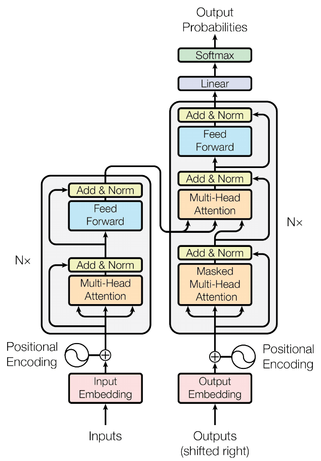
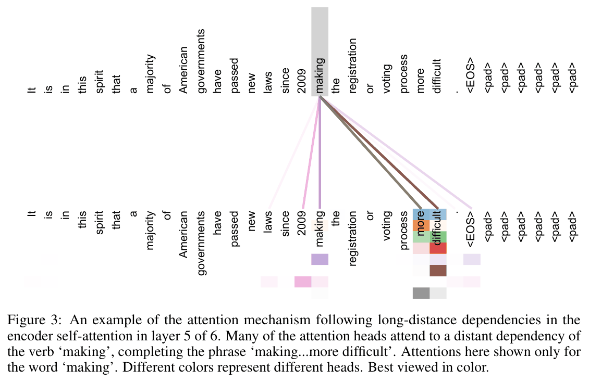
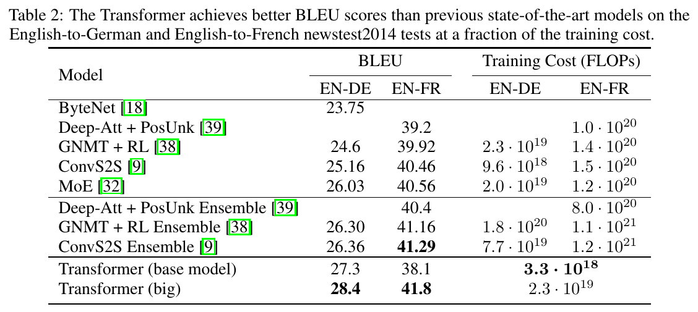
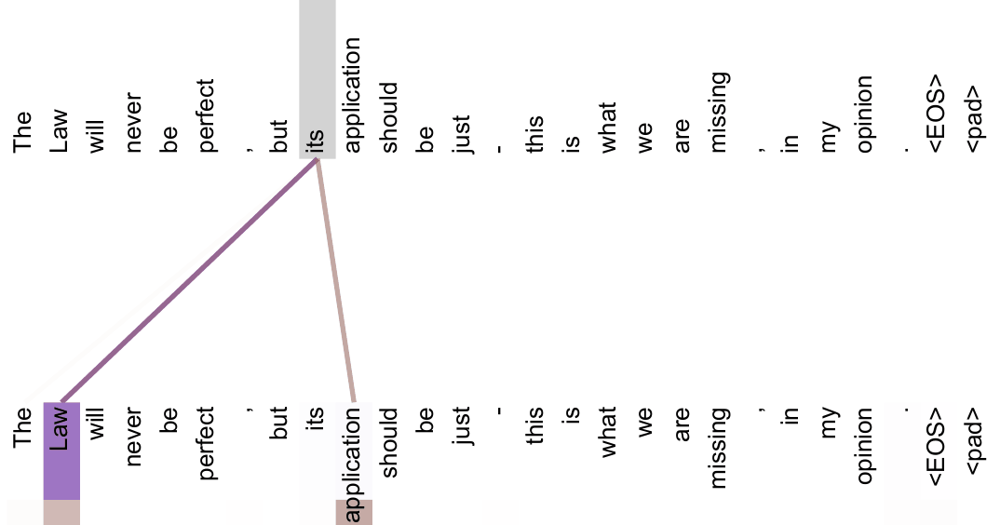

<!-- paginate: true -->

<!--
  DECK BRIEF
  Subject: Vaswani et al., Attention Is All You Need (NIPS 2017), arXiv:1706.03762v7.
  Audience: ML engineers who use transformers daily but have never read the paper.
  Reader promise: by the end they can say what Q, K and V are in each of the three
  places attention is used, why the dot product is divided by sqrt(d_k), what
  multi-head buys, what the mask actually does, and which column of Table 1 carries
  the argument.
  Source of truth: the frozen PDF; section anchors via ar5iv.
  Every figure is hand-authored SVG; every box links to the matching section.
-->

<!-- HOVER TOOLKIT — body-level tooltip card + affordance styles. Keep this block;
     it is inert until an element carries data-tip. -->

<!-- _class: title paper -->

Paper deep dive

# **Vaswani et al. (2017):** Attention Is All You Need

## Drop recurrence entirely and every word reads every other in one hop: **28.4 BLEU** after 3.5 days on 8 GPUs

Google Brain, Google Research, University of Toronto · NIPS 2017, arXiv June 2017

<a href="https://arxiv.org/abs/1706.03762">arXiv</a><a href="https://arxiv.org/pdf/1706.03762v7">PDF</a><a href="https://papers.nips.cc/paper_files/paper/2017/hash/3f5ee243547dee91fbd053c1c4a845aa-Abstract.html">NIPS proceedings</a><a href="https://github.com/tensorflow/tensor2tensor">code (tensor2tensor)</a><a href="https://ar5iv.labs.arxiv.org/html/1706.03762">section anchors</a>

---

## TL;DR

- **What it is** — the **Transformer**: translation built **only from attention**, with **no recurrence and no convolution** anywhere.
- **The trick** — **every position reads every other position in one step**, so any two words sit **one hop apart, not n**.
- **The stabilisers** — scores divided by **√d_k**, a **residual + LayerNorm** wrapper on every sub-layer, and a **warmup then inverse-sqrt** learning-rate decay.
- **The numbers** — the **big** model scores **28.4 BLEU** (n-gram overlap with reference translations, 0–100) English-German on newstest2014 as a **single model**, **over 2 BLEU** past the previous best, an **ensemble** of ConvS2S models at 26.36 — after **3.5 days on 8 P100s**; **41.8** English-French (§6.1's text says 41.0); the **base** model gets 27.3 in **12 hours**.
- **Why it mattered** — BERT, GPT and every LLM since are **built from halves of this one diagram**.

<a href="https://arxiv.org/abs/1706.03762">Figure 1 from Vaswani et al. 2017</a>

---

<!-- _class: fs-sm -->

## The task is machine translation: English in, German or French out

- **Machine translation** on the WMT 2014 benchmarks: **English→German** (about 4.5M sentence pairs) and **English→French** (36M sentences); every headline number is a **BLEU** score on newstest2014 (§5.1, §6.1)
- **One sentence, step by step** (illustrative, **not model output**): the encoder reads the **whole English sentence at once**; the decoder writes German **one token per step**, each step reading the source words it needs

<!--FIGSM:the-task-->

- **A second task, only as a generalisation test**: English constituency parsing on the Penn Treebank's Wall Street Journal section (§6.3, slide 26)

---

## The core idea — every word reads every other directly

- **Why care:** recurrence **ties positions to steps in computation time** — no parallelism inside a sentence.
- **What prior work does:** ByteNet and ConvS2S use convolutions, but relating two positions takes **more operations the further apart they are** — linearly for ConvS2S, logarithmically for ByteNet (§2).
- **What this paper does instead:** one layer relates **every pair of positions in a constant number of sequential operations**, however far apart.
- **The enabling fact:** attention already sat inside recurrent encoder-decoders — this paper **keeps it and deletes the recurrence**.
- **Lifted from:** self-attention existed for reading comprehension; this is **the first transduction model built only on it**.

---

<!-- _class: fs-sm -->

## The five Cs, in one look

Five Cs — a standard first-pass checklist for a paper: Category, Context, Correctness, Contributions, Clarity.

| | |
|---|---|
| **Category** | An **architecture paper** with one ablation table (Table 3) over heads, key size, model size, dropout, label smoothing and positions. |
| **Context** | Displaces recurrent ([GNMT](https://arxiv.org/abs/1609.08144)) and convolutional seq2seq ([ConvS2S](https://arxiv.org/abs/1705.03122), [ByteNet](https://arxiv.org/abs/1610.10099)); attention itself is [Bahdanau et al.](https://arxiv.org/abs/1409.0473) |
| **Correctness** | Quality rests on **two test sets, single runs, no error bars**; cost rests on **estimated** FLOPs. |
| **Contributions** | Scaled dot-product and multi-head attention, a purely attentional encoder-decoder, **state of the art on both language pairs**; the **base** model beats every English-German baseline **at a fraction of their estimated cost**. |
| **Clarity** | [Figure 1](https://ar5iv.labs.arxiv.org/html/1706.03762#S3.F1) and [Table 1](https://ar5iv.labs.arxiv.org/html/1706.03762#S4.T1) carry the argument; §3.2.3, the three uses of attention (slide 12), is the paragraph everyone re-reads. |

---

<!-- _class: fs-lg -->

## Should you read further?

- **Read §3, the model, and §6, the results, if** you work on anything sequence-shaped — this is the architecture under BERT, GPT and every LLM in production; the mechanism is on **slides 8–20**, the evidence on **slides 24–27**.
- **Skim §3.2, the attention section, and Figure 2 if** you only need **what Q, K and V are** and **why the scores are divided by √d_k** — two pages and one figure, walked through on **slides 11–17**.
- **Skip it if** you want long-context or efficiency work: the O(n²) cost is acknowledged here only as future work (**slide 20**), and lives in [FlashAttention](https://arxiv.org/abs/2205.14135) and [Longformer](https://arxiv.org/abs/2004.05150) instead.

---

<!-- _class: fs-sm -->

## Recurrence serialises training along the sequence; attention does not

<!--FIG:why-not-rnn-->

---

<!-- _class: fs-sm -->

## The model is two stacks of six identical layers, 512 wide throughout

<!--FIGXS:arch-->

- **Encoder layer**: self-attention + feed-forward; each **decoder** layer adds a third sub-layer that reads the **final** encoder layer's output — the same keys and values in all six
- Every sub-layer is wrapped in residual + LayerNorm, so every sub-layer and embedding reads and writes 512-wide vectors

---

<!-- _class: fs-sm -->

## Training shows the decoder the whole reference; the mask hides each answer

<!--FIGXS:teacher-forcing-->

- **Shifted right by one** (§3.1): decoder input i holds reference token i−1 and must predict token i
- **Teacher forcing** (standard name, not the paper's): feed the **reference**, not the model's guesses, so **all positions train in one pass**
- **A causal mask** (slide 17) lets position i read only inputs 1…i, reference tokens up to i−1 — never the token it must predict

---

<!-- _class: fs-sm -->

## Encode the whole sentence in one step, then decode one word per step

<!--FIGSM:encode-decode-flow-->

- **At inference** the encoder runs once; each step feeds the tokens so far back into the decoder, and beam search extends **4 candidate prefixes** at a time. How earlier steps are reused the paper does not say; implementations cache each layer's keys and values

---

<!-- _class: fs-sm -->

## Attention is a soft dictionary lookup: score against every key, then average the values

<!--FIGCOL:qkv-lookup-->

<a href="https://arxiv.org/abs/1706.03762">Figure 3 from Vaswani et al. 2017</a> — the real weights behind the example on the left

- A **query** asks, a **key** advertises, a **value** is what gets copied out — so a position can advertise one thing and deliver another
- **All three are learned projections**, per **head** i (one of 8 parallel lookups, slide 16): `X W_i^Q`, `Y W_i^K`, `Y W_i^V`, with **X the reading positions** and **Y the positions read**; X = Y except in encoder-decoder attention (next slide). Equation 1's Q, K, V are these projected matrices

---

<!-- _class: fs-sm -->

## Q, K and V come from three different places, one per use of attention

<!--FIG:qkv-three-places-->

---

<!-- _class: fs-sm -->

## Equation 1 is four operations, and every symbol has a job

<!--FIGSM:scaled-dot-product-->

- **Dot product, not a small network**: additive attention has similar theoretical cost, but the dot product runs as one optimised matrix multiply

---

<!-- _class: fs-sm -->

## One attention sub-layer, end to end, with the shapes written out

| step | shape | with n = 10 tokens |
|---|---|---|
| layer input X | n × d_model | 10 × 512 |
| head i: X WiQ, X WiK, X WiV (each W is 512 × 64) | n × d_k | 10 × 64 each |
| Q Kᵀ | n × n | 10 × 10 raw scores |
| ÷ √d_k, then softmax row-wise | n × n | each row sums to 1 |
| × V | n × d_v | 10 × 64 |
| concat 8 heads | n × h·d_v | 10 × 512 |
| × WO (512 × 512) | n × d_model | 10 × 512 |

- **n = 10 is illustrative**; `d_k = d_v = 64`, `d_model = 512` and `h = 8` are the paper's base model
- **Q Kᵀ only decides how much** to read; the multiply by **V** is where content from *other* positions enters row i
- **Encoder-decoder attention**: m target queries against n source keys give an **m × n** score matrix and an m × 512 output

---

<!-- _class: fs-sm -->

## Dividing by √d_k keeps the softmax out of the region where it has no gradient

<!--FIGXS:sqrt-dk-->

- **Thin evidence**: footnote 4 assumes **independent, mean-0, variance-1** q and k components; the cited result, [Britz et al. 2017](https://arxiv.org/abs/1703.03906), a large sweep of translation models, found additive attention beating *unscaled* dot product at large d_k. **No Table 3 row** drops the scaling or learns it
- **Our numbers**: at d_k = 64 two scores differ by about 8·√2 ≈ 11, so a gap of 16 is ordinary: weights e¹⁶ ≈ 9 million to 1; divided by 8, e² ≈ 7 to 1

---

## Eight heads at 64 dimensions cost about one head at 512

<!--FIG:multi-head-->

---

<!-- _class: fs-sm -->

## The mask makes the decoder autoregressive, from inside the softmax

<!--FIGXS:masking-->

- §3.2.3 masks every pair with **j &gt; i** in "the input of the softmax", so the weights are **exactly zero**; j = i is safe, as input i holds token i−1 (slide 9)
- **This one mask suffices**: feed-forward, residual and LayerNorm act per position, and encoder-decoder attention reads only the source, so no other path joins two target positions

---

## The parts everyone skips: wrapper, feed-forward net, tied weights

<!--FIGSM:sublayer-->

---

<!-- _class: fs-sm -->

## Order must be injected; sinusoids were chosen for a property never measured

<!--FIGXS:posenc-->

- **Linear in k**: each sin/cos pair at pos + k is the pair at pos **rotated by an angle set by k alone**, so one fixed linear map steps any encoding k back; a query projection could learn it to match **"the token k positions back"** — the paper's hypothesis, untested
- **Added, not concatenated**: equal 512 width "so that the two can be summed" (§3.5); concatenation is never tried

---

<!-- _class: fs-sm -->

## Maximum path length is the column of Table 1 that carries the argument

<!--FIGXS:path-length-->

- **A design argument, not a measurement**: no experiment separates short paths from parallelism
- n = sentence length, d = width (512), k = kernel size (logk n for dilated convolutions, n/k for contiguous), r = window of **restricted** attention, left to future work

---

## The training bill on 8 P100 GPUs: 12 hours for base, 3.5 days for the big model behind 28.4

| | base | big |
|---|---|---|
| layers N | 6 | 6 |
| d_model / d_ff | 512 / 2048 | 1024 / 4096 |
| heads h | 8 | 16 |
| dropout Pdrop | 0.1 | 0.3 |
| steps | 100,000 | 300,000 |
| step time | 0.4 s | 1.0 s |
| wall clock | 12 hours | 3.5 days |
| parameters | 65M | 213M |

- Data: WMT 2014 En-De, **4.5M sentence pairs**, shared byte-pair vocabulary of about **37000** tokens; En-Fr is **36M** sentences and a **32000** word-piece vocabulary, not stated as shared, though the tied embeddings (slide 18) need one shared vocabulary
- Batches hold roughly **25000 source and 25000 target tokens** of similar-length sentences; the paper never mentions padding, which implementations mask out of attention
- Decoding: beam size 4, length penalty `0.6`, base averages the last **5** checkpoints, big the last **20**

---

<!-- _class: fs-sm -->

## The learning rate ramps up linearly for 4000 steps, then decays as 1/√step

<!--FIGXS:lr-schedule-->

- **Peak**, at step 4000: 512−0.5 · 4000−0.5 ≈ **7.0 × 10⁻⁴** for base; ≈ 4.9 × 10⁻⁴ for big (d_model = 1024), if it keeps the one warmup value the paper states
- **Hand-set, then fixed**: warmup = 4000 and Adam's β₂ = 0.98 are given without a reported search; after that, the rate follows from `d_model` and the step alone

---

## Label smoothing trades perplexity for BLEU: the perplexity cost is clear, the BLEU gain is half a point

| row of Table 3 | setting | PPL (dev) | BLEU (dev) |
|---|---|---|---|
| base | εls = 0.1 | 4.92 | **25.8** |
| (D) | εls = 0.0, no smoothing | **4.67** | 25.3 |
| (D) | εls = 0.2 | 5.47 | 25.7 |

- Label smoothing "hurts perplexity, as the model learns to be more unsure, but improves accuracy and BLEU score"
- **The ablation is consistent with the claim, but small**: turning it off gives the *best* perplexity and **0.5 BLEU less**, one run each; 0.1 against 0.2 differ by 0.1 BLEU, too small to read without repeated runs
- Read it as a warning: **the metric you tune is not the metric you ship** — here dev perplexity and BLEU move in opposite directions

---

<!-- _class: fs-sm -->

## Base beats every EN-DE baseline at a fraction of their estimated cost; big costs as much as GNMT + RL ⓘ forensics

 <a href="https://arxiv.org/abs/1706.03762">Table 2 from Vaswani et al. 2017</a> — baselines: <a href="https://arxiv.org/abs/1609.08144">GNMT + RL</a>, <a href="https://arxiv.org/abs/1705.03122">ConvS2S</a>

- **Base**: 27.3 EN-DE for **3.3 × 10¹⁸** FLOPs, against **9.6 × 10¹⁸** for ConvS2S, the cheapest baseline listed; **big**: 28.4 for **2.3 × 10¹⁹**, the same as GNMT + RL — both **single models**, against a 26.36 **ensemble**
- **EN-FR**: big scores **41.8** — quote this: Table 2 and the abstract agree, §6.1's text says 41.0, at "less than 1/4 the training cost of the previous state-of-the-art model", which the paper does not name
- **Derived, not measured**: time × GPUs × an *assumed* TFLOPS per GPU (9.5 for a P100), so **utilisation is invisible** on every row

---

<!-- _class: fs-sm -->

## Table 3: only the large drops stand clear of single-run noise — one head, a shallow or narrow model, no dropout ⓘ forensics

| row | what changes | BLEU | vs base |
|---|---|---|---|
| base | — | 25.8 | |
| (A) | h = 1, d_k = 512 | 24.9 | **−0.9** |
| (A) | h = 16, d_k = 32 | 25.8 | 0.0 |
| (A) | h = 32, d_k = 16 | 25.4 | −0.4 |
| (B) | d_k = 16, h = 8 | 25.1 | −0.7 |
| (C) | N = 2 layers | 23.7 | **−2.1** |
| (C) | d_model = 256, d_k = 32 | 24.5 | **−1.3** |
| (C) | d_ff = 4096 | 26.2 | +0.4 |
| (D) | Pdrop = 0.0 | 24.6 | **−1.2** |
| (E) | learned positions | 25.7 | −0.1 |
| big | the big configuration | 26.4 | +0.6 |

- **Scope**: English-German dev (`newstest2013`), no checkpoint averaging, **one run per row**, settings not listed are base's — so base's 25.8 is not comparable with its 27.3 on the newstest2014 test (Table 2). **Our rule of thumb**, not the paper's: read only gaps of **about a point**
- **Clear**: 2 layers, width 256 and no dropout each cost over a point; one head is **0.9 worse**, but that row also widens d_k to 512
- **Unresolved**: 8 against 16 heads, learned against sinusoidal positions, 32 heads (−0.4)
- **Bigger is better**: d_ff = 4096 scores 26.2 — "as expected, bigger models are better"; the big model adopts it, the base keeps 2048 as the cheap point
- **Not in the table**: no row removes positional encodings or the √d_k scaling

---

## Generalisation rests on exactly one extra task ⓘ forensics

| parser | training | WSJ 23 F1 |
|---|---|---|
| [Vinyals & Kaiser et al.](https://arxiv.org/abs/1412.7449) | WSJ only | 88.3 |
| [Dyer et al. (2016)](https://arxiv.org/abs/1602.07776) | WSJ only | 91.7 |
| **Transformer, 4 layers** | WSJ only | **91.3** |
| Vinyals & Kaiser et al. | semi-supervised | 92.1 |
| **Transformer, 4 layers** | semi-supervised | **92.7** |
| [Luong et al. (2015)](https://arxiv.org/abs/1511.06114) | multi-task | 93.0 |
| Dyer et al. (2016) | generative | 93.3 |

- Constituency parsing on the Penn Treebank: **40K** training sentences for WSJ-only, about **17M** for semi-supervised, from the high-confidence and BerkeleyParser corpora of Vinyals & Kaiser et al.
- Beats every prior result **except** the recurrent neural network grammar and a multi-task model (93.0), with almost no task-specific tuning
- But this is **one** task. The headline claims still rest on **two translation datasets**

---

## Challenge the assumptions — what each claim actually rests on

| claim | what is shown | what would settle it |
|---|---|---|
| heads are interpretable | hand-picked heads in layer 5 of 6, said to *appear* syntactic | a probe over every head |
| trains far cheaper | FLOPs derived from assumed per-GPU TFLOPS | wall clock on one machine |
| sinusoids extrapolate | a hypothesis; row (E) shows in-distribution parity | evaluation past training length |
| handles long inputs | O(n² · d) cost; restricted attention deferred | a long-context benchmark |
| it generalises | two language pairs, one parsing task | more tasks, more modalities |

<a href="https://arxiv.org/abs/1706.03762">Figure 4 (bottom) from Vaswani et al. 2017</a> — the evidence for interpretable heads

- And it disagrees with itself on EN-FR: **41.8** in Table 2 and the abstract, 41.0 in §6.1's text — quote 41.8

---

<!-- _class: fs-sm -->

## Steal list — checked against what already exists

| what to reuse | where it is | why it still holds |
|---|---|---|
| scale scores by 1/√d_k | [Sec 3.2.1](https://ar5iv.labs.arxiv.org/html/1706.03762#S3.SS2.SSS1) | every attention kernel since ships it by default |
| several narrow heads, not one wide one | [Sec 3.2.2](https://ar5iv.labs.arxiv.org/html/1706.03762#S3.SS2.SSS2) | row (A): one head is 0.9 BLEU worse, in a run that also widens d_k; 4 to 32 heads sit within 0.4 |
| warmup then inverse-sqrt decay | [Sec 5.3](https://ar5iv.labs.arxiv.org/html/1706.03762#S5.SS3) | still the default shape of transformer schedules, though the paper never tests training without it |
| label smoothing 0.1 | [Sec 5.4](https://ar5iv.labs.arxiv.org/html/1706.03762#S5.SS4) | buys BLEU, costs perplexity — only if likelihood is not the metric |
| tie embedding and output weights | [Sec 3.4](https://ar5iv.labs.arxiv.org/html/1706.03762#S3.SS4) | saves a vocabulary-sized matrix |

- **Do not steal the cost comparison** — estimate against estimate; neither side was measured

---

## What to keep from this paper

1. **Self-attention puts any two positions one hop apart and removes the sequential loop in training** — decoding still writes one token per step ([slides 7, 9, 20](#7)).
2. **Q, K and V are learned projections; only their source differs** across the three uses of attention ([slide 12](#12)).
3. **Scale scores by 1/√d_k and split attention into several narrow heads** — same cost as one wide head; the one-head run is 0.9 BLEU worse but also changes d_k, so treat 8 heads as a default, not a law ([slides 15–16](#15)).
4. **Train the decoder on the shifted reference in one pass, behind a causal mask** — the mask is what keeps that pass honest ([slides 9, 17](#9)).
5. **Treat the FLOPs column and sub-point ablation gaps as estimates** — re-measure before citing them ([slides 24–25](#24)).

*Later background, not in this paper*: most current stacks keep this recipe but move LayerNorm **before** each sub-layer (pre-norm) — see [Xiong et al. 2020](https://arxiv.org/abs/2002.04745).

**Check in your own stack:** scores divided by √d_k, the causal mask applied before the softmax, padding masked out of the keys, and embeddings tied only over a shared vocabulary.

---

## Discussion

Open questions for the group: the paper settles none of them.

**The paper normalises after each residual add (post-norm). Would this exact recipe still train at 48 layers?**
Six layers, post-norm and warmup are only tested together here; later work moved LayerNorm before each sub-layer (background, not this paper). **Try:** base recipe at 6 and 24 layers, post-norm against pre-norm, same warmup.

**Row (A) says 8 and 16 heads tie. Is head count a capacity knob or a redundancy knob?**
One head loses 0.9 BLEU, 32 heads lose 0.4. Nothing separates *more subspaces* from *more tries at one*. **Try:** h = 1 at d_k = 64 against h = 8, three seeds each.

**If the FLOPs column were measured wall clock, does the efficiency claim survive?**
The 12-hour figure is measured; the baselines' are not — the weakest joint in the second contribution. **Check:** time base and ConvS2S for 1000 steps on the same GPU.

---

<!-- _class: lead -->

# Questions

[Read it end to end](https://arxiv.org/pdf/1706.03762v7) · [section anchors](https://ar5iv.labs.arxiv.org/html/1706.03762) · [reference implementation](https://github.com/tensorflow/tensor2tensor)

Can you now say where Q, K and V come from in each use of attention (slide 12), why one mask stops every look-ahead (slide 17), and which Table 1 column carries the argument (slide 20)? The appendix, slides 33–41, restates every hover note — reference only.

---

<!-- _class: invert -->

# Appendix

Reference for review: every hover note and term, restated in print. Not presented.

---

<!-- _class: fs-xs -->

## Appendix — figure hover notes 1/6: the task + why not recurrence (reviewable record)

| on | hover note |
|---|---|
| [s3](#3) | **What goes in** — One English sentence, split into sub-word tokens by byte-pair encoding from a shared source-target vocabulary of about 37000 tokens. The whole sentence enters the encoder at once, there is no left-to-right pass over the input. This is the sentence the paper itself visualises in Figures 4 and 5. |
| [s3](#3) | **Attention, illustrated** — Each curve is an attention weight from the German word being produced to an English source word: the brighter and thicker, the more of that word is read. The German words and the weights here are illustrative, the paper prints only the English side of this sentence, in Figures 4 and 5. |
| [s3](#3) | **What comes out** — One German sentence, produced one token at a time, left to right: each new token is fed back in and the decoder reads the encoder output plus everything it has written so far. Decoding uses beam search of width 4 with a length penalty of 0.6, and quality is scored with BLEU against human reference translations on newstest2014. |
| [s7](#7) | **Hidden state h_1** — A recurrent model generates a sequence of hidden states, where the state at position t is a function of the state at t-1 and the input at t. |
| [s7](#7) | **Hidden state h_2** — This state cannot be computed until h_1 exists. The dependency is on the previous step, not on the previous layer. |
| [s7](#7) | **Hidden state h_3** — Because the chain is serial, the only parallelism left is across examples, and memory constraints limit that batching as sequences get longer. |
| [s7](#7) | **Hidden state h_4** — Factorisation tricks and conditional computation have improved the constant factor, but the paper notes the fundamental constraint of sequential computation remains. |
| [s7](#7) | **Hidden state h_5** — The last state is n steps away from the first, which is also why the maximum path length of a recurrent layer is O(n). |
| [s7](#7) | **One sub-layer, all positions** — Self-attention plus the position-wise feed-forward network process every position of the sequence in the same step, so the only serial dimension left is depth. |
| [s7](#7) | **Output z_1** — Every output position is a weighted sum over all input positions, so it depends on the whole sequence but on no other output. |
| [s7](#7) | **Output z_2** — No output waits for another output, so the whole row is one matrix multiply on the GPU. |
| [s7](#7) | **Output z_3** — Serialisation moves from the sequence axis to the depth axis: N = 6 layers, not n positions. |
| [s7](#7) | **Output z_4** — Order is not implied by the computation at all, which is exactly why positional encodings have to be added at the bottom of the stack. |
| [s7](#7) | **Output z_5** — The last position is one hop from the first, which is the O(1) maximum path length of Table 1. |

---

<!-- _class: fs-xs -->

## Appendix — figure hover notes 2/6: why not recurrence + the architecture + one sentence, encoded and decoded (reviewable record)

| on | hover note |
|---|---|
| [s7](#7) | **The cost of recurrence** — The introduction names this as the fundamental constraint: aligning positions to steps in computation time precludes parallelization within training examples. |
| [s7](#7) | **What attention buys** — Table 1 gives a self-attention layer a constant number of sequentially executed operations, against O(n) for a recurrent layer. |
| [s7](#7) | **The trade** — Self-attention buys parallelism and short paths, and pays for them with a cost that is quadratic in the sequence length. The paper argues that is the right side of the trade for sentence-length inputs. |
| [s8](#8) | **Encoder self-attention** — All three inputs come from one place: the output of the previous encoder layer. Q, K and V are three different learned linear projections of that same matrix, so every position may attend to every position of the layer below it. |
| [s8](#8) | **Add and Norm** — A residual connection adds the sub-layer input back to its output, then layer normalisation rescales it. The paper writes this as LayerNorm of x plus Sublayer of x. Every sub-layer and every embedding emits 512 dimensions so the addition is always shape-compatible. |
| [s8](#8) | **Position-wise feed-forward** — Two linear layers with a ReLU between them, applied to each position separately and identically. Inner width is 2048, outer width 512. Same weights across positions inside one layer, different weights in every layer. |
| [s8](#8) | **Add and Norm** — The second residual plus layer-norm of the encoder layer, wrapped around the feed-forward sub-layer. Dropout with rate 0.1 is applied to the sub-layer output before the addition. |
| [s8](#8) | **Input embedding** — A learned lookup table turning each byte-pair token id into a 512-dimensional vector. Its weight matrix is shared with the output embedding and with the pre-softmax linear layer, and is multiplied by the square root of 512. |
| [s8](#8) | **Masked decoder self-attention** — All three inputs come from the output of the previous decoder layer, but every score for a future position is set to minus infinity before the softmax, so position i can only see positions up to and including i. |
| [s8](#8) | **Add and Norm** — Residual plus layer normalisation around the masked self-attention sub-layer of the decoder. |
| [s8](#8) | **Encoder-decoder attention** — The only place where the two stacks meet. Queries come from the previous decoder layer; keys and values come from the output of the encoder stack, meaning its final layer, and the same encoder output feeds this sub-layer in all six decoder layers. Every decoder position can attend over every input position. |
| [s8](#8) | **Add and Norm** — Residual plus layer normalisation around the encoder-decoder attention sub-layer. |
| [s8](#8) | **Position-wise feed-forward** — Identical in form to the encoder feed-forward sub-layer: 512 in, 2048 hidden with ReLU, 512 out, applied at each position independently. |
| [s8](#8) | **Add and Norm** — Residual plus layer normalisation around the decoder feed-forward sub-layer. This is the third such wrapper in every decoder layer, against two in every encoder layer. |
| [s8](#8) | **Output embedding** — The same kind of lookup table as on the encoder side, applied to the tokens generated so far. The sequence is offset by one position so that the prediction for position i never consumes the token at position i. |
| [s8](#8) | **Linear projection** — Projects the 512-dimensional decoder output onto the vocabulary. Its weight matrix is tied to both embedding tables, which is why the same matrix appears three times in the model. |
| [s8](#8) | **Softmax** — Turns vocabulary logits into next-token probabilities. At inference the model is decoded with beam search of width 4 and length penalty 0.6. |
| [s8](#8) | **Positional encoding** — Fixed sine and cosine waves of geometrically spaced wavelengths, added to the embeddings. Without them the model has no notion of order at all, because attention is a set operation. |
| [s8](#8) | **Positional encoding** — The same fixed sinusoids are added at the bottom of the decoder stack. They are parameter-free, so nothing about position has to be learned. |
| [s10](#10) | **Encoder self-attention, one sentence** — Keys, values and queries all come from the previous encoder layer, so each position attends to all positions of the layer below. The encoder maps the sentence to one vector per word; given those, the decoder then generates the output one word at a time. |
| [s10](#10) | **Masked self-attention, one step** — Each decoder position attends to all decoder positions up to and including itself. In training a mask sets the scores of later positions to minus infinity; when generating, later words do not exist yet. |
| [s10](#10) | **Encoder-decoder attention, one step** — Queries come from the previous decoder layer; keys and values come from the output of the encoder, so every decoder position can attend over all positions of the English sentence. |
| [s10](#10) | **Next word, fed back** — The model is auto-regressive: at each step it consumes the previously generated symbols as additional input when generating the next. The paper decodes with beam search of size 4 rather than one greedy word. |

---

<!-- _class: fs-xs -->

## Appendix — figure hover notes 3/6: the soft dictionary lookup + where Q, K and V come from (reviewable record)

| on | hover note |
|---|---|
| [s11](#11) | **The query** — One row of Q. It is a learned linear projection of the current representation of the position that is doing the reading, here the word making from Figure 3 of the paper. |
| [s11](#11) | **A key** — One row of K, a second learned projection of a position. The dot product of the query with this key is the compatibility score that decides how much of this position gets read. |
| [s11](#11) | **A key** — Keys and values are separate projections of the same position, so a position can advertise one thing and deliver another. |
| [s11](#11) | **A key** — Every position in the sequence contributes a key, so the query is scored against all of them at once rather than scanned one at a time. |
| [s11](#11) | **Softmax weight** — The scaled score after softmax. Weights are non-negative and sum to one across the row, so the read-out is an average and never a hard pick. This value is illustrative, not measured. |
| [s11](#11) | **Softmax weight** — Figure 3 of the paper shows heads at layer 5 attending from making to the distant words that complete the phrase making more difficult. This value is illustrative, not measured. |
| [s11](#11) | **Softmax weight** — A near-zero weight still contributes: attention never truly drops a position, it only shrinks its share. This value is illustrative, not measured. |
| [s11](#11) | **A value** — One row of V, the content that is actually summed into the output. Values have width d_v, set to 64 in the base model. |
| [s11](#11) | **A value** — Values carry what gets copied forward. Changing which value a position exposes changes what its neighbours can read, without changing how much they attend to it. |
| [s11](#11) | **A value** — Every position supplies a value, so the output is a blend over the whole sequence rather than a choice of one neighbour. |
| [s11](#11) | **The output** — The weighted sum of every value in the sequence. One such vector comes out per position, and it replaces that position s representation for the next sub-layer. |
| [s12](#12) | **Encoder self-attention** — Q, K and V are three different learned projections of one and the same tensor: the output of the previous encoder layer. No causal mask here, so every position sees every position of the sentence; only padding, added to fill out a batch, is hidden from the keys in implementations, a detail the paper leaves out. |
| [s12](#12) | **Masked decoder self-attention** — Same shape as encoder self-attention: all three come from the previous decoder layer. The difference is the mask, which sets every score for a later position to minus infinity before the softmax. |
| [s12](#12) | **Encoder-decoder attention** — The asymmetric one. Queries come from the previous decoder layer; the memory keys and values come from the output of the encoder stack. This is the only place the two stacks exchange information. |
| [s12](#12) | **Where Q comes from** — The encoder has no external source to query: the queries are a projection of the layer below, exactly like the keys and values. |
| [s12](#12) | **Where K and V come from** — The paper states it plainly: in a self-attention layer all of the keys, values and queries come from the same place, the output of the previous layer in the encoder. |
| [s12](#12) | **Where Q comes from** — A projection of the decoder representation of the token being predicted. Under teacher forcing the whole target sequence is present at once, which is why a mask is needed at all. |
| [s12](#12) | **Where K and V come from** — Also the previous decoder layer. The restriction to positions up to and including i is imposed by the mask inside scaled dot-product attention, not by where the tensors come from. |
| [s12](#12) | **Where Q comes from** — The queries come from the previous decoder layer, so the target side decides what to look for in the source sentence. |
| [s12](#12) | **Where K and V come from** — The memory keys and values come from the output of the encoder stack, computed once for the whole source sentence and reused at every decoder layer and every decoding step. |

---

<!-- _class: fs-xs -->

## Appendix — figure hover notes 4/6: Equation 1 + the sqrt(d_k) scaling + multi-head attention (reviewable record)

| on | hover note |
|---|---|
| [s13](#13) | **Q, the queries** — One row per position that is doing the looking. Each row is a learned linear projection of that position s current representation, of width d_k = 64 inside a head. |
| [s13](#13) | **K, the keys** — One row per position that can be looked at. A key is the advertisement a position offers: the query is compared against it to decide how much attention that position gets. |
| [s13](#13) | **V, the values** — The content that actually gets read out and summed. Values have width d_v, which the paper sets equal to d_k = 64. Keys decide how much, values decide what. |
| [s13](#13) | **MatMul: Q times K transposed** — One dot product per query-key pair. With n positions the result is an n by n matrix of raw compatibility scores, computed for all pairs at once as a single matrix multiply. |
| [s13](#13) | **Scale** — Divide every score by the square root of d_k. This is the only difference between this attention and plain dot-product attention, and it exists to keep the softmax out of its saturated region. |
| [s13](#13) | **Mask, optional** — Used only in decoder self-attention. Every score that corresponds to an illegal connection is set to minus infinity here, before the softmax, so its weight comes out as exactly zero. |
| [s13](#13) | **SoftMax** — Applied along each row, so the n scores for one query become n non-negative weights that sum to one. This is what makes attention a soft, differentiable lookup instead of a hard pick. |
| [s13](#13) | **MatMul: weights times V** — The weighted sum. Output row i is the average of all value rows, weighted by row i of the softmax. The softmax couples the scores within a row, but only this product carries content from other positions into row i. |
| [s13](#13) | **Head output** — One d_v-wide vector per position. Inside multi-head attention this is one of h such outputs, which are concatenated and projected back to 512 dimensions. |
| [s13](#13) | **Q K transposed** — The compatibility function. Dot product rather than a small feed-forward network, because it can be run as one highly optimised matrix multiply. |
| [s13](#13) | **Divide by the square root of d_k** — The scaling factor. It is the whole difference between this and classic dot-product attention, and the paper attributes it to the variance of the dot product growing with d_k. |
| [s13](#13) | **softmax** — Applied row-wise. It converts scores into a distribution, which is what makes the read-out an average rather than a hard selection. |
| [s13](#13) | **Times V** — The read-out. The paper defines attention as a weighted sum of the values, where the weight on each value comes from the compatibility of the query with the matching key. |
| [s15](#15) | **Step 1: d_k grows** — d_k is the width of a single query or key vector. The base model uses 64 per head, but the ablation in Table 3 row A also runs a single head at the full 512. |
| [s15](#15) | **Step 2: dot products grow** — Footnote 4 of the paper: if the components of q and k are independent with mean 0 and variance 1, their dot product has mean 0 and variance d_k. Typical magnitude therefore grows like the square root of d_k. |
| [s15](#15) | **Step 3: the softmax saturates** — Exponentiating scores that are tens of units apart makes one weight essentially 1 and the rest essentially 0. The row stops being a distribution over positions and becomes a hard pick. |
| [s15](#15) | **Step 4: gradients vanish** — The paper suspects that for large d_k the dot products grow large in magnitude, pushing the softmax function into regions where it has extremely small gradients. That is the concrete failure being avoided. |
| [s15](#15) | **The fix** — Dividing by the square root of d_k is the only difference between scaled dot-product attention and the classic dot-product attention it is built on. |
| [s16](#16) | **V, the value input** — The raw 512-wide input of the positions being read, Y on slide 11, before any projection. The per-head matrix W_i^V is the only value projection. |
| [s16](#16) | **K, the key input** — The raw 512-wide input of the positions being read, Y on slide 11, before any projection. Which tensor this is depends on which of the three usages the layer is: see the three-places slide. |

---

<!-- _class: fs-xs -->

## Appendix — figure hover notes 5/6: multi-head attention + the decoder mask + the sub-layer wrapper (reviewable record)

| on | hover note |
|---|---|
| [s16](#16) | **Q, the query input** — The raw 512-wide input of the reading positions, X on slide 11, not yet projected. The per-head matrix W_i^Q is the only query projection. |
| [s16](#16) | **Per-head linear projections** — Each of Q, K and V is projected h times with different learned matrices, from 512 down to 64. These are the W matrices in the head formula. |
| [s16](#16) | **Per-head linear projections** — h separate 512-by-64 matrices per input, so each head sees its own learned subspace rather than the raw representation. |
| [s16](#16) | **Per-head linear projections** — The projections are what make multi-head attention more than an average: each head can read a different learned view of the same tensor. |
| [s16](#16) | **One head** — A complete scaled dot-product attention, but at width 64 instead of 512. Its cost is one eighth of a full-width head, which is why eight of them cost about the same. |
| [s16](#16) | **One head** — Heads run in parallel and never see each other until the concatenation, so they can specialise. Figure 5 of the paper shows heads whose behaviour seems related to the structure of the sentence. |
| [s16](#16) | **One head** — The base model uses h = 8. Table 3 row A varies h from 1 to 32 at constant compute and finds 8 and 16 best. |
| [s16](#16) | **Concat** — The h head outputs of width d_v are laid side by side, giving h times d_v = 512 columns again. |
| [s16](#16) | **Output projection W^O** — A final learned 512-by-512 matrix that mixes the concatenated heads back into one representation. Without it the heads would remain in disjoint slices of the vector. |
| [s16](#16) | **Sub-layer output** — 512 dimensions per position, the same width as every other sub-layer output and every embedding, so the residual addition always lines up. |
| [s16](#16) | **Why the cost stays flat** — Because each head is narrower by exactly the factor h, the total work across all heads is about the work of one full-width head. The paper states the total computational cost is similar to that of single-head attention with full dimensionality. |
| [s16](#16) | **What the extra heads buy** — Multi-head attention lets the model jointly attend to information from different representation subspaces at different positions. With a single attention head, averaging inhibits this. |
| [s16](#16) | **What the ablation shows** — Table 3 rows A vary the number of heads while keeping the amount of computation constant. Single-head attention is 0.9 BLEU worse than the best setting, and quality also drops off with too many heads. |
| [s17](#17) | **Raw score matrix** — One scaled dot product for every ordered pair of positions. Nothing here knows about time: position 1 has a perfectly good score against position 4. |
| [s17](#17) | **Masked score matrix** — Every entry whose key index exceeds its query index is overwritten with minus infinity. This happens to the input of the softmax, not to its output. |
| [s17](#17) | **Attention weights** — Exponentiating minus infinity gives exactly zero, so the blocked cells contribute nothing to the weighted sum and no gradient flows back through them. |
| [s17](#17) | **Raw score** — The scaled dot product between the query at position i and the key at position j. Nothing here knows about time: position 1 has a perfectly good score against position 4. |
| [s17](#17) | **Legal pair** — j is at most i, so this score survives the mask and becomes a real attention weight. |
| [s17](#17) | **Illegal pair** — j is greater than i, so this entry is overwritten with minus infinity before the softmax sees it. |
| [s17](#17) | **Surviving weight** — A non-negative weight; the surviving entries of the row still sum to one after the softmax. |
| [s17](#17) | **Exactly zero** — The exponential of minus infinity is exactly zero, so no value from a future token is summed in and no gradient flows back through this cell. |
| [s17](#17) | **Where the mask lands** — Section 3.2.3 places the mask inside scaled dot-product attention, on the input of the softmax. That placement is what makes the zeros exact rather than merely small. |
| [s18](#18) | **Sub-layer input** — The representation coming out of the layer below, 512 dimensions per position. |

---

<!-- _class: fs-xs -->

## Appendix — figure hover notes 6/6: the sub-layer wrapper + positional encodings + Table 1, path length + the learning-rate schedule (reviewable record)

| on | hover note |
|---|---|
| [s18](#18) | **The sub-layer itself** — Either a multi-head attention block or the position-wise feed-forward network. The wrapper around it is identical in both cases. |
| [s18](#18) | **Layer normalisation** — The paper writes the whole wrapper as LayerNorm of x plus Sublayer of x. Note the ordering: the norm comes after the addition, which is the post-norm arrangement. |
| [s18](#18) | **Sub-layer output** — Fed straight into the next sub-layer. Six such layers on the encoder side, six on the decoder side. |
| [s18](#18) | **Why the shapes always line up** — To facilitate the residual connections, all sub-layers in the model as well as the embedding layers produce outputs of dimension 512. |
| [s18](#18) | **Input to the feed-forward net** — One 512-dimensional vector per position, taken from the attention sub-layer below. |
| [s18](#18) | **Inner layer** — A linear map up to 2048 followed by a ReLU. This is where most of the parameters of a Transformer layer live. |
| [s18](#18) | **Output layer** — A second linear map back down to 512, so the result can go through the residual addition unchanged in shape. |
| [s18](#18) | **Three things people skip** — The feed-forward network is where each position digests what it just read; nothing here moves information between positions. That job belongs entirely to attention. |
| [s18](#18) | **Shared embedding weights** — The same weight matrix is shared between the two embedding layers and the pre-softmax linear transformation, and in the embedding layers those weights are multiplied by the square root of d_model. Sharing one matrix between input and output embeddings needs one vocabulary for both languages: the paper states a shared source-target vocabulary for English-German, and only a 32000 word-piece vocabulary for English-French. It gives no reason for the square-root scaling. |
| [s18](#18) | **Where dropout is applied** — Dropout is applied to the output of each sub-layer before it is added to the sub-layer input and normalised, and to the sums of the embeddings and the positional encodings in both stacks. |
| [s18](#18) | **Base model shape** — The base configuration is the top row of Table 3: 6 layers, d_model 512, d_ff 2048, 8 heads, 65 million parameters. |
| [s19](#19) | **Why any positional signal is needed** — Attention is a set operation: permute the input rows and the output rows permute with them. Since the model contains no recurrence and no convolution, order has to be injected explicitly. |
| [s19](#19) | **Sinusoidal versus learned** — Table 3 row E swaps the sinusoids for learned positional embeddings and reports 4.92 perplexity and 25.7 BLEU against 4.92 and 25.8 for the base model. The choice was not made on accuracy. |
| [s19](#19) | **What is not shown** — The extrapolation argument is a hypothesis in the paper, not a measurement. No experiment in the paper tests sequences longer than those seen in training. |
| [s20](#20) | **Maximum path length** — The length of the path a forward or backward signal must travel between two positions. The paper argues the shorter these paths, the easier long-range dependencies are to learn, which is why this column carries the case for self-attention. |
| [s20](#20) | **The verdict** — Section 4 lists three desiderata: total complexity per layer, how much can be parallelised, and the path length between long-range dependencies. Only the third distinguishes self-attention sharply from both alternatives. |
| [s22](#22) | **The width term** — A wider model has larger activations, so the schedule is scaled down by the square root of d_model. For the base model that is one over the square root of 512. |
| [s22](#22) | **The warmup branch** — For the first warmup_steps updates this branch is the smaller of the two, and it grows linearly with the step number, so the learning rate ramps up from near zero. |
| [s22](#22) | **The decay branch** — After the crossover the inverse square root of the step number is the smaller term, so the rate decays slowly rather than being cut on a fixed schedule. |
| [s22](#22) | **Why warm up** — A common later interpretation, not stated in the paper: Adam adapts each parameter using running estimates of the first and second moments of its gradient. Early on those estimates are built from very few samples, so a large step size can move parameters a long way on noisy evidence. |

---

<!-- _class: fs-xs -->

## Appendix — paper-figure hover notes: Figure 1, Figure 3, Table 2 and Figure 4 (reviewable record)

| on | hover note |
|---|---|
| [s2](#2) | **Encoder, left stack** — Six identical layers: multi-head self-attention, then a position-wise feed-forward network, each wrapped in Add and Norm. BERT keeps this half. |
| [s2](#2) | **Decoder, right stack** — Six identical layers with a third sub-layer in the middle that attends over the encoder output; the first sub-layer is masked so position i never reads a later position. GPT keeps this half, minus the middle sub-layer. |
| [s11](#11) | **The query word** — The shaded column is making, the word whose attention is drawn. Every line leaves from it: one query, scored against every key in the sentence. |
| [s11](#11) | **Where the weight goes** — The strongest lines land on more and difficult, completing the phrase making more difficult across five intervening words. Each colour is a different head of layer 5. |
| [s24](#24) | **The two Transformer rows** — Base: 27.3 EN-DE and 38.1 EN-FR for 3.3 times 10 to the 18 FLOPs. Big: 28.4 and 41.8, the headline numbers, for 2.3 times 10 to the 19, the same estimated cost as GNMT plus RL on EN-DE. |
| [s24](#24) | **Training cost columns** — Not measured. Each entry is training time times number of GPUs times an assumed sustained single-precision capacity per GPU, so utilisation is invisible on every row. |
| [s24](#24) | **Baseline rows** — BLEU for ByteNet, Deep-Att, GNMT plus RL, ConvS2S and MoE, single models above the rule and ensembles below, copied from the cited papers rather than re-run. |
| [s27](#27) | **One hand-picked head** — Attention from its to Law and application, read by the paper as anaphora resolution. It is one of two heads shown from layer 5 of 6, chosen by the authors; the paper says the heads appear to be related to sentence structure, and measures nothing. |

---

<!-- _class: fs-xs -->

## Appendix — glossary 1/2: the terms this deck underlines (reviewable record)

| on | plain-language meaning |
|---|---|
| [s2](#2) | **One hop, not n** — n is the sentence length in tokens. A recurrent model carries information from word 1 to word n through n steps; one self-attention layer connects them directly. Table 1 calls this the maximum path length, slide 20. |
| [s2](#2) | **Square root of d_k** — d_k is the width of each query and key vector, 64 in the base model. Dividing the attention scores by its square root keeps the softmax out of its flat, saturated region; slide 15. |
| [s2](#2) | **Residual + LayerNorm wrapper** — Each sub-layer adds its input back to its output (the residual) and then normalises the sum per position (LayerNorm); slide 18 shows it. |
| [s2](#2) | **Warmup, then inverse-sqrt decay** — The learning rate rises linearly for the first 4000 training steps, then falls as one over the square root of the step number; slide 22. |
| [s4](#4) | **Encoder-decoder** — An encoder turns the whole input sentence into one vector per token; a decoder then writes the output one token at a time. Attention lets each decoder step look back at the encoder vectors it needs instead of one fixed summary. |
| [s4](#4) | **Transduction** — Mapping one sequence to another sequence, possibly of a different length, such as an English sentence to a German one. |
| [s2](#2) | **Base and big** — The paper trains two sizes. Base: 6 layers, width 512, 8 heads, 65M parameters. Big: width 1024, 16 heads, 213M parameters. Slide 21 lists both. |
| [s2](#2) | **P100** — NVIDIA Tesla P100, a 2016 data-centre GPU. For its cost estimates the paper assumes 9.5 TFLOPS of sustained single-precision throughput per P100. |
| [s2](#2) | **BLEU** — A precision-style score comparing machine output to human reference translations by counting matching word n-grams, with a penalty for output that is too short. Higher is better; one BLEU point is a large gap on WMT. |
| [s8](#8) | **Position-wise feed-forward network** — Two linear layers with a ReLU between them, applied to every position separately and with the same weights inside one layer. It mixes the channels of one token, never two tokens. |
| [s8](#8) | **Residual connection** — The sub-layer input is added back to its output before normalisation, so a layer only has to learn a correction to what it received rather than a full replacement. |
| [s8](#8) | **Layer normalisation** — Rescales each position vector to zero mean and unit variance across its own features, then applies a learned gain and bias. Unlike batch norm it does not look at other examples. |
| [s13](#13) | **Additive attention** — The alternative compatibility function, from Bahdanau et al. 2014: a one-hidden-layer feed-forward network scoring the query against the key. Similar theoretical cost, much slower in practice. |
| [s23](#23) | **Perplexity** — The exponential of the average negative log-likelihood per token: how surprised the model is by the correct next token. Lower is better. In Table 3 it is per word-piece, so it is not comparable to per-word figures. |
| [s21](#21) | **Byte-pair encoding** — A subword vocabulary built by repeatedly merging the most frequent adjacent symbol pair. It keeps the vocabulary small while still spelling out rare words, so nothing is out-of-vocabulary. |
| [s21](#21) | **Beam search** — Instead of taking the single most likely next token, keep the best few partial translations at every step and extend all of them. Beam size 4 here; the length penalty stops it from preferring short outputs. |

---

<!-- _class: fs-xs -->

## Appendix — glossary 2/2: the terms, and what the forensics chips say (reviewable record)

| on | plain-language meaning |
|---|---|
| [s23](#23) | **Label smoothing** — Instead of training against a one-hot target, spread a small share of the probability mass over every other token. The model is penalised for being fully certain, which costs likelihood but tends to help decoding. |
| [s24](#24) | **A discrepancy in the paper** — Table 2 and the abstract list 41.8 BLEU for Transformer (big) on English-French, while the text of Section 6.1 says the big model achieves 41.0 on the same task. The paper never reconciles the two; quote 41.8, the figure two of its three mentions agree on. |
| [s21](#21) | **Checkpoint averaging** — The last few saved snapshots of the weights are averaged element-wise into one single model, not an ensemble. Base checkpoints were written at 10-minute intervals. The Table 3 ablations skip this step. |
| [s26](#26) | **Constituency parsing** — Predicting the nested phrase structure of a sentence as a tree. Output is far longer than the input and must obey strict structural constraints, which is why it is a hard target for sequence-to-sequence models. |
| [s24](#24) | **Forensics, Table 2** — What Table 2 does not control for. The FLOPs column is not measured: it is training time multiplied by the number of GPUs multiplied by an ASSUMED sustained single-precision capacity per GPU - 2.8, 3.7, 6.0 and 9.5 TFLOPS for K80, K40, M40 and P100 - so actual utilisation is invisible on every row, ours included. Baseline BLEU is copied from the cited papers rather than re-run. Every row is a single run with no error bars, on one test set per language pair. |
| [s25](#25) | **Forensics, Table 3** — What Table 3 does not control for. Every row is a single run on one development set - English-German newstest2013 - with no error bars and no seed variance, so differences of a tenth of a BLEU point are not separable from noise. Rows change one thing at a time from the base model, so no interaction between the choices is measured. Beam search and the training data are held fixed throughout, and no checkpoint averaging is used. |
| [s26](#26) | **Forensics, Table 4** — What Table 4 does not control for. Baseline parser scores are quoted from their own papers rather than re-run here, so tokenisation and training data differ between rows. Only dropout, learning rates and beam size were tuned, in a small number of experiments on Section 22 development data; everything else is carried over from the translation model. One dataset, WSJ Section 23, single runs, no error bars. |

<!-- sr:review-include -->

<link rel="stylesheet" href="../../_assets/review.css">
