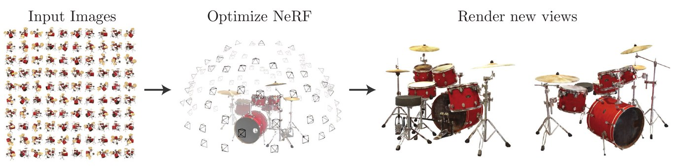
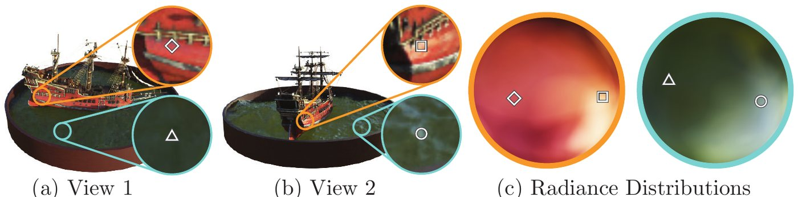
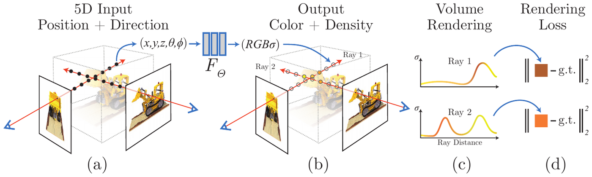
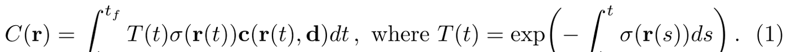
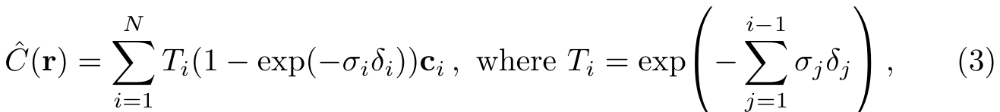
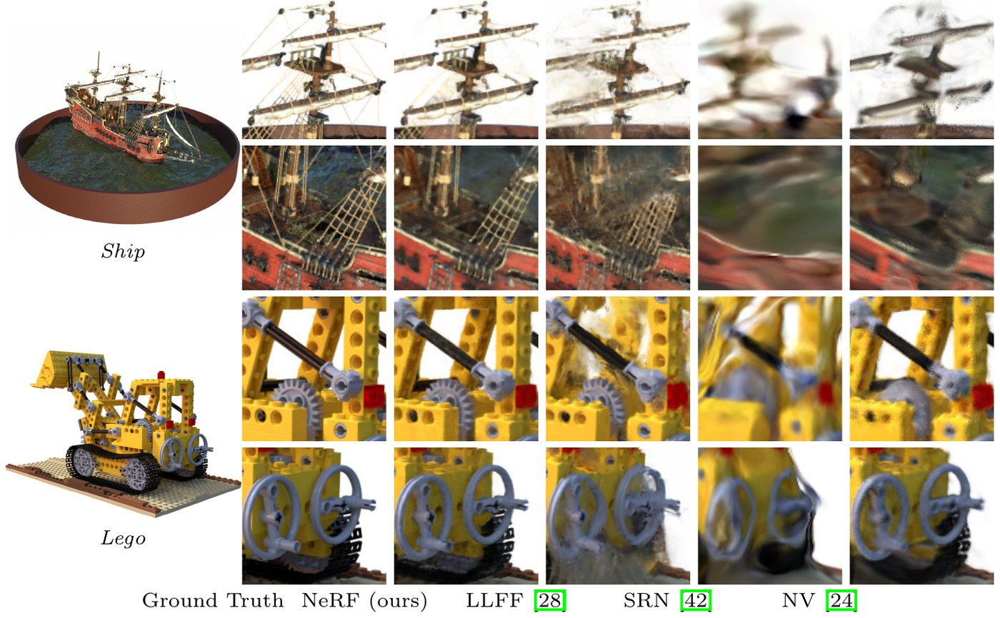
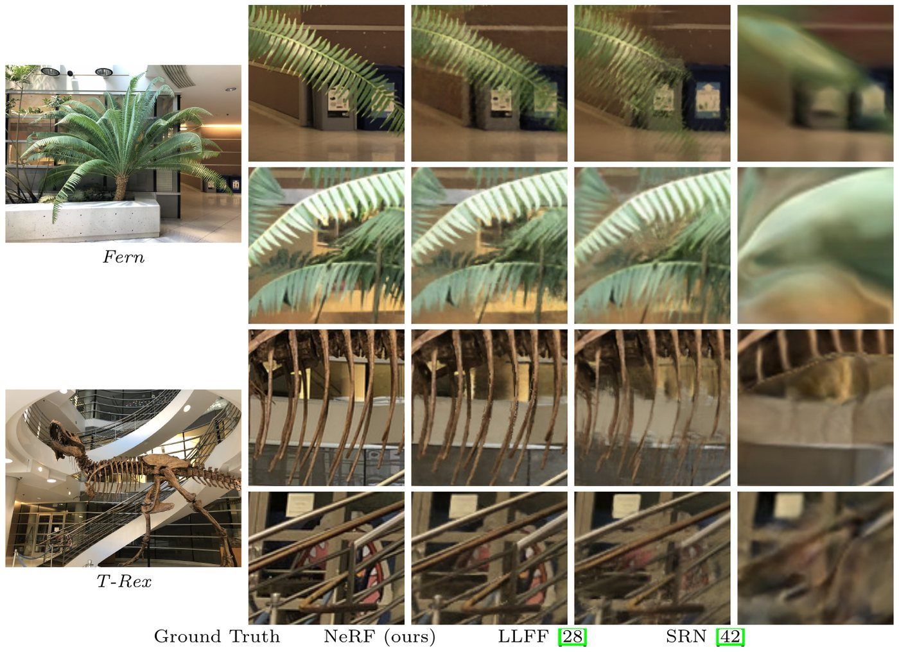

<!-- paginate: true -->

<!--
  DECK BRIEF
  Subject: Mildenhall, Srinivasan, Tancik et al., NeRF (ECCV 2020), arXiv:2003.08934v2.
  Scope: main body pp. 1-14. Two facts are taken from the supplementary
  implementation details and are labelled as such on the slide where they appear
  (render time per frame; queries per rendered image).
  Audience: ML engineers who have heard of NeRF, can read a rendering equation if
  walked through it, and have never read the paper.
  Reader promise: by the end they can state the 5D input and why density ignores
  view direction, walk Equation 1 term by term including what T(t) is doing, say
  where the gradient comes from, explain what positional encoding fixes, and never
  again think a NeRF generalises to a new scene.
  Source of truth: the frozen PDF; section anchors via ar5iv.
  Motion evidence: official project page, credited on every borrowed clip.
  Arc follows the house style: title, TL;DR, demo, core idea,
  five Cs, should-you-read-further, then background/mechanism/results/critique, then
  the reviewable appendix that restates every hover note in print.
-->

<!-- HOVER TOOLKIT — body-level tooltip card + affordance styles. Keep this block;
     it is inert until an element carries data-tip. -->

<!-- _class: title paper -->

Paper deep dive

# **Mildenhall et al. (2020):** NeRF: Representing Scenes as Neural Radiance Fields for View Synthesis

## One fit <em>is</em> one scene: **31.01 PSNR** against 26.05 for the best baseline (NV) on realistic synthetic scenes, in 5 MB of weights where LLFF stores more than 15 GB

UC Berkeley, Google Research, UC San Diego · ECCV 2020, arXiv March 2020

<a href="https://arxiv.org/abs/2003.08934">arXiv</a><a class="project" href="https://www.matthewtancik.com/nerf">project page</a><a href="https://github.com/bmild/nerf">code</a><a href="https://www.youtube.com/watch?v=JuH79E8rdKc">video</a>

<em>Dashed underlines are fact-checked against the paper — hover one to read the note.</em>

---

<!-- _class: fs-sm -->

## TL;DR

- **What it is** — **one small MLP that stores one scene**, so you can render that scene from **new cameras nobody photographed**, from **tens of posed photos and nothing else** — posed meaning each photo's camera position, orientation and intrinsics are known, with near and far scene bounds ([slide 21](#21)).
- **The trick** — the scene is **a continuous (x, y, z, θ, φ) → (RGB, σ) function** of a 3D point and a viewing direction, where σ is volume density, how strongly that point stops a ray; and an image is **a volume-rendering integral along each ray** — which is **differentiable**, so squared pixel error trains it.
- **The stabilisers** — **positional encoding** lifts coordinates into doubling-frequency sines (10 frequencies for position, 4 for direction), and a **coarse-to-fine sampler** aims 128 extra samples where the ray stops.
- **The numbers** — on the realistic synthetic scenes, **31.01** PSNR against **26.05 for the best baseline**, NV *(Table 1)*; **5 MB** of weights against **over 15 GB** of grids for LLFF: **3000×** smaller *(Sec. 6.3)*.
- **Why it mattered** — coordinate networks displaced voxel grids; ancestor of [mip-NeRF](https://arxiv.org/abs/2103.13415), [Instant-NGP](https://arxiv.org/abs/2201.05989) and, by reaction, [3D Gaussian Splatting](https://arxiv.org/abs/2308.04079).

---

<!-- _class: fs-sm -->

## The demo — posed images in, a camera path nobody shot out

<figure class="credit" style="text-align:center; margin:0"><figcaption>Figure 1 from <a href="https://arxiv.org/abs/2003.08934">Mildenhall et al. 2020</a>, p. 2.</figcaption></figure>

<figure class="credit"><video class="clip" src="https://cseweb.ucsd.edu/~viscomp/projects/LF/papers/ECCV20/nerf/website_renders/synth_grid_3.mp4" style="width:430px;height:242px" data-autoplay muted loop playsinline controls preload="metadata"><a href="https://cseweb.ucsd.edu/~viscomp/projects/LF/papers/ECCV20/nerf/website_renders/synth_grid_3.mp4" target="_blank" rel="noopener">synth_grid_3.mp4 on the NeRF project site</a></video></figure>

| the task, exactly | |
|---|---|
| **in** | 100 posed images of **one** scene, at 800 × 800 — renders for the synthetic scenes, photos for the real ones |
| **out** | new cameras on a continuous path among the input views, none of them shot |

*The static crops undersell it: **"View synthesis results are best viewed as videos"** — clip from the [project page](https://www.matthewtancik.com/nerf), not the PDF.*

---

## The core idea — store a function, not a scene

- **Why care:** the scene used to be **a discretised grid** — LLFF needs **over 15 GB** per scene; NV's **128³ voxels** cap detail outright.
- **What prior work does:** train a **CNN that outputs that grid** — resolution bought with memory, cubically.
- **What this paper does instead:** keep the scene **continuous**, as **one MLP, no convolutions**; never materialise a grid.
- **The enabling fact:** volume rendering is **naturally differentiable**, so *"the only input required to optimize our representation is a set of images with known camera poses"*.
- **Lifted from:** the integral is Kajiya and Von Herzen's [volume rendering](https://en.wikipedia.org/wiki/Volume_rendering) (1984); the low-frequency bias behind the encoding is [Rahaman et al.](https://arxiv.org/abs/1806.08734)

---

<!-- _class: fs-sm -->

## The five Cs, in one look

Five Cs — a standard first-pass checklist for a paper: Category, Context, Correctness, Contributions, Clarity.

- **Category** — an **empirical method paper**: a scene representation, plus the renderer that makes it trainable.
- **Context** — against voxel and MPI grids ([NV](https://arxiv.org/abs/1906.07751), [LLFF](https://arxiv.org/abs/1905.00889)) and against per-ray coordinate nets ([SRN](https://arxiv.org/abs/1906.01618)).
- **Correctness** — rests on two things that hold: rendering is **differentiable**, and an MLP fed Fourier features fits high frequencies. Everything else is **reported without seeds or error bars**.
- **Contributions** — the **5D radiance field**; the **differentiable renderer** trained from RGB alone; **positional encoding** and **hierarchical sampling**.
- **Clarity** — very high: Figure 2 carries the method, Figure 4 the ablation, Section 4 the derivation.

---

## Should you read further?

- **Read §3–5 — the representation, the renderer, and the two training tricks — if** you build or evaluate **3D reconstruction from cameras**: this is the reference frame for neural rendering since. The mechanism is walked through on **[slides 7–21](#7)**, §4 included.
- **Skim §4, the volume-rendering integral and its quadrature, plus Figure 2, if** you only want **the differentiable renderer**. Section 4 spans two pages and it is the transferable idea; it is on **[slides 11–16](#11)**.
- **Read §6, results and ablations, if** you need to judge **how far the gains hold** — Tables 1–2 and Figures 5–6 are on **[slides 22–26](#22)**, cost, limits and open challenges on [slides 27–29](#27).
- **Skip it if** you need **speed, dynamic scenes or generalisation** — none of them are here (**[slides 27–28](#27)**). Go to [Instant-NGP](https://arxiv.org/abs/2201.05989), [D-NeRF](https://arxiv.org/abs/2011.13961) and [pixelNeRF](https://arxiv.org/abs/2012.02190) respectively.

---

<!-- _class: fs-sm -->

## First what it does — then the price: one fit is one scene

<!--FIGSM:per-scene-->

- **A NeRF is a lookup you can differentiate**, not a model of scenes: the weights are **that scene's file format**, and a scene is one static capture — one set of posed photos of one object or room, fitted from random weights *(Sec. 3, 5.3)*.

---

<!-- _class: fs-sm -->

## The direction reaches colour, but never reaches geometry

- **The conclusion, first:** σ is a function of **position only**, so **every camera sees the same shape**, which the paper says *encourages* multiview consistency rather than guarantees it — and colour is a function of **position and direction**, so cameras are *allowed* to disagree about the **look** *(Sec. 3)*.

<!--FIGSM:asymmetry-->

---

## The paper's own picture of it — two points, two cameras, and the hemisphere of colours each point emits

<figure class="credit"><figcaption>Figure 3 from <a href="https://arxiv.org/abs/2003.08934">Mildenhall et al. 2020</a>, p. 6 — the Ship scene; orange inset: a point on the hull, blue inset: a point on the water.</figcaption></figure>

- **Same two 3D points, two cameras** (a, b): the geometry is shared, and the **colour of both points changes** with the camera.
- **(c) is what the colour head learns** — a whole hemisphere of directions per point; the next slide shows it moving on a real capture.

---

<!-- _class: fs-sm -->

## Same point, same geometry, different colour — on real capture

<figure class="credit"><video class="clip" src="https://cseweb.ucsd.edu/~viscomp/projects/LF/papers/ECCV20/nerf/website_renders/viewdirs_website_bww.mp4" style="width:860px;height:329px" data-autoplay muted loop playsinline controls preload="metadata"><a href="https://cseweb.ucsd.edu/~viscomp/projects/LF/papers/ECCV20/nerf/website_renders/viewdirs_website_bww.mp4" target="_blank" rel="noopener">viewdirs_website_bww.mp4 on the NeRF project site</a></video><figcaption>Clip from the <a class="project" href="https://www.matthewtancik.com/nerf">project page</a>, section View-Dependent Appearance — not in the PDF.</figcaption></figure>

| what moves | what does not |
|---|---|
| the d **handed to the colour head**, swept by the renderer while the camera stays **fixed** | each pixel's ray, the points it samples, and the density, because **σ never sees d** |

- **How the clip is made:** d is just an input, so the renderer can query a fixed camera's points with **someone else's viewing direction** — geometry stays put, the highlights slide.

---

## Figure 2 as printed — four panels (a)–(d); the next slide runs them as five numbered steps

<figure class="credit"><figcaption>Figure 2 from <a href="https://arxiv.org/abs/2003.08934">Mildenhall et al. 2020</a>, p. 5.</figcaption></figure>

- **(a)** sample 5D coordinates along camera rays → **(b)** the MLP returns colour and density → **(c)** volume rendering composites them into a pixel → **(d)** squared error against the photograph, **differentiable all the way back**.

---

## One pixel, end to end — and the gradient path back

<!--FIG:pipeline-->

---

## Equation 1 is three factors, and one of them is not obvious

Equation 1 as printed in <a href="https://arxiv.org/abs/2003.08934">Mildenhall et al. 2020</a>, p. 5 — the figure takes it apart.

<!--FIGSM:integral-->

---

## Transmittance is why a wall hides what is behind it

<!--FIG:transmittance-->

---

<!-- _class: fs-sm rawhead tight -->

## Six samples, worked through, so the symbols stop being symbols

| sample | where it is | σᵢδᵢ | αᵢ = 1 − e−σᵢδᵢ | Tᵢ | wᵢ = Tᵢαᵢ |
|---|---|---|---|---|---|
| 1 | air | 0.01 | 0.01 | 1.00 | 0.01 |
| 2 | air | 0.01 | 0.01 | 0.99 | 0.01 |
| 3 | thin glass | 0.22 | 0.20 | 0.98 | 0.20 |
| 4 | **the wall** | 2.30 | **0.90** | **0.78** | **0.70** |
| 5 | behind the wall | 3.00 | 0.95 | 0.08 | 0.08 |
| 6 | behind the wall | 3.00 | 0.95 | 0.00 | 0.00 |

- **Illustrative densities, invented for this walk-through** — no such table appears in the paper
- Sample 6 is *solid*: high density, and still contributes nothing, because **Tᵢ has already collapsed**; σ itself is **never negative** — a ReLU rectifies it *(Fig. 7)*
- Here the weights sum to **1.00** because the wall stops the ray, so Ĉ(r) is a weighted average. A ray that **hits nothing** keeps leftover transmittance and its weights sum to **less than 1**: the rest is transmitted past the far bound
- **What fills that gap is not in the paper**; the released code composites the synthetic scenes onto **a white background** and treats the last sample's δ as effectively infinite
- On the **real forward-facing scenes** the volume reaches to infinity: depth is mapped into [−1, 1] in normalized device coordinates *(supplement A)*, so distant background is inside the volume, not left over

---

<!-- _class: fig-720 -->

## The integral compiles down to alpha compositing

Equation 3 as printed in <a href="https://arxiv.org/abs/2003.08934">Mildenhall et al. 2020</a>, p. 6 — the figure takes it apart.

<b>From Eq. 1 to Eq. 3:</b> hold σ constant on each slab, so T(tᵢ) = exp(−Σj&lt;i σⱼδⱼ) = Πj&lt;i e−σⱼδⱼ = Πj&lt;i (1 − αⱼ)

<!--FIGSM:quadrature-->

---

## The only teacher is a photograph you already had

<!--FIG:gradient-->

---

## Raw coordinates give a blur; a fixed change of basis fixes it

<!--FIG:posenc-->

---

## Spend the samples where the ray is likely to stop

<!--FIG:hierarchical-->

---

<!-- _class: fs-sm -->

## Two networks, 64 + 192 = 256 queries per ray, and a loss term for each

| network | evaluated at | produces | in the loss (Eq. 6) |
|---|---|---|---|
| **coarse** | 64 stratified samples | Ĉc(r), and the weights wᵢ | ‖Ĉc(r) − C(r)‖² |
| **fine** | the same 64 **plus** 128 drawn from wᵢ: **192** | Ĉf(r), the image you see | ‖Ĉf(r) − C(r)‖² |
| **total** | **256 network queries per ray** at render time *(supplement A)* | | |

- **The 64 coarse positions are queried twice**, once by each network — two sets of weights, so two different answers.
- **Inverse transform sampling, in three steps:** (1) the running sum of the normalised weights ŵᵢ is a CDF along the ray, rising from 0 to 1; (2) draw 128 uniform numbers in [0, 1]; (3) put each sample where the CDF crosses its number. **Where wᵢ is large the CDF is steep**, so most of the 128 land there. The released code then sorts all 192 by depth and recomputes each δᵢ before Eq. 3; the paper says only "the union".
- **Why the coarse render is scored too:** the image comes from Ĉf alone, but the paper also minimises the coarse loss **"so that the weight distribution from the coarse network can be used to allocate samples in the fine network"**. The fine pass uses the coarse network only to place samples, so this term is what teaches the coarse network where surfaces are.

---

## Posed photographs — and the poses are a hard prerequisite

<!--FIG:inputs-->

---

<!-- _class: fs-sm -->

## Geometry emerges even though nothing supervised it

<figure class="credit"><video class="clip" src="https://cseweb.ucsd.edu/~viscomp/projects/LF/papers/ECCV20/nerf/website_renders/depth_ornament.mp4" style="width:860px;height:329px" data-autoplay muted loop playsinline controls preload="metadata"><a href="https://cseweb.ucsd.edu/~viscomp/projects/LF/papers/ECCV20/nerf/website_renders/depth_ornament.mp4" target="_blank" rel="noopener">depth_ornament.mp4 on the NeRF project site</a></video><figcaption>Clip from the <a class="project" href="https://www.matthewtancik.com/nerf">project page</a>, section Geometry Visualization — not a PDF figure.</figcaption></figure>

| what you are seeing | why it is not free |
|---|---|
| depth = **expected ray termination**, Σᵢ wᵢtᵢ: the weight-averaged sample distance | **no depth was ever a target** — only pixel colours were |

- **Qualitative only:** the paper reports **no depth or geometry metric**; Σᵢ wᵢtᵢ is the read-out the released code uses, not an equation in the paper.

---

<!-- _class: fs-xs -->

## Best on eight of the nine numbers in Table 1 — and the ninth matters ⓘ forensics

| method | Diffuse Synthetic 360° | Realistic Synthetic 360° | Real Forward-Facing |
|---|---|---|---|
| | PSNR↑ / SSIM↑ / LPIPS↓ | PSNR↑ / SSIM↑ / LPIPS↓ | PSNR↑ / SSIM↑ / LPIPS↓ |
| [SRN](https://arxiv.org/abs/1906.01618) | 33.20 / 0.963 / 0.073 | 22.26 / 0.846 / 0.170 | 22.84 / 0.668 / 0.378 |
| [NV](https://arxiv.org/abs/1906.07751) | 29.62 / 0.929 / 0.099 | 26.05 / 0.893 / 0.160 | not applicable |
| [LLFF](https://arxiv.org/abs/1905.00889) | 34.38 / 0.985 / 0.048 | 24.88 / 0.911 / 0.114 | 24.13 / 0.798 / **0.212** |
| **NeRF** | **40.15 / 0.991 / 0.023** | **31.01 / 0.947 / 0.081** | **26.50 / 0.811** / 0.250 |

- **Metrics:** **PSNR** is pixel error in dB, higher is better, and +3 dB is about half the squared error; **SSIM** runs 0 to 1, higher is better, and compares local structure; **LPIPS** is a distance between deep features, lower is better, and tracks human judgement more closely
- Scope: four diffuse objects, eight pathtraced objects, eight handheld real captures — **no seeds, no error bars**; every method gets the same input views. NV and SRN run from **their authors' code and single-scene training procedure**, LLFF as **the authors' pretrained model** *(supplement B)*; no tuning is reported. **Compute is not matched**: NeRF fits for 1–2 days, the other per-scene methods at least 12 hours, LLFF under 10 minutes
- **LLFF wins LPIPS on the real scenes**, 0.212 against 0.250 — the paper answers with a video, not a number. **Verdict: a real loss**, on the perceptual metric and on the capture style LLFF was designed for; the multiview-consistency counterclaim stays unmeasured

---

<!-- _class: fs-xs -->

## Remove any one ingredient and PSNR drops ⓘ forensics

| row | what changes | PSNR↑ | SSIM↑ | LPIPS↓ |
|---|---|---|---|---|
| 1 | **all three removed**: raw xyz only, 256 coarse samples, one network | 26.67 | 0.906 | 0.136 |
| 2 | full model **minus positional encoding**: raw xyz and direction in | 28.77 | 0.924 | 0.108 |
| 3 | full model **minus view dependence**: xyz in, no direction | 27.66 | 0.925 | 0.117 |
| 4 | full model **minus hierarchical sampling**: one network, 256 coarse samples | 30.06 | 0.938 | 0.109 |
| 5 / 6 | **25 / 50** images, not 100 | 27.78 / 29.79 | 0.925 / 0.940 | 0.107 / 0.096 |
| 7 / 8 | **L = 5 / 15**, not 10 | 30.59 / 30.81 | 0.944 / 0.946 | 0.088 / 0.096 |
| **9** | **complete model** | **31.01** | **0.947** | **0.081** |

- Paper: **"positional encoding (row 2) and view-dependence (row 3) provide the largest quantitative benefit"** — PSNR puts **view dependence** first, 27.66 against 31.01, then the encoding, then the hierarchy; single runs, no error bars
- **Row 1 already beats NV** on the same eight scenes, 26.67 against 26.05 PSNR, and on SSIM and LPIPS too *(Table 1)*; **row 4 keeps the query budget**: 256 per ray in one network, against 64 + 192 in two
- **Fig. 4 suggests the opposite order** because it shows Lego, where dropping the encoding is worse (27.75 against 29.93); on shiny Materials it flips (24.96 against 27.79) *(supp. Table 6)*
- **The metrics disagree**: on LPIPS, dropping the encoding (0.108) ties dropping the hierarchy (0.109)

---

<!-- _class: fs-sm -->

## Figure 5 — the synthetic crops where every baseline loses detail: rigging, gears, treads

<figure class="credit"><figcaption>Figure 5 (Ship and Lego rows) from <a href="https://arxiv.org/abs/2003.08934">Mildenhall et al. 2020</a>, p. 11.</figcaption></figure>

- **NeRF keeps the thin and the shiny**: the Ship rigging, the Lego gear and treads *(Fig. 5 caption)*
- **LLFF**: ghosting in the Ship mast and inside the Lego object
- **SRN**: blurry, distorted; **NV**: no rigging at all — a 128³ grid cannot hold it
- **Caveat**: the authors picked these crops; Table 1 averages all eight scenes, **with no error bars**

---

<!-- _class: fs-sm -->

## Figure 6 — real handheld captures, where LLFF wins LPIPS and the paper answers with a video

<figure class="credit"><figcaption>Figure 6 (Fern and T-Rex rows) from <a href="https://arxiv.org/abs/2003.08934">Mildenhall et al. 2020</a>, p. 12.</figcaption></figure>

<figure class="credit"><video class="clip" src="https://cseweb.ucsd.edu/~viscomp/projects/LF/papers/ECCV20/nerf/website_renders/fern_200k_rgb.mp4" style="width:300px;height:169px" data-autoplay muted loop playsinline controls preload="metadata"><a href="https://cseweb.ucsd.edu/~viscomp/projects/LF/papers/ECCV20/nerf/website_renders/fern_200k_rgb.mp4" target="_blank" rel="noopener">fern_200k_rgb.mp4 on the NeRF project site</a></video><figcaption>Fern fly-through — clip from the <a class="project" href="https://www.matthewtancik.com/nerf">project page</a>, not in the PDF.</figcaption></figure>

- **LLFF wins LPIPS on real scenes** (0.212 vs 0.250); the paper counters with *"better multiview consistency"* and *"fewer artifacts"* *(Table 1 caption)*
- **That claim lives in motion**: multiview consistency is about whether frames agree as the camera moves, which no per-frame metric measures

---

## Days to fit a scene, half a minute to look at it

<!--FIG:cost-->

---

<!-- _class: fs-sm -->

## What it cannot do, separated into concessions and silences

| limitation | evidence | conceded? |
|---|---|---|
| **static scenes only** | "We represent a static scene" — Sec 1 | by construction |
| **no cross-scene reuse** | one fit per scene | stated, never costed |
| **slow to render** | 30 s a frame, supplement | Sec 7, as future work |
| **accurate poses required** | COLMAP on real captures | stated as an input (Sec. 5.3); sensitivity never measured |
| **interpolation, not extrapolation** | test views come from the same capture: the same hemisphere or sphere of cameras for synthetic scenes, a held-out eighth of the same handheld sweep for real ones (Sec. 6.1) | never tested beyond |
| **no relighting or editing** | colour is *emitted*, lighting baked in; a gap of this method, which later work fills | silent |

- Sec 7 concedes two things: efficiency, and that **"it is unclear how to analyze these issues when we encode scenes in the weights of a deep neural network"**

---

<!-- _class: fs-sm -->

## Challenge the assumptions

| claim | what is shown | what would settle it |
|---|---|---|
| encoding is decisive | Table 2 ranks it second by PSNR | seeds and error bars |
| it beats LLFF | eight of nine numbers | a perceptual test, not a video |
| 25 views suffice | cited to the supplement | the table itself |
| poses are just an input | never perturbed | a pose-noise sweep |
| renders are photorealistic | author-picked crops | crops chosen by a stated rule over all test views |

- **Mechanism proven, margins unmeasured** — no seeds or error bars anywhere
- Not contested: **5 MB against 15 GB** is too large a gap to be an artefact

---

<!-- _class: fs-sm -->

## Steal list — checked against what already exists

| worth stealing | where | rough effort, presenter's estimate |
|---|---|---|
| lift coordinates before an MLP sees them | [Sec. 5.1](https://ar5iv.labs.arxiv.org/html/2003.08934#S5.SS1) | a parameter-free layer — hours |
| supervise a differentiable renderer in image space | [Sec. 4](https://ar5iv.labs.arxiv.org/html/2003.08934#S4) | the renderer, not labels — weeks |
| enforce consistency by *withholding* an input | [Sec. 3](https://ar5iv.labs.arxiv.org/html/2003.08934#S3) | free, and the strongest idea here |
| reuse forward-pass weights as a sampling PDF | [Sec. 5.2](https://ar5iv.labs.arxiv.org/html/2003.08934#S5.SS2) | one extra network, no new labels |
| store a signal as weights, not as a grid | [Sec. 6.3](https://ar5iv.labs.arxiv.org/html/2003.08934#S6.SS3) | days of fitting per instance |

- Where it went next: [relighting](https://pratulsrinivasan.github.io/nerv/) · [anti-aliasing](https://jonbarron.info/mipnerf/) · [fast fitting](https://www.matthewtancik.com/learnit) · [the encoding itself](https://bmild.github.io/fourfeat/)

---

<!-- _class: fs-sm -->

## What to keep from this paper

1. **With posed images and no 3D labels, make the renderer differentiable and supervise in pixels** — squared colour error is the whole objective ([slide 17](#17)).
2. **Lift coordinates with fixed sines and cosines before any coordinate MLP sees them** — raw xyz gives a blur ([slides 18](#18), [24](#24)).
3. **Get consistency by withholding an input**: density never sees the viewing direction, so every camera must agree on the shape ([slide 8](#8)).
4. **Let a cheap pass's own weights decide where the expensive pass samples, and train the cheap pass for that job** ([slides 19–20](#19)).
5. **Budget one fit per scene, about 30 s per frame, and accurate poses** ([slides 27–28](#27)); later background: Instant-NGP and 3D Gaussian Splatting are built to cut exactly these costs.

**Starting today** (later practice, not from the paper): use a maintained successor such as [nerfstudio](https://docs.nerf.studio/) or [Instant-NGP](https://github.com/NVlabs/instant-ngp) for speed, and read this paper for the formulation.

**If you do one thing:** work the six-sample table on [slide 15](#15) by hand — Eq. 3 is the transferable idea.

---

<!-- _class: fs-lg -->

## Discussion — open questions for the group

- **The asymmetry is imposed, not learned.** Would a *soft* version buy anything on real captures — or just re-open the door to per-camera geometry?
- **256 queries per pixel.** Every fast successor attacks that number, not the representation. Which ingredient survives a real-time budget?
- **The scene is the weights.** What does diffing or partially updating a scene mean with no addressable geometry?
- **Poses are assumed exact.** Nothing measures what COLMAP error costs — is that why casual phone captures often disappoint?

---

<!-- _class: invert -->

# Appendix

Reference for review: every hover note and term, restated in print. Not presented.

---

<!-- _class: fs-xs apx -->

## Appendix — figure hover notes 1/9: what a NeRF is, and the asymmetry (reviewable record)

| where | hover note, restated for print |
|---|---|
| [s7](#7) | **The query** — Five numbers: a point anywhere in the scene volume and the direction you are looking from. Continuous, so there is no grid and no resolution limit. |
| [s7](#7) | **The function itself** — One fully-connected network, no convolutions: eight 256-channel layers for density, one 128-channel layer for colour. Two copies of it are trained, a coarse and a fine one; at about 0.6 million parameters each in 32-bit floats, the pair comes to the paper's 5 MB. |
| [s7](#7) | **The answer** — Volume density at that point, and the RGB colour it emits toward the direction you asked about. One point, one answer. |
| [s7](#7) | **Who does the asking** — A volume renderer. For every pixel it marches a ray, asks the coarse network at 64 points and the fine network at 192 points along it, 256 queries in all, and integrates the answers into one colour. The network never sees a picture. |
| [s7](#7) | **The paper's own sentence** — Section 5.3 opens with it: we optimize a separate neural continuous volume representation network for each scene. Every fit starts from random weights. |
| [s7](#7) | **Scene A** — One hundred posed renderings of the Lego bulldozer, optimised from scratch for one to two days on a single V100. |
| [s7](#7) | **Scene B** — A handheld forward-facing capture of a fern with poses recovered by COLMAP. A completely separate run: nothing from the Lego fit is reused, not even as an initialisation. |
| [s7](#7) | **Your scene** — Same story, and there is no warm start available, because there is no pretrained NeRF to warm start from. |
| [s8](#8) | **Where the split happens inside the MLP** — The encoded position passes through eight 256-channel ReLU layers. Density branches off there, before the direction has been seen at all, so it structurally cannot depend on it. Only afterwards is the encoded direction concatenated to the 256-wide feature and pushed through one more 128-channel layer to produce RGB. |
| [s8](#8) | **Encoded position** — The three spatial coordinates, each lifted to twenty sine and cosine values: sixty numbers in total. |
| [s8](#8) | **The trunk** — Eight fully-connected layers, 256 channels each, ReLU activations. The viewing direction is nowhere near this part of the network. |
| [s8](#8) | **Density output** — Volume density leaves the network here, and by that point the direction has not been supplied. It cannot depend on d even if the optimiser wanted it to. |
| [s8](#8) | **Hidden feature** — A 256-wide vector that carries whatever the trunk learned about this point onward to the colour head. |
| [s8](#8) | **Encoded direction** — The unit viewing direction, lifted to twenty-four numbers with four octaves. It enters the network late and only affects colour. |
| [s8](#8) | **Colour head** — One fully-connected layer of 128 channels, the only place in the network where position and direction are combined. |
| [s8](#8) | **Colour output** — Emitted RGB toward the given direction. Two rays through the same point may legitimately receive different colours. |

---

<!-- _class: fs-xs apx -->

## Appendix — figure hover notes 2/9: why the asymmetry, and the pipeline (reviewable record)

| where | hover note, restated for print |
|---|---|
| [s8](#8) | **Why density must ignore direction** — If density could change with the viewing direction, every training camera could carve out its own private geometry that explains its own pixels and nothing else. The network would fit the training views perfectly and produce nonsense in between. Forcing one density field shared by all rays is what makes the reconstruction multi-view consistent. |
| [s8](#8) | **Why colour must see direction** — Real surfaces are not Lambertian. A wet floor, a glossy hull or a metal grille sends different colour to different cameras. Figure 3 visualises exactly this for two points on the Ship scene, and Figure 4 shows that a model trained without view dependence loses the specular reflection on the bulldozer tread. |
| [s12](#12) | **1 · March a ray and sample it** — One camera ray per pixel: r(t) = o + t d, where o is the camera centre and d the unit direction through that pixel. The span between the near and far bounds is cut into equal bins and one sample is drawn at random inside each, so across training steps the MLP is queried at continuous positions rather than on a fixed grid. |
| [s12](#12) | **2 · Positional encoding** — Each of the three coordinates of x and each of the three components of d is replaced by a ladder of sines and cosines at doubling frequencies. Nothing is learned here: it is a fixed lift into a higher-dimensional space, and it is what lets the MLP fit sharp edges instead of a blur. |
| [s12](#12) | **3 · The MLP is the scene** — Eight fully-connected ReLU layers of 256 channels see the encoded position alone and emit the density plus a 256-wide feature. Only then is the encoded direction concatenated, and one 128-channel layer turns that into RGB. Density cannot depend on where you stand; colour can. |
| [s12](#12) | **The trunk** — Eight fully-connected layers of 256 channels with ReLU activations, applied to the encoded position only. |
| [s12](#12) | **Density head** — Volume density, produced from the encoded position before the viewing direction has entered the network at all. |
| [s12](#12) | **Feature vector** — A 256-wide hidden feature emitted alongside the density and carried forward to the colour head. |
| [s12](#12) | **Colour head** — One fully-connected layer of 128 channels sees the feature together with the encoded viewing direction and outputs the emitted RGB. |
| [s12](#12) | **4 · Composite the samples into one colour** — The samples along the ray are folded into a single RGB value by the quadrature form of the volume rendering integral. It is ordinary alpha compositing: each sample contributes its colour scaled by how opaque it is and by how much light was still travelling when the ray arrived. |
| [s12](#12) | **5 · Compare with the photograph** — The rendered colour is compared with the colour that pixel actually has in its training photograph. Squared error, summed over a batch of 4096 rays drawn from all training photographs, for the coarse and the fine render alike. That is the entire training signal. |
| [s12](#12) | **The rendered colour** — What the current weights predict this pixel should look like from this camera. |
| [s12](#12) | **The observed colour** — The colour that pixel already has in the training photograph. No annotation, no preprocessing, no 3D anything. |
| [s12](#12) | **The backward pass** — The forward pass runs steps 1 to 5; the error then travels this dashed path in reverse. Photometric error differentiates through the compositing sum, through the MLP outputs and into every weight. This dashed path is the only reason the density field ever becomes correct geometry. |

---

<!-- _class: fs-xs apx -->

## Appendix — figure hover notes 3/9: the integral and transmittance (reviewable record)

| where | hover note, restated for print |
|---|---|
| [s13](#13) | **T(t), accumulated transmittance** — The probability that the ray travels from the near bound to t without hitting any other particle. It starts at exactly 1 at the near bound and can only fall, because the integral in its exponent only grows. This is the occlusion term: it is why a wall hides what is behind it, and it is the only part of Equation 1 that looks backwards along the ray. |
| [s13](#13) | **The shape of T along a ray** — Flat and near 1 through empty space, then a cliff at the first opaque surface, then flat and near zero for the rest of the ray. |
| [s13](#13) | **Sigma, volume density** — The differential probability of a ray terminating at an infinitesimal particle at that location. Not a colour and not an opacity by itself: it is a rate, so what a slab of thickness delta actually blocks is 1 minus exp of minus sigma times delta. It is a function of position alone. |
| [s13](#13) | **c, emitted colour** — The RGB the point sends back along direction d. Because it takes the direction as an input, the same point can look white to one camera and orange to another, which is how the model reproduces highlights and reflections. There is no light source in the model: the colour is emitted, so the lighting is baked in. |
| [s14](#14) | **The scene along one ray** — A ray leaves the camera, crosses empty air, grazes a thin translucent surface, then meets an opaque wall. Everything past the wall is still in the volume and the MLP still has an opinion about its colour, but no light from it reaches the camera. |
| [s14](#14) | **What the ray passes through** — Empty air, then a thin translucent pane, then an opaque wall, and finally solid content that the wall completely hides. |
| [s14](#14) | **Density along the ray** — Sigma is what the MLP outputs at each sample. It is near zero in air, moderate in the glass and large in the wall. On its own it says nothing about visibility: the wall and the object hidden behind it both have high density. |
| [s14](#14) | **Density bars** — One bar per sample. The two bars on the right are inside solid content that sits behind the wall, and their density is just as high as the wall itself. |
| [s14](#14) | **Transmittance along the ray** — T is the running product of what got through so far. It leaves the camera at 1, dips slightly in the glass and collapses at the wall. Past the wall it is essentially zero, so whatever the MLP claims is back there is multiplied away. |
| [s14](#14) | **The transmittance curve** — Monotone by construction: the exponent only accumulates, so T can never recover once it has fallen. |
| [s14](#14) | **The weight the pixel actually uses** — The product of transmittance and opacity is the weight each sample gets in the final colour. Most of it lands on the first opaque surface, with a smaller share on the glass in front of it, which is exactly the behaviour you want and the same quantity the hierarchical sampler reuses as a distribution. |
| [s14](#14) | **The weight bars** — Most of the mass lands on the wall, the first opaque surface; the glass takes a smaller share. The two samples behind the wall are multiplied by a transmittance of nearly zero and vanish. |

---

<!-- _class: fs-xs apx -->

## Appendix — figure hover notes 4/9: quadrature and the gradient (reviewable record)

| where | hover note, restated for print |
|---|---|
| [s16](#16) | **Equation 2: stratified sampling** — The span between the near and far bounds is cut into N equal bins and one sample is drawn uniformly at random inside each bin. A fixed grid would pin the representation to a fixed resolution; randomising inside the bins means that across training steps the MLP is asked about every position in the interval, so the learned field stays continuous. |
| [s16](#16) | **One draw per bin** — The bin edges are fixed; the sample inside each bin is not. Over many steps every position in the interval gets queried. |
| [s16](#16) | **Equation 3: the quadrature rule** — Between two adjacent samples the density is treated as constant over a slab of thickness delta. The chance that the ray is stopped inside that slab is one minus exp of minus sigma delta, which is exactly an alpha value, and the running product of the alphas that came before it is the discrete transmittance. |
| [s16](#16) | **Alpha, the opacity of one slab** — Density is a rate per unit length. Multiplying by the slab thickness and passing it through one minus exp gives the fraction of light the slab stops. |
| [s16](#16) | **Discrete transmittance** — The running product of one minus alpha over every earlier slab: how much light was still travelling when the ray reached this sample. |
| [s16](#16) | **Delta, the slab thickness** — The distance to the next sample along the ray. It is what converts a density into an opacity, and it is why a thin dense slab and a thick thin one can block the same light. |
| [s16](#16) | **It is alpha compositing** — Written this way the render is the front-to-back over operator that every graphics pipeline already implements. The paper says so explicitly: the function reduces to traditional alpha compositing with alpha values one minus exp of minus sigma delta. |
| [s17](#17) | **The supervision signal** — Every training step picks 4096 rays at random from the pool of all pixels in all training photographs. Each ray is rendered twice, coarse and fine, and both renders are scored against the same single number: the colour that pixel already has in the photograph. |
| [s17](#17) | **The data** — The training photographs, each with a known camera pose. Rays are drawn from the pool of all pixels in all training images, not one image at a time. |
| [s17](#17) | **The forward pass** — Every chosen ray is marched, encoded, pushed through the MLP and composited, twice: once through the coarse network and once through the fine one. |
| [s17](#17) | **The comparison** — Total squared error between rendered and true pixel colours, for both the coarse and the fine render. That is Equation 6 in full. |
| [s17](#17) | **The objective** — One scalar, measured entirely in image space. Nothing in it refers to a surface, a depth or an occupancy. |
| [s17](#17) | **The update** — Adam, with a learning rate that decays exponentially over the run, applied to the weights of both networks. |
| [s17](#17) | **Why the chain rule survives the renderer** — The sample positions are constants once drawn, and everything after them is a sum of products of smooth functions. So the derivative of the pixel error with respect to every density and colour the MLP produced exists, and from there ordinary backpropagation carries it into the weights. |

---

<!-- _class: fs-xs apx -->

## Appendix — figure hover notes 5/9: positional encoding (reviewable record)

| where | hover note, restated for print |
|---|---|
| [s18](#18) | **The failure that motivates it** — Feeding raw coordinates in, the network must express a rapidly varying function of a slowly varying input. Rahaman et al. showed deep networks are biased towards learning lower frequency functions, so what comes out is a smooth blur: correct at low frequency, missing every edge and texture. |
| [s18](#18) | **Raw coordinates** — A position normalised to the range minus 1 to 1, plus the viewing direction. Two points a hair apart look almost identical to the first layer. |
| [s18](#18) | **The same MLP** — Nothing is wrong with the network. It is a universal approximator; it is simply biased toward the low-frequency end. |
| [s18](#18) | **The result** — Right in the large and wrong at every edge. Figure 4 shows geometry and texture washing out into a soft blob. |
| [s18](#18) | **Equation 4: the encoding itself** — Gamma maps one scalar to a ladder of sines and cosines at frequencies that double: 2 to the 0, 2 to the 1, up to 2 to the L minus 1, each times pi times the coordinate. It has no parameters and learns nothing. Nearby coordinates that a network would otherwise struggle to separate get very different high-frequency components, so the MLP can turn a sharp corner over a tiny change in position. |
| [s18](#18) | **Why L differs for position and direction** — Position must carry texture and sharp geometric edges, so it gets ten octaves. Viewing direction only has to describe how appearance drifts as you walk around an object, which is a smooth function of angle, so four octaves are enough. Each scalar becomes 2L numbers, applied to all three components. |
| [s18](#18) | **Position budget** — Ten octaves per coordinate, so each of x, y and z becomes twenty numbers: sixty in total. |
| [s18](#18) | **Direction budget** — Four octaves per component, so the unit direction vector becomes twenty-four numbers. |
| [s18](#18) | **Where L stops paying** — Rows 7 and 8 of Table 2 sweep the number of frequencies for position. Five is too few and costs quality; fifteen buys nothing over ten. The paper attributes the ceiling to two to the L exceeding the maximum frequency present in the input images, roughly 1024 in their data. Positions are normalised to the range minus 1 to 1 before encoding, so the frequencies are relative to the scene volume; the paper gives no units for the 1024. |

---

<!-- _class: fs-xs apx -->

## Appendix — figure hover notes 6/9: hierarchical sampling (reviewable record)

| where | hover note, restated for print |
|---|---|
| [s19](#19) | **Step 1: the coarse network** — Sixty-four samples are spread over the whole ray by stratified sampling and pushed through the coarse network. Most of them land in empty space or behind the first surface, where they contribute almost nothing to the pixel, so this pass is deliberately cheap and deliberately wasteful. |
| [s19](#19) | **Evenly spread samples** — Sixty-four positions covering the entire near-to-far interval. Most of them are in air or behind the surface and contribute nothing. |
| [s19](#19) | **Step 2: reuse the weights as a distribution** — The coarse render is rewritten as a weighted sum of its sample colours. Those weights are already the product of transmittance and opacity, so they are large exactly where the ray is likely to stop. Normalising them by their sum turns them into a piecewise-constant PDF along the ray. Nothing new is computed here. |
| [s19](#19) | **Normalisation** — Divide each weight by the sum of the weights along that ray. The result integrates to one, which is all a probability density needs. |
| [s19](#19) | **The resulting PDF** — Piecewise constant along the ray and peaked at whatever the coarse pass believes is the first visible surface. |
| [s19](#19) | **Step 3: the fine network** — A second set of 128 locations is drawn from that PDF by inverse transform sampling, so they cluster where the coarse pass thought the surface was. The fine network is then evaluated on the union of both sets, 192 samples, and its render is the one you look at. |
| [s19](#19) | **Concentrated samples** — Coarse samples first, then the PDF built from their weights, then the fine samples where that PDF peaks. The same total budget, spent where the pixel colour is actually decided. A handful still land elsewhere, because the evenly spread coarse samples stay in the union. |

---

<!-- _class: fs-xs apx -->

## Appendix — figure hover notes 7/9: inputs and cost (reviewable record)

| where | hover note, restated for print |
|---|---|
| [s21](#21) | **The capture** — The real scenes are eight handheld forward-facing captures taken with a cellphone, with 20 to 62 images each and one eighth held out for testing. The synthetic scenes are pathtraced renderings, 100 views in and 200 held out for testing at 800 by 800 pixels. |
| [s21](#21) | **COLMAP** — An open-source structure-from-motion and multi-view stereo package. It matches features across the photographs, then solves jointly for where each camera was, what its intrinsics are and a sparse point cloud. NeRF uses it on the real captures to recover poses, intrinsics and scene bounds. |
| [s21](#21) | **What the optimiser is handed** — A set of RGB images, one camera pose and intrinsics per image, and near and far bounds for the scene. On the synthetic data these are exact by construction; on the real captures they are COLMAP estimates, and the paper says so. |
| [s21](#21) | **Where the pose requirement bites** — A pose error is not noise the optimiser can average away. Two cameras that disagree about where they were disagree about where the surface is, and the only way to satisfy both is to smear the density field. The paper does not measure sensitivity to pose error. |
| [s21](#21) | **How far the view count can drop** — Rows 5 and 6 of Table 2 cut the input set. With 50 views quality falls from 31.01 to 29.79, and with 25 it falls to 27.78. The paper notes that its 25-view result still beats the three baselines given 100 views each, citing the supplementary material. |
| [s27](#27) | **Training cost** — Between 100 thousand and 300 thousand optimisation iterations, about one to two days on a single NVIDIA V100, for one scene. Each iteration renders 4096 rays with a coarse and a fine network. Adam, learning rate decaying exponentially over the run. |
| [s27](#27) | **The training run** — One to two days of continuous optimisation on a single V100, for a single scene, before you can render anything at all. |
| [s27](#27) | **Render cost, and where it comes from** — Every pixel needs its own ray, and every ray needs 64 coarse queries plus 192 fine ones. At 800 by 800 that is 640 thousand rays for one frame. The paper reports between 150 and 200 million network queries per rendered image, taking about 30 seconds per frame on a V100. That figure lives in the supplementary implementation details, not the main body. |
| [s27](#27) | **Rays per frame** — One ray per pixel. An 800 by 800 render needs 640 thousand of them; the real scenes need 762 thousand. |
| [s27](#27) | **Queries per ray** — Sixty-four evaluations of the coarse network plus 192 of the fine network: 256 forward passes for a single pixel. |
| [s27](#27) | **Queries per image** — Between 150 and 200 million network evaluations for one rendered image, which is what the wall-clock number reduces to. |
| [s27](#27) | **Time versus space** — The paper frames the comparison as time against space. LLFF processes a small dataset in under ten minutes but produces a voxel grid per input image, over 15 GB for one realistic synthetic scene. NeRF spends days up front and stores about 5 MB, which is less than its own input photographs. |

---

<!-- _class: fs-xs apx -->

## Appendix — figure hover notes 8/9: Figures 2 and 3 as printed (reviewable record)

| where | hover note, restated for print |
|---|---|
| [s9](#9) | **(a) View 1** — Two fixed 3D points on the Ship scene seen from the first camera: one on the hull (orange inset) and one on the water surface (blue inset). |
| [s9](#9) | **(b) View 2** — The same two points from a second camera. The specular appearance of both points changes with where you stand. |
| [s9](#9) | **(c) Radiance distributions** — For each point, the colour the network emits over the whole hemisphere of viewing directions. Smooth and continuous over the whole hemisphere, and learned only from the training photographs. |
| [s11](#11) | **(a) 5D input** — Camera rays are marched through the scene and sampled at discrete points; each sample is a position plus the viewing direction of its ray. |
| [s11](#11) | **(b) Output** — The MLP maps every sample to an emitted colour and a volume density; the density profile along two rays is sketched in red. |
| [s11](#11) | **(c) Volume rendering** — The colours along one ray are composited into a single pixel, weighted by density and by how much light still reaches the camera at that depth. |
| [s11](#11) | **(d) Rendering loss** — The rendered pixel is compared with the ground-truth photograph by squared error. The whole chain is differentiable, so this is the only supervision. |

---

<!-- _class: fs-xs apx -->

## Appendix — figure hover notes 9/9: Figures 5 and 6, and the transmittance panels (reviewable record)

| where | hover note, restated for print |
|---|---|
| [s25](#25) | **Scene** — The full test view of the Ship and Lego scenes from the authors own pathtraced dataset; the crops to the right zoom into two regions of each. |
| [s25](#25) | **Ground truth** — The rendered reference image for the held-out test view. Every method is compared against this. |
| [s25](#25) | **NeRF** — The paper: fine detail in both geometry and appearance, such as the Ship rigging and the Lego gear and treads. |
| [s25](#25) | **LLFF** — The paper: ghosting artifacts in the Ship mast and inside the Lego object. These synthetic scenes have up to 400-500 pixels of disparity, far past LLFF's 64-pixel sampling guideline. |
| [s25](#25) | **SRN** — The paper: blurry and distorted renderings in every case. SRN predicts one opaque surface per ray, so thin structures and reflections are lost. |
| [s25](#25) | **NV** — The paper: cannot capture the Lego gears and completely fails to recover the Ship rigging; a 128-cubed voxel grid has no room for it. |
| [s26](#26) | **Scene** — A full test view of the Fern and T-Rex captures: handheld cellphone photographs with poses recovered by COLMAP. |
| [s26](#26) | **Ground truth** — The held-out photograph. No synthetic rendering here: this is the camera image. |
| [s26](#26) | **NeRF** — The paper: fine geometry rendered consistently across views, such as the Fern leaves and the T-Rex ribs and railing, and partially occluded regions reconstructed correctly, like the yellow shelves behind the leaves. |
| [s26](#26) | **LLFF** — The paper: repeated edges where multiple renderings are blended, and struggles to render partially occluded regions cleanly. |
| [s26](#26) | **SRN** — The paper: captures the low-frequency geometry and colour but none of the fine detail. NV has no column because it only reconstructs bounded objects. |
| [s14](#14) | **Reading the three panels together** — Follow the ray from the camera: each sample adds its density bar, T(t) falls by what that sample absorbed, and the pixel weight is whatever T was still left times the opacity of that sample. Illustrative values, not a measurement. |

---

<!-- _class: fs-xs apx -->

## Appendix — hover notes on the demo, the quiz and the two results tables (reviewable record)

| where | hover note, restated for print |
|---|---|
| [s3](#3) | **IN — 100 posed images** — The whole input: 100 rendered views of the synthetic Drums scene, sampled at random on a surrounding hemisphere, each with its camera pose. No mesh, no depth map, no 3D annotation of any kind. |
| [s3](#3) | **THE FIT — one MLP for this scene** — The camera frusta are the input views; the network is optimised so that rendering it from each of those cameras reproduces that camera's photograph. One to two days on a single V100, and the result is about 5 MB of weights. |
| [s3](#3) | **OUT — views nobody captured** — Two novel viewpoints rendered from the optimised NeRF. These cameras are not in the input set; the scene between the input views has been reconstructed, not interpolated in image space. |
| [s23](#23) | **Table forensics** — Every number is an average over the scenes in that dataset. There are no seeds, no confidence intervals, and no per-scene spread in the main body. Baselines were re-run by the authors on their data rather than copied, and the paper does not report equalised training budgets. NV has no entry on real forward-facing data because it only reconstructs objects inside a bounded volume. |
| [s24](#24) | **Table forensics** — All rows are averaged over the eight realistic synthetic scenes, with no seeds and no error bars. Rows 5 and 6 change the input data rather than the model, so they are not ablations of an architectural choice. The claim that 25 views still beats every baseline at 100 views is deferred to the supplementary material, which is not in the main body. |

---

<!-- _class: fs-xs apx -->

## Appendix — term hover notes (reviewable record)

| where | hover note, restated for print |
|---|---|
| [s2](#2) | **Why a fixed lift helps** — Rahaman et al. showed deep networks are biased toward low-frequency functions. Replacing each coordinate by sines and cosines at doubling frequencies makes nearby points easy to tell apart, so the MLP can fit sharp edges instead of a blur. It has no parameters and learns nothing. |
| [s2](#2) | **PSNR** — Peak signal-to-noise ratio: the mean squared pixel error on a log scale, in decibels. Higher is better; plus 3 dB means roughly half the squared error, and differences of a few tenths are usually invisible. |
| [s2](#2) | **NV, Neural Volumes** — Lombardi et al. 2019. A 3D convolutional network, optimised per scene, predicts a 128-cubed RGB-alpha voxel grid plus a warp grid, and novel views are rendered by marching rays through it. Objects must sit in a bounded volume in front of a separately captured background. |
| [s2](#2) | **LLFF, Local Light Field Fusion** — Mildenhall et al. 2019. One 3D convolutional network, trained once on a large dataset, turns each input photo of a new scene into a multiplane image; novel views blend nearby MPIs. No per-scene training, which is why it takes minutes and stores gigabytes. |
| [s5](#5) | **MPI, multiplane image** — A stack of semi-transparent RGB-alpha planes at fixed depths in front of one camera. A new view is rendered by alpha compositing the planes, which works well only for viewpoints near that camera. |
| [s5](#5) | **SRN, Scene Representation Networks** — Sitzmann et al. 2019. An MLP maps each 3D point to a feature vector, and a learned recurrent ray marcher steps along each ray to find one opaque surface, whose feature is decoded into a single colour. One depth and one colour per ray, so thin or translucent structure is lost. |
| [s5](#5) | **Fourier features** — Each coordinate is replaced by a ladder of sines and cosines at frequencies that double. The MLP's low-frequency bias is then a bias in the lifted space, not in scene space, so sharp edges become learnable. |
| [s23](#23) | **Diffuse Synthetic 360°** — The DeepVoxels dataset: four Lambertian objects with simple geometry, rendered at 512 by 512 from the upper hemisphere, 479 views in and 1000 for testing. |
| [s23](#23) | **Realistic Synthetic 360°** — The authors own dataset: eight pathtraced objects with complicated geometry and non-Lambertian materials, 100 views in and 200 for testing, all at 800 by 800. |
| [s23](#23) | **Real Forward-Facing** — Eight scenes captured with a handheld cellphone, five from the LLFF paper and three new, with 20 to 62 images each and one eighth held out for testing, at 1008 by 756. |
| [s23](#23) | **LPIPS** — Learned Perceptual Image Patch Similarity: the distance between deep features of the two images rather than their pixels, calibrated against human judgements. Lower is better, and it often disagrees with PSNR about which artefact is worse. |

---

<!-- _class: fs-xs apx -->

## Appendix — glossary (reviewable record)

| term | plain-language meaning |
|---|---|
| view synthesis | render the image a camera *would* have taken from a viewpoint nobody photographed |
| radiance | light leaving a point in a direction; here *emitted*, so lighting is baked in |
| volume density σ | rate at which a ray terminates at that point — a rate, not an opacity |
| transmittance T(t) | probability the ray reaches t un-blocked; starts at 1, only falls |
| alpha compositing | blend samples front to back, each scaled by opacity and by surviving light |
| stratified sampling | equal bins, one random sample inside each — not a fixed grid |
| inverse transform sampling | turn uniform randoms into draws from a distribution by inverting its CDF |
| structure from motion | recover camera poses from unordered photographs; here [COLMAP](https://colmap.github.io/) |
| non-Lambertian | a surface whose brightness depends on where you look from |
| PSNR / SSIM / [LPIPS](https://arxiv.org/abs/1801.03924) | pixel error in dB / structural similarity / learned perceptual distance |

---

<!-- _class: lead -->

# Questions

[📄 arXiv](https://arxiv.org/abs/2003.08934) · [📕 frozen PDF](https://arxiv.org/pdf/2003.08934v2) · [🔗 section anchors](https://ar5iv.labs.arxiv.org/html/2003.08934) · [🌐 project page and videos](https://www.matthewtancik.com/nerf) · [💻 code](https://github.com/bmild/nerf) · [▶️ 10-minute overview talk](https://www.youtube.com/watch?v=JuH79E8rdKc)

<!-- sr:review-include -->

<link rel="stylesheet" href="../../_assets/review.css">
