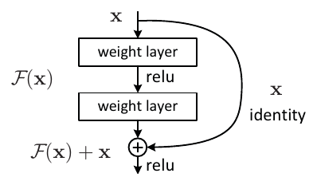
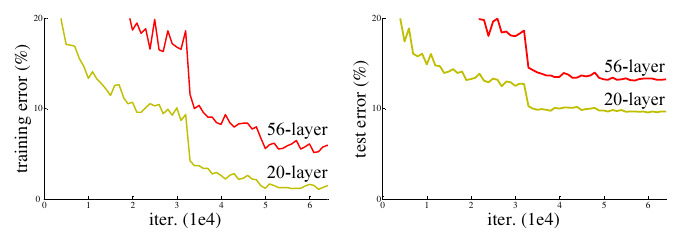
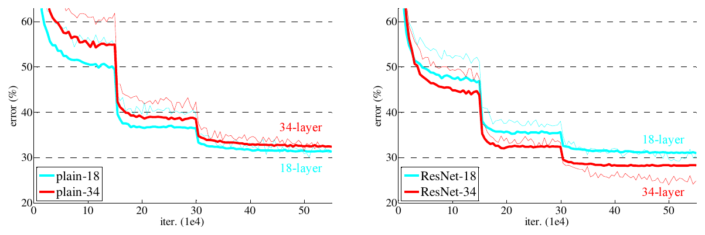
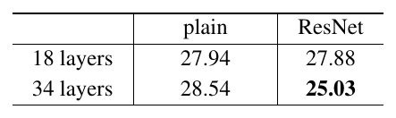

<!-- paginate: true -->

<!--
  DECK BRIEF
  Subject: He, Zhang, Ren & Sun, Deep Residual Learning for Image Recognition
  (CVPR 2016), arXiv:1512.03385v1.
  Audience: ML engineers who use residual connections daily and have never read
  the original. Mixed seniority.
  Reader promise: by the end they can say exactly what the degradation problem
  was (a TRAINING-error result, not overfitting), walk y = F(x) + x term by term,
  say which shortcut option ships and why, do the bottleneck arithmetic, name
  the explanation the paper explicitly rules out, and separate what the paper
  demonstrated from what it merely hypothesised.
  Source of truth: the frozen PDF; section anchors via ar5iv.
-->

<!-- HOVER TOOLKIT — body-level tooltip card + affordance styles. Keep this block;
     it is inert until an element carries data-tip. -->

<!-- _class: title paper -->

Paper deep dive

# **He et al. (2016):** Deep Residual Learning for Image Recognition

## Deeper nets fit the <em>training</em> set worse; an identity shortcut — free wherever shapes match — reverses that and takes **3.57%** top-5

<strong>He, Zhang, Ren &amp; Sun</strong> · Microsoft Research · CVPR 2016, arXiv Dec 2015

<a href="https://arxiv.org/abs/1512.03385">arXiv</a><a href="https://arxiv.org/pdf/1512.03385v1">PDF</a><a href="https://openaccess.thecvf.com/content_cvpr_2016/html/He_Deep_Residual_Learning_CVPR_2016_paper.html">CVPR open access</a><a href="https://github.com/KaimingHe/deep-residual-networks">code</a><a href="https://ar5iv.labs.arxiv.org/html/1512.03385">section anchors</a>

<em>Underlines in review mode are fact-checked against the paper — hover one to open the explanation.</em>

---

## TL;DR

- **What it is** — a wiring rule: every few layers get an **identity shortcut** carrying their input around them.
- **The trick** — a block computes `y = F(x) + x`, so the layers fit the **residual**; **doing nothing means driving F to zero**, which leaves the block close to an identity.
- **A fair test** — the identity shortcut adds **no parameters**, so a residual net and its **plain twin** — the same VGG-style conv stack (Table 1), shortcuts removed — match on **depth, width, parameters and FLOPs** (multiply-adds per image). The deeper production nets add a **1x1 projection only between stages** ([slide 13](#13)); a **stage** is a run of blocks at one feature-map size, and at each stage boundary the design halves the map and doubles the channels.
- **The numbers** — the reversal, in top-1 error (%): **plain-34 worse than plain-18** (28.54 vs 27.94 top-1), **ResNet-34 better than ResNet-18** (25.03 vs 27.88); an ensemble of six reaches **3.57%** top-5 error and wins ILSVRC 2015.
- **Why it mattered** — residual connections went **universal**, transformers included; the *why* never settled.

---

<!-- _class: fs-sm -->

## The result before the method — and the task it is measured on

<!--FIGSM:money-shot-->

*Both numbers are top-5 error on the same 1000-class task. The headline **3.57%** is an **ensemble of six models** of different depth — the paper does not say how their outputs are combined — scored on the test set and took **1st place at ILSVRC 2015**; the best **single** model — **ResNet-152**, 152 layers, **11.3 billion FLOPs** — is **4.49%** on validation (Tables 4 and 5, p. 6).*

---

## The core idea — ask the layers for the correction, not the answer

- **Why care:** **more layers made the network worse on its own training set**.
- **What prior work does:** [batch normalisation (BN)](https://arxiv.org/abs/1502.03167) and normalized initialisation had largely solved **convergence**, meaning here that a deep net *starts* to train: its loss falls instead of stalling from the first iterations. The paper argues the remaining failure is therefore not signal propagation, and backs that on [slide 18](#18).
- **What this paper does instead:** the block computes `H(x) = F(x) + x`, so layers learn only **the correction**.
- **The enabling fact:** a deeper net can **copy a shallower one and pad with identity layers** — a good solution **provably exists**.
- **Closest relative:** the concurrent [highway networks](https://arxiv.org/abs/1505.00387) gate their shortcuts with learned, data-dependent weights; this one is **ungated and parameter-free**.

<figure class="credit"><figcaption>Figure 2 from <a href="https://arxiv.org/abs/1512.03385">He et al. 2016</a>, p. 2</figcaption></figure>

---

<!-- _class: fs-sm -->

## The five Cs, in one look

Five Cs — a standard first-pass checklist for a paper: Category, Context, Correctness, Contributions, Clarity.

- **Category** — an **empirical architecture paper**: one wiring change, defended by ablations on two datasets.
- **Context** — [VGG](https://arxiv.org/abs/1409.1556) and [GoogLeNet](https://arxiv.org/abs/1409.4842) (depth by hand), [batch norm](https://arxiv.org/abs/1502.03167) (convergence, assumed here), [highway nets](https://arxiv.org/abs/1505.00387) (gated shortcuts, no demonstrated gain past 100 layers).
- **Correctness** — one construction plus **matched-parameter comparisons**; both hold. *Why* residuals are easier to fit stays a **hypothesis**.
- **Contributions** — degradation as a **training-error** result; the identity shortcut; the **bottleneck** block; five 1st places — ILSVRC 2015 classification, ImageNet detection and localization, COCO detection and segmentation.
- **Clarity** — very high: Figures 1, 2 and 5 carry the argument, and the authors state their own negative results.

---

<!-- _class: fs-lg -->

## Should you read further?

- **Read the introduction and §4.1, the ImageNet experiments, if** you design or debug deep stacks — the reasoning that turns *"it got worse"* into a **falsifiable diagnosis** is the transferable part; the deck walks it on slides 7–10 and 16–18.
- **Read §3, the method — residual learning, the shortcut, the network designs — with Figures 1, 2 and 5 if** you want just the mechanism: the **construction argument**, the block, and the shortcut options. That is the whole mechanism, on slides 10–15.
- **Skip it if** you want to know *why* residuals help: this paper does not answer that (slides 18–19). Go to [ensembles of shallow paths](https://arxiv.org/abs/1605.06431), [shattered gradients](https://arxiv.org/abs/1702.08591) or [loss-surface visualisation](https://arxiv.org/abs/1712.09913) instead.

---

<!-- _class: fs-sm -->

## The paper's own Figure 1: at 56 layers the plain net is worse than at 20 — on the training set

Figure 1 from <a href="https://arxiv.org/abs/1512.03385">He et al. 2016</a> (arXiv 1512.03385, p. 1) — CIFAR-10, 20-layer and 56-layer plain networks, training error left, test error right.

- **Red sits above yellow in both panels** — the caption's own reading: the deeper network has **higher training error, and thus test error**
- The **drop near 32k iterations** is the schedule, not the method — learning rate **divided by 10 at 32k and 48k** (§4.2); the [next slide](#8) redraws the panels, 20 layers in green and 56 in orange

---

<!-- _class: fs-sm -->

## Deeper plain nets do not overfit — they get worse on the data they are being trained on

<!--FIGSM:degradation-->

- The degradation problem: accuracy saturates, then **degrades rapidly** — and the paper says it is **not caused by overfitting**
- This panel is [CIFAR-10](https://www.cs.toronto.edu/~kriz/cifar.html); the same effect appears on ImageNet at 18 and 34 layers — [slide 16](#16)
- **One recipe for every depth**, not tuned per net: learning rate 0.1, divided by 10 at 32k and 48k iterations, stop at 64k (§4.2). On ImageNet, 3x the iterations did not close the gap either ([slide 18](#18))

---

## Three failures look alike from a distance, and the paper is only about the third

<!--FIG:three-signatures-->

---

## A deeper net can copy a shallower one and pad with identity layers — so the obstacle is the search, not the model

<!--FIG:construction-->

---

<!-- _class: fs-sm -->

## The fix is one wire: carry the input past the layers and add it back

<!--FIGSM:block-->

- The layers fit the residual `F(x) = H(x) - x`: **doing nothing means driving weights toward zero**, and the block **approaches** an identity
- Close, not exact: each BN ends with a learned per-channel **scale and shift**, so zero conv weights leave `F` equal to the last BN's shift, not 0; and the outer ReLU keeps `x` only because `x` is a ReLU output, never negative
- Why it should be easier — **preconditioning**, recasting a problem so the solver starts nearer the answer: if the best mapping is **closer to identity than to zero**, a **small perturbation of identity** is easier to find than an identity mapping rebuilt from conv, BN and ReLU. **Argued, not tested**: no run starts from the identity solution; Figure 7 is the only support ([slide 19](#19))

---

## Equation 1, term by term, with the shapes written out

<!--FIG:formula-->

---

## Three ways to cross a stage boundary — and the best number is not the one that ships ⓘ forensics

<!--FIG:shortcut-options-->

---

<!-- _class: fs-sm -->

## One more layer and 4x the width, at the two-layer block's price

<!--FIGSM:bottleneck-->

- A bottleneck is `1x1 → 3x3 → 1x1`. Figure 5 holds the **56x56 map and the 64-channel 3x3 fixed**; the bottleneck adds a layer and carries **4x the width, 256 channels, between blocks**
- ResNet-50 swaps each of ResNet-34's **16** two-layer blocks for one: 16 × 3 + 2 = **50** layers, the +2 being the first 7x7 conv and the final fc layer. 101 and 152 stack more blocks per stage — **3-4-23-3** and **3-8-36-3** (Table 1)
- Cost: **3.8 / 7.6 / 11.3 billion** FLOPs against VGG-19's **19.6 billion**

---

## Identity is load-bearing here: a projection would sit on the two widest points of the block

<!--FIG:bottleneck-identity-->

---

<!-- _class: fs-sm -->

## The paper's own Figure 4: the same two depths, plain on the left, shortcuts added on the right

Figure 4 and Table 2 from <a href="https://arxiv.org/abs/1512.03385">He et al. 2016</a> (arXiv 1512.03385, p. 5) — thin = training error, bold = validation error of the center crops.

<figure class="credit"></figure>

- **Left: 34 above 18. Right: 34 below 18** — identical depth, width and parameter count on both sides
- Table 2 says the same in two columns: plain **27.94 → 28.54**, ResNet **27.88 → 25.03** top-1 (10-crop, validation)

---

<!-- _class: fs-sm -->

## The evidence is the reversal, not the error rates ⓘ forensics

<!--FIGSM:imagenet-curves-->

- **plain-34 is worse than plain-18; ResNet-34 is better than ResNet-18** — same depth, same width, same parameter count on both sides. Scope: option A, 18 and 34 layers; for bottleneck nets only a footnote says plain twins degrade too, with no numbers
- At 18 layers the two are a tie: when the net is *not overly deep* SGD still finds good plain solutions, and the ResNet only **converges faster** — the paper's reading of Figure 4, *at the early stage*, with no number given
- One run per network, no error bars: trust rests on the **size and direction** of the gaps, and on CIFAR-10 repeating them (paper's Figure 6: plain worse from 20 to 56 layers, ResNets better)

---

<!-- _class: fs-sm -->

## The paper spends a paragraph ruling out the answer everyone gives

<!--FIGSM:not-vanishing-->

- Batch normalisation is applied after **every** convolution in the plain nets too, so the forward signal is demonstrably alive
- What replaces the explanation is a **conjecture** — exponentially low convergence rates — and an admission that the reason is still open. The paper does not say exponential in what. Longer training closing the gap would undercut it; 3x the iterations did not (footnote 3) — consistent, not proof

---

## Easier to fit the residual is a hypothesis with a correlation behind it, not a result

<!--FIG:responses-->

---

<!-- _class: fs-sm -->

## The headline is an ensemble number; the best single model in the paper is a different one ⓘ forensics

<!--FIGSM:headline-provenance-->

- **3.57%** is six models combined, scored on the **test** set by the evaluation server; **4.49%** is the best single model, on **validation**
- Tables 2 and 3 are neither: they use 10-crop testing for like-for-like comparison rather than for the headline

---

<!-- _class: fs-sm -->

## At 1202 layers it trains beautifully and generalises worse — and the authors say so first ⓘ forensics

<!--FIGSM:cifar-1202-->

- **One run, CIFAR-10 only:** 1202 is reported once, 110 as the best of five; against the 110-layer **mean, 6.61 ± 0.16**, 7.93 is still **1.3 points worse**. On ImageNet the paper stops at 152 layers

---

<!-- _class: fs-sm -->

## The backbone transfers to detection; the shortcut is not isolated ⓘ forensics

<!--FIGSM:transfer-->

- Same [Faster R-CNN](https://arxiv.org/abs/1506.01497) code, same proposal setup, same hyper-parameters: the paper argues the gain is **solely due to the learned representations**
- **Verdict:** a better backbone transfers; the swap is the **backbone as a whole**, not the shortcut — ResNet-101 is also deeper, cheaper (**7.6 vs 15.3 billion FLOPs**) and attached differently, via NoC; no plain-101 detector is tested
- **mAP** (mean average precision): precision averaged over recall levels and classes, a box counting as correct above 0.5 box overlap (IoU); **mAP@[.5, .95]** averages over ten IoU thresholds, 0.5 to 0.95, so it also rewards tight boxes
- Competition entries built on them won **ImageNet detection, ImageNet localization, [COCO](https://cocodataset.org/) detection and COCO segmentation** at [ILSVRC 2015](https://www.image-net.org/challenges/LSVRC/2015/) — five 1st places with classification

---

<!-- _class: fs-sm -->

## Challenge the assumptions

| claim | status |
|---|---|
| plain nets degrade on **training** error | **holds** — Figures 1 and 4 |
| identity shortcuts reverse it | **holds**, single runs — Table 2 at matched parameter count (option A, 18/34 layers) and Figure 6 on CIFAR-10; bottleneck nets: one footnote, no numbers |
| it is **not** vanishing gradients | **mostly holds** — BN throughout; the gradient-norm check is one sentence, no plot |
| residuals are intrinsically easier to fit | **contested** — Figure 7 is a correlation; [ensembles](https://arxiv.org/abs/1605.06431) · [shattered gradients](https://arxiv.org/abs/1702.08591) · [loss surface](https://arxiv.org/abs/1712.09913) |
| ReLU belongs after the addition | **revised** — [pre-activation](https://arxiv.org/abs/1603.05027), same authors |
| depth always pays | **bounded on CIFAR-10** — one 1202-layer run overfits |

- **Single runs, no error bars** — only CIFAR ResNet-110 is repeated (6.43 best, 6.61 ± 0.16); the ImageNet A/B/C margins come with no spread at all.

---

<!-- _class: fs-sm -->

## Steal list — three habits worth copying, and the gap each one closes

- **Split "worse" into training-worse and test-worse** — the paper turns on it *(effort: free)*.
  A report with a single eval metric makes deeper-is-worse look like overfitting.
- **The construction argument as a debugging tool** — if the bigger model reproduces the smaller one exactly, failing to match it is an **optimisation bug, not a capacity limit** *(effort: hours)*.
  A recipe, not from the paper: (1) build the bigger model from the smaller one's trained weights, extra blocks set to identity; (2) check it reproduces the smaller model's training loss; (3) train the bigger one from scratch — ending above that loss is an optimisation gap. Rarely a required check before scaling up.
- **Cost-first ablation reading** — the paper takes option B over the better option C, judging a sub-point margin not worth the extra parameters *(effort: free)*.
  Results tables often bold the best cell without a second seed.

---

## What to keep from this paper

- **When a deeper model is worse, compare training error before anything else** — higher training error means an optimisation problem, and regularisation will not fix it.
- **Build new layers so that doing nothing is the easy default** — wrap them in an identity shortcut, so added depth starts close to the shallower net.
- **Keep shortcuts identity and project only where the shape changes** — in bottleneck blocks a projection on every shortcut would double cost and model size.
- **Quote every number with its protocol** — split, single model or ensemble, crops, top-1 or top-5: the same ResNet-34 B is 24.52 or 21.84 top-1 depending on testing alone.
- **A default for today — later practice, not this paper:** bottleneck blocks with identity shortcuts, a projection only between stages, and the last BN scale in each block initialised to zero so every block starts as an identity ([Goyal et al. 2017](https://arxiv.org/abs/1706.02677)); for very deep stacks, [pre-activation](https://arxiv.org/abs/1603.05027) ordering keeps the shortcut a pure identity.

**If you do one thing:** when a bigger model is worse, check its training error before reaching for regularisation.

---

## Discussion — open questions for the group

**The mechanism is still contested — does that change how skips should be used?**
If ResNets work as ensembles of shallow paths, depth budgets, pruning and early-exit designs all change.

**On CIFAR-10, one 1202-layer run did worse than 110 layers — overfitting, the paper argues. Where does depth stop paying on a given dataset?**
The best tested depth there was 110 layers. For a new dataset the crossover is unknown until measured.

**A, B and C differ by a fraction of a point. How many published ablation wins sit inside a margin like that?**
The paper read a sub-point margin as projections being non-essential and picked on cost.

---

<!-- _class: invert -->

# Appendix

Reference for review: every hover note and term, restated in print. Not presented. `sN` is the main-deck slide number; click it to jump there.

---

<!-- _class: fs-xs -->

## Appendix — figure hover notes 1/7: the task, the result, and the two failure modes (reviewable record)

| on | element | what the hover says |
|---|---|---|
| [s4](#4) | **Figure 2 — the building block** | The paper's own drawing of one residual block: two weight layers compute F(x), the curved identity path carries x around them, and the two are added before the final ReLU. Slide 11 redraws it piece by piece. |
| [s3](#3) | **The input** | One RGB image, a 224x224 crop. The models are trained on the 1.28 million ImageNet training images and evaluated on the 50k validation images; the final headline number comes from the 100k test images and is reported by the test server. |
| [s3](#3) | **The network** | ResNet-152: 152 layers, 11.3 billion FLOPs. The paper's framing is that this is 8 times deeper than VGG nets and still has lower complexity than VGG-16/19, which cost 15.3 and 19.6 billion FLOPs. Depth is cheap here because the layers are narrow and most 3x3 convolutions run inside bottleneck blocks at a quarter of the width, slide 14. |
| [s3](#3) | **The output** | A score for every one of the 1000 ImageNet classes. Top-1 error counts an image as wrong when the highest-scoring class is not the truth; top-5 error counts it as wrong only when the truth is outside the five highest-scoring classes. Lower is better in both cases. |
| [s3](#3) | **The headline bar** | 3.57% top-5 error on the ImageNet test set, from an ensemble of six models of different depth — only two of them 152-layer at the time of submission. This entry won 1st place in ILSVRC 2015. It is not a single-model number. |
| [s3](#3) | **Two protocols in one chart** | The 4.49% row is a single model scored on the 50k validation images. The other rows are test-set numbers reported by the evaluation server on the 100k test images. The paper reports both, and mixing them is the easiest mistake to make with this paper. |
| [s7](#7) | **Left panel — training error** | Training error on CIFAR-10 for two plain networks. The red 56-layer curve stays above the yellow 20-layer curve for the entire run, so the deeper net fits the data it is optimised on worse. This panel alone rules out overfitting. |
| [s7](#7) | **Right panel — test error** | Test error for the same two runs. The ordering is unchanged: 56 layers above 20 layers. The paper's caption reads the right panel as a consequence of the left one: higher training error, and thus test error. |
| [s8](#8) | **20-layer plain net, training error** | The shallower of the two. Its training error falls to the bottom of the panel: the solver fits this network well. |
| [s8](#8) | **56-layer plain net, training error** | Nearly three times deeper and it never catches up. Its training error stays above the 20-layer curve for the whole run, so the extra capacity buys nothing. |
| [s8](#8) | **20-layer plain net, test error** | Test error is higher than training error, as always. What matters is that the ordering between the two depths is the same in both panels. |
| [s8](#8) | **56-layer plain net, test error** | The paper's caption: the deeper network has higher training error, and thus test error. Test error is the consequence here, not the diagnosis. |
| [s8](#8) | **The gap, in order** | The 20-layer curve lights up first, then the 56-layer curve settles above it, then the test panel repeats the ordering. The curve shapes are schematic; the ordering is the paper's. |
| [s8](#8) | **Why this is not overfitting** | Overfitting means the model fits the training set too well and the test set worse. Here the deeper model fits the training set worse. Nothing about capacity or regularisation can explain a higher training error. |
| [s9](#9) | **Overfitting** | The model memorises the training set. Training error keeps falling, held-out error turns back up, and the gap between them widens. This is the failure ResNet is NOT about. |
| [s9](#9) | **Vanishing or exploding gradients** | The signal dies on its way through the stack and the network never starts converging. The paper's introduction says this had been largely addressed by normalized initialization and intermediate normalization layers. |
| [s9](#9) | **Degradation** | The network converges perfectly happily, and still lands at a higher training error than a shallower version of itself. This is the failure the paper isolates and the one residual learning is aimed at. |

---

<!-- _class: fs-xs -->

## Appendix — figure hover notes 2/7: the constructed solution (reviewable record)

| on | element | what the hover says |
|---|---|---|
| [s10](#10) | **A trained shallower network** | Take any network that has already been trained to some training error. Call that error E. |
| [s10](#10) | **A trained shallower network** | Nothing special about these layers: they are whatever the shallower model happened to converge to. |
| [s10](#10) | **A trained shallower network** | The stack is drawn with three layers only for the picture; the argument holds for any depth. |
| [s10](#10) | **The copied layers** | The first layers of the deeper model are copied verbatim from the learned shallower model. Nothing is retrained. |
| [s10](#10) | **The copied layers** | Same weights, same order. The deeper model starts out reproducing the shallower model exactly. |
| [s10](#10) | **The copied layers** | This is why the shallower model's solution space is a subspace of the deeper model's solution space. |
| [s10](#10) | **The added layers are identity** | Every extra layer just passes its input through unchanged, so the deeper network computes exactly the same function as the shallower one. |
| [s10](#10) | **The added layers are identity** | Add as many of these as you like. None of them can raise the training error, because none of them changes the output. |
| [s10](#10) | **The added layers are identity** | Fitting an identity mapping with a stack of nonlinear layers is exactly what the paper suspects solvers find hard. One illustrative way to build it: a 3x3 kernel with a single centred 1 for its own channel, BN set to undo its own normalisation, and a ReLU that sees only non-negative inputs because they come from the previous ReLU. |
| [s10](#10) | **The constructed solution** | The paper: there exists a solution by construction to the deeper model, the added layers are identity mapping, and the other layers are copied from the learned shallower model. |
| [s10](#10) | **What experiments find** | The paper: experiments show that our current solvers on hand are unable to find solutions that are comparably good or better than the constructed solution, or unable to do so in feasible time. |
| [s10](#10) | **Why this motivates residual learning** | If the useful thing is hard to reach because it sits near an identity mapping, change the parameterisation so that identity is what you get when the weights are zero. |

---

<!-- _class: fs-xs -->

## Appendix — figure hover notes 3/7: the residual block and Equation 1 (reviewable record)

| on | element | what the hover says |
|---|---|---|
| [s11](#11) | **The identity shortcut** | The input is carried around the weight layers unchanged and added back. It holds no matrix, so it adds no parameter and no convolution: the paper says identity shortcut connections add neither extra parameter nor computational complexity. |
| [s11](#11) | **Block input x** | The input to this group of layers. It is used twice: once as the input to the weight layers and once, unmodified, on the shortcut. |
| [s11](#11) | **First weight layer** | A convolution, with batch normalisation right after it. In the paper's notation this contributes the W1 in F = W2 sigma(W1 x); biases are omitted to simplify the notation. |
| [s11](#11) | **Inner ReLU** | The sigma in F = W2 sigma(W1 x). This nonlinearity sits inside the residual branch, between the two weight layers. |
| [s11](#11) | **Second weight layer** | The W2 of the residual branch. Its output is what gets added to x, so it must have the same shape as x for the addition to be defined. |
| [s11](#11) | **Element-wise addition** | Not a concatenation and not a gate. The two feature maps are added channel by channel, position by position, with no learned weight anywhere in the operation. |
| [s11](#11) | **Outer ReLU** | The paper adopts the second nonlinearity after the addition. That ordering is the one the same authors revisited a few months later in Identity Mappings in Deep Residual Networks. |
| [s11](#11) | **Block output** | The block computes H(x) = F(x) + x and passes it through the outer ReLU. The layers were asked to fit F, the residual, rather than H, the full mapping. |
| [s11](#11) | **Reading the block** | The block is defined in Section 3.2 of the paper as y = F(x, {Wi}) + x, where F is the residual mapping to be learned. |
| [s11](#11) | **Why parameter-free matters** | Because the shortcut costs nothing, a plain net and a residual net can be built with identical depth, width, parameter count and FLOPs. Without that, the comparison in Table 2 would be confounded. |
| [s12](#12) | **Block output y** | The output vector of the layers considered. It has the same shape as x, which is what lets these blocks be stacked without any glue between them. |
| [s12](#12) | **Residual mapping F** | The function the stacked layers actually have to learn. The paper defines it as F(x) := H(x) - x, where H is the mapping you originally wanted. |
| [s12](#12) | **The shortcut term x** | The block input itself, added back element-wise. It is not transformed, not gated and not scaled, which is why it costs nothing. |
| [s12](#12) | **Shape of y** | Because y must have the same shape as x, a stack of these blocks keeps one width and one map size all the way through a stage: a run of blocks at one feature-map size, conv2_x to conv5_x in Table 1. |
| [s12](#12) | **What F contains** | F can be two or three layers. With one layer only, the paper notes the block is similar to a plain linear layer and it observed no advantage. |
| [s12](#12) | **Why the identity path is free** | There is no matrix on this path. Nothing is learned, nothing is multiplied, so the shortcut adds neither extra parameter nor computation complexity. |
| [s12](#12) | **The addition is element-wise** | Performed on two feature maps channel by channel. Every entry of F(x) is added to the entry of x at the same position and channel, so the two tensors must have identical shape. |
| [s12](#12) | **Equation 2, the mismatch case** | At a stage boundary the channel count doubles and the feature map halves, so x and F(x) no longer have the same shape and cannot be added. Equation 2 inserts a linear projection Ws on the shortcut, done by 1x1 convolutions with a stride of 2. |

---

<!-- _class: fs-xs -->

## Appendix — figure hover notes 4/7: the three shortcut options and the bottleneck (reviewable record)

| on | element | what the hover says |
|---|---|---|
| [s13](#13) | **Option A — zero-padded identity** | The shortcut still performs identity mapping, with extra zero entries padded for increasing dimensions, and across the stage boundary it is performed with a stride of 2. This option introduces no extra parameter. It is what Table 2 and Figure 4 use, and what every CIFAR-10 model in the paper uses. |
| [s13](#13) | **Block input** | The feature map arriving at this block: 56x56 positions, 64 channels. |
| [s13](#13) | **The residual branch** | Two 3x3 convolutions; the first has a stride of 2, so the map halves to 28x28 while the width doubles to 128. Both changes break the shapes apart. |
| [s13](#13) | **Option B — project only on mismatch** | The projection shortcut of Eqn 2 is used to match dimensions, done by 1x1 convolutions with a stride of 2 across the stage boundary; all other shortcuts stay identity. This is the option ResNet-50, ResNet-101 and ResNet-152 are built with. |
| [s13](#13) | **Block input** | The feature map arriving at this block: 56x56 positions, 64 channels. |
| [s13](#13) | **The residual branch** | Two 3x3 convolutions; the first has a stride of 2, so the map halves to 28x28 while the width doubles to 128. Both changes break the shapes apart. |
| [s13](#13) | **Option C — project everywhere** | All shortcuts are projections, including the ones where nothing changes shape. Best of the three by a fraction of a point, and the paper attributes even that to the extra parameters introduced by many, thirteen, projection shortcuts: ResNet-34 has 16 shortcuts, B already projects the 3 at stage boundaries, and C turns the other 13 into projections too. |
| [s13](#13) | **Block input** | The feature map arriving at this block: 56x56 positions, 64 channels. |
| [s13](#13) | **The residual branch** | Two 3x3 convolutions; the first has a stride of 2, so the map halves to 28x28 while the width doubles to 128. Both changes break the shapes apart. |
| [s13](#13) | **Why B and not C** | The paper: the small differences among A/B/C indicate that projection shortcuts are not essential for addressing the degradation problem, so we do not use option C in the rest of this paper, to reduce memory/time complexity and model sizes. |
| [s14](#14) | **The two-layer block** | The building block used in ResNet-34, shown in Figure 5 left. Two 3x3 convolutions operating on 56x56 feature maps with 64 channels. |
| [s14](#14) | **First 3x3** | Sees 64 input channels and produces 64 output channels, on 56x56 feature maps. |
| [s14](#14) | **Second 3x3** | Same shape again. Its output is what gets added to the shortcut, so it must match the block input exactly. |
| [s14](#14) | **The bottleneck block** | Figure 5 right. Three layers instead of two: the 1x1 layers are responsible for reducing and then increasing, restoring, dimensions, leaving the 3x3 layer a bottleneck with smaller input and output dimensions. |
| [s14](#14) | **1x1 down-projection** | Cuts the 256 incoming channels to 64. It is a pointwise convolution, so it costs in-channels times out-channels per position. |
| [s14](#14) | **The bottleneck 3x3** | The expensive layer, now running on 64 channels instead of 256. This is where the whole saving comes from. |
| [s14](#14) | **1x1 up-projection** | Restores the width to 256 so that the result can be added to the shortcut, which is still carrying a 256-channel tensor. |
| [s14](#14) | **The arithmetic behind similar time complexity** | Counting multiply-adds per output position: a 3x3 convolution costs 9 times in-channels times out-channels, a 1x1 convolution costs in-channels times out-channels. Squeezing the 3x3 down to 64 channels is what keeps the three-layer block affordable. The paper prints only the shapes and the phrase similar time complexity; the products in the right-hand column were multiplied out for this deck so the claim can be checked rather than taken on trust. |

---

<!-- _class: fs-xs -->

## Appendix — figure hover notes 5/7: identity on a bottleneck, and the ImageNet reversal (reviewable record)

| on | element | what the hover says |
|---|---|---|
| [s15](#15) | **Identity on a bottleneck shortcut** | The shortcut joins the 256-channel input to the 256-channel output. Left as identity it holds no weights at all, so the block costs exactly its three convolutions. |
| [s15](#15) | **1x1 down-projection** | Cuts the 256 incoming channels to 64 before the expensive 3x3 runs. |
| [s15](#15) | **The bottleneck 3x3** | The expensive layer, running on the narrow 64-channel tensor. |
| [s15](#15) | **1x1 up-projection** | Restores the width to 256 so the branch output matches what the shortcut is carrying. |
| [s15](#15) | **Projection on a bottleneck shortcut** | A 1x1 convolution mapping 256 channels to 256 channels. The paper: if the identity shortcut is replaced with projection, one can show that the time complexity and model size are doubled, as the shortcut is connected to the two high-dimensional ends. |
| [s15](#15) | **1x1 down-projection** | Unchanged from the block on the left. Only the shortcut differs between the two panels. |
| [s15](#15) | **The bottleneck 3x3** | Unchanged from the block on the left. Only the shortcut differs between the two panels. |
| [s15](#15) | **1x1 up-projection** | Unchanged from the block on the left. Only the shortcut differs between the two panels. |
| [s15](#15) | **Where the shortcut sits decides everything** | On a two-layer block the shortcut connects 64-channel ends, so a projection there is sixteen times cheaper than on a bottleneck. The bottleneck moves its shortcut to the wide side of the block, and that is what makes identity load-bearing rather than merely elegant. |
| [s16](#16) | **Left — plain-18 vs plain-34** | ImageNet training. Thin curves are training error, bold curves validation error on the center crops. The red 34-layer plain net sits above the cyan 18-layer one throughout the whole training procedure: degradation again, now at ImageNet scale. |
| [s16](#16) | **Right — ResNet-18 vs ResNet-34** | The same architectures with identity shortcuts added, zero-padded where the width grows, so no extra parameter. The order flips: ResNet-34 ends below ResNet-18 on both training and validation error. The reversal is the evidence. |
| [s16](#16) | **Table 2** | Top-1 error in percent, 10-crop testing, ImageNet validation. Depth makes the plain net worse, 27.94 to 28.54, and the ResNet better, 27.88 to 25.03 — with no extra parameter on the residual side. |
| [s17](#17) | **plain-18** | Thin curve is training error, bold curve is validation error on the center crops. The steps are the learning rate being divided by ten when the error plateaus. |
| [s17](#17) | **plain-34** | Both of its curves sit above plain-18 for the entire run. The paper: the 34-layer plain net has higher training error throughout the whole training procedure. |
| [s17](#17) | **ResNet-18** | Comparably accurate to plain-18 in the end, but it converges faster. The paper: when the net is not overly deep, the current SGD solver is still able to find good solutions to the plain net. |
| [s17](#17) | **ResNet-34** | Below ResNet-18 on both curves. The paper: the 34-layer ResNet exhibits considerably lower training error and is generalizable to the validation data. |
| [s17](#17) | **Table 2** | Top-1 error in percent with 10-crop testing on the ImageNet validation set. In this table the ResNets have no extra parameter compared to their plain counterparts, because they use the zero-padded option A shortcuts. |

---

<!-- _class: fs-xs -->

## Appendix — figure hover notes 6/7: ruling out vanishing gradients, and the response magnitudes (reviewable record)

| on | element | what the hover says |
|---|---|---|
| [s18](#18) | **The claim being ruled out** | The paper argues this optimization difficulty is unlikely to be caused by vanishing gradients, and gives four separate reasons. Vanishing gradients were the obstacle before this paper, and the introduction says they had been largely addressed by normalized initialization and intermediate normalization layers. |
| [s18](#18) | **Batch normalisation is already there** | Section 3.4: batch normalisation is adopted right after each convolution and before activation, in the plain networks as well as the residual ones. That is what keeps the forward signal alive. |
| [s18](#18) | **The gradients were checked** | Section 4.1, in one sentence: the authors verify that the backward propagated gradients exhibit healthy norms with BN, and conclude that neither forward nor backward signals vanish. No plot, number or definition of healthy is given, so this is the weakest of the four observations. |
| [s18](#18) | **The plain net is not dead** | A network whose gradients had vanished would not learn at all. plain-34 reaches accuracy in the same range as VGG-16, which the paper reads as the solver working to some extent. |
| [s18](#18) | **It is not impatience either** | Footnote 3: the authors experimented with three times more training iterations and still observed the degradation problem, so it cannot feasibly be addressed by simply training for longer. |
| [s18](#18) | **What the paper offers instead** | Section 4.1 ends with a conjecture, not an explanation: the deep plain nets may have exponentially low convergence rates, which impact the reducing of the training error. The reason for such optimization difficulties will be studied in the future. |
| [s19](#19) | **plain-20 and plain-56** | The two plain networks sit highest: every layer changes the signal by a lot. Residual nets sit visibly below them at the same depth. |
| [s19](#19) | **ResNet-20, ResNet-56, ResNet-110** | The residual networks sit lower, and the deeper the ResNet the lower it sits. The paper: when there are more layers, an individual layer of ResNets tends to modify the signal less. |
| [s19](#19) | **Hypothesis, support, and the gap between them** | Section 3.1 states the intuition as a hypothesis and Section 4.2 offers the response magnitudes as support. The paper never claims to have isolated the mechanism. |
| [s19](#19) | **Where the explanation went afterwards** | Veit, Wilber and Belongie argued a ResNet behaves like an ensemble of relatively shallow networks; Balduzzi et al. described shattered gradients in plain nets; Li et al. visualised skip connections smoothing the loss landscape. All of them postdate this paper. |

---

<!-- _class: fs-xs -->

## Appendix — figure hover notes 7/7: provenance, the 1202-layer limit, and transfer (reviewable record)

| on | element | what the hover says |
|---|---|---|
| [s20](#20) | **Table 4 — single models** | Error rates in percent of single-model results on the ImageNet validation set, except one VGG entry marked as reported on the test set. This is the table to quote when comparing one network against another. It uses the paper's best-results testing, fully-convolutional and averaged over multiple scales, so its numbers sit below Table 3's 10-crop numbers for the same models. Background: PReLU-net is the same authors' earlier ImageNet model, BN-inception is the Inception network trained with batch normalisation, and VGG (v5) is the final arXiv version of the VGG results. |
| [s20](#20) | **Table 5 — ensembles** | Error rates in percent of ensembles. The top-5 error is on the test set of ImageNet and reported by the test server. This is where the 3.57% headline comes from. |
| [s20](#20) | **Four different evaluation protocols** | The paper reports 10-crop testing in Tables 2 and 3, single-model validation results in Table 4, ensemble test-server results in Table 5, and fully-convolutional multi-scale testing for its best results. Comparing across them without saying so is the easiest mistake to make with this paper. |
| [s21](#21) | **ResNet-110** | Test error 6.43% on CIFAR-10, with 1.7M parameters. The paper runs this configuration five times and reports best and mean plus or minus standard deviation. |
| [s21](#21) | **ResNet-1202** | No optimisation difficulty at all: this network reaches a training error below 0.1%. Its test error is 7.93%, worse than the 110-layer net, with 19.4M parameters. |
| [s21](#21) | **The authors' own concession** | The paper: the testing result of this 1202-layer network is worse than that of our 110-layer network, although both have similar training error. We argue that this is because of overfitting. |
| [s21](#21) | **Table 6** | Classification error on the CIFAR-10 test set, all methods with data augmentation. For ResNet-110 the paper runs it five times and shows best with mean and standard deviation in brackets. |
| [s22](#22) | **VGG-16 backbone** | The convolutional trunk used by the original Faster R-CNN. The detection pipeline around it is kept the same in this comparison. |
| [s22](#22) | **ResNet-101 backbone** | The same detection system with the trunk swapped. The paper notes ResNet has no hidden fully-connected layers, so it adopts the Networks on Conv feature maps idea to keep the two systems comparable. |
| [s22](#22) | **Tables 7 and 8** | Object detection mAP in percent using baseline Faster R-CNN, on the PASCAL VOC 2007 and 2012 test sets and on the COCO validation set. The paper says the gain is solely due to the learned representations. |

---

<!-- _class: fs-xs -->

## Appendix — term hover notes 1/2: the task, the method and its cost (reviewable record)

| on | element | what the hover says |
|---|---|---|
| [s2](#2) | **Top-5 error** | The share of test images whose true class is not among the model's five highest-scoring classes. Top-1 error counts an image as wrong whenever the single best guess is wrong. |
| [s2](#2) | **ILSVRC** | The ImageNet Large Scale Visual Recognition Challenge, the yearly competition on the ImageNet benchmark. Its classification track ranks entries by top-5 error on a held-out test set scored by the organisers' server. |
| [s4](#4) | **Normalized initialisation** | Background: drawing each layer's initial weights with a variance scaled to its number of inputs, so activations neither shrink nor blow up from layer to layer at the start of training. This paper initialises its weights as in He et al. 2015. |
| [s8](#8) | **The degradation problem** | With the network depth increasing, accuracy gets saturated and then degrades rapidly. The paper's point is that this shows up first as higher training error, which is why it cannot be overfitting. |
| [s11](#11) | **Residual function** | Instead of asking a stack of layers for the mapping H(x) you want, you ask it for F(x) = H(x) - x and add x back afterwards. Doing nothing then means driving F toward zero, which the paper argues is easier for a solver than fitting an identity with nonlinear layers. |
| [s11](#11) | **Identity mapping** | A path that returns its input unchanged. On the shortcut it means the block input is simply copied forward: no weights, no gate, no multiplications. |

---

<!-- _class: fs-xs -->

## Appendix — term hover notes 2/2: cost, evidence and transfer (reviewable record)

| on | element | what the hover says |
|---|---|---|
| [s14](#14) | **Bottleneck block** | A three-layer block of 1x1, 3x3, 1x1 convolutions. The 1x1 layers reduce and then restore the channel count so that the expensive 3x3 convolution runs on a narrower tensor. |
| [s14](#14) | **FLOPs** | Floating point operations for one forward pass on one image, counted here as multiply-adds. It is a proxy for compute cost, not a measured runtime. |
| [s18](#18) | **Batch normalisation** | Normalises each channel over the current mini-batch to zero mean and unit variance, then rescales with learned parameters. Here it is applied right after every convolution and before the activation. |
| [s18](#18) | **Exponentially low convergence rates** | The paper's phrase, not defined further. One plain reading: the training error keeps falling, but so slowly that no feasible schedule reaches the shallower net's error. Footnote 3 fits that reading: three times the iterations still left the degradation in place. |
| [s20](#20) | **10-crop testing** | The score for an image is averaged over ten fixed crops: the four corners, the centre, and the horizontal flips of all five. It is a mild test-time ensemble, so its numbers are not comparable to single-crop ones. |
| [s22](#22) | **Networks on Conv feature maps (NoC)** | ResNet has no hidden fully-connected layers to act as the per-region head. So conv1 to conv4_x, 91 conv layers, compute the shared feature maps at a stride of 16 pixels like VGG-16's 13 conv layers, and conv5_x runs on each region after RoI pooling, in the role of VGG-16's fc layers. |

---

<!-- _class: fs-xs -->

## Appendix — forensics chips: what each evidence slide cannot show (reviewable record)

| on | element | what the hover says |
|---|---|---|
| [s13](#13) | **Figure forensics** | Table 3 is 10-crop testing on the ImageNet validation set, reported without repeats or error bars. A, B and C are separated by fractions of a point — a margin the paper reads as showing projections are not essential, which is why it decides on cost. Option A is what Table 2 and every CIFAR model use; option B is what ResNet-50/101/152 ship with. Table 4 lists the same ResNet-34 B at 21.84 top-1: that is multi-scale testing, not a better model. |
| [s17](#17) | **Figure forensics** | One run per configuration on ImageNet and no error bars anywhere in Table 2, so the 18-layer tie is a tie by eye, not by a test. The numbers are 10-crop testing on the validation set — a mild test-time ensemble, not comparable with the single-crop or test-server numbers elsewhere in the paper. The plain nets are the authors' own baselines, not third-party results. |
| [s20](#20) | **Figure forensics** | 3.57% is an ensemble of six models of different depth, scored on the 100k test images by the evaluation server. The best single model is 4.49%, on the 50k validation images. Tables 2 and 3 are 10-crop testing and comparable to neither. Four evaluation protocols appear in this paper, and only one of the paper's own rows, CIFAR-10 ResNet-110, carries a spread. |
| [s21](#21) | **Figure forensics** | ResNet-110 is the only configuration in the paper that is repeated: five runs, reported as best 6.43 with mean 6.61 plus or minus 0.16. The 1202-layer row is a single reported number, so 6.43 against 7.93 sets one run against the best of five. The paper's own reading is overfitting on a small dataset, and it notes no regularisation such as maxout or dropout was applied. |
| [s22](#22) | **Figure forensics** | The attribution to representations rests on a same-implementation argument, not an ablation: same Faster R-CNN code, same region-proposal setup, same hyper-parameters, backbone swapped from VGG-16 to ResNet-101. Nothing isolates which part of the backbone carries the gain. The competition entries stack multi-scale testing, box refinement and ensembles on top, so those numbers are not the swap-only comparison. |

---

<!-- _class: fs-lg -->

## Appendix — glossary 1/2 (reviewable record)

| term | plain-language meaning |
|---|---|
| degradation problem · [s8](#8) | accuracy saturates then falls as depth grows, visible first in **training** error |
| residual function F · [s11](#11) | what the layers must learn once you subtract the input: `F(x) = H(x) - x` |
| identity mapping · [s11](#11) | a path that returns its input unchanged — no weights, no multiplications |
| projection shortcut · [s13](#13) | a `1x1` convolution on the shortcut, used only to match a changed channel count and map size |
| bottleneck block · [s14](#14) | `1x1 → 3x3 → 1x1`; the outer layers shrink then restore width so the `3x3` runs narrow |

---

<!-- _class: fs-lg -->

## Appendix — glossary 2/2 (reviewable record)

| term | plain-language meaning |
|---|---|
| batch normalisation · [s18](#18) | per-channel normalisation over the mini-batch, applied after every convolution here |
| top-1 / top-5 error · [s2](#2) | share of images where the best guess is wrong / where the truth is outside the best five |
| 10-crop testing · [s20](#20) | average the scores over four corners, the centre, and all five horizontal flips |
| FLOPs · [s14](#14) | multiply-adds for one forward pass on one image — a compute proxy, not a measured runtime |
| mAP@[.5, .95] · [s22](#22) | detection precision averaged over classes and over ten box-overlap thresholds |

---

<!-- _class: lead -->

# Questions

[📄 arXiv](https://arxiv.org/abs/1512.03385) · [📕 read it end to end](https://arxiv.org/pdf/1512.03385v1) · [🔗 section anchors](https://ar5iv.labs.arxiv.org/html/1512.03385) · [💻 reference implementation](https://github.com/KaimingHe/deep-residual-networks) · [📄 the sequel that revised the ordering](https://arxiv.org/abs/1603.05027)

<!-- sr:review-include -->

<link rel="stylesheet" href="../../_assets/review.css">
