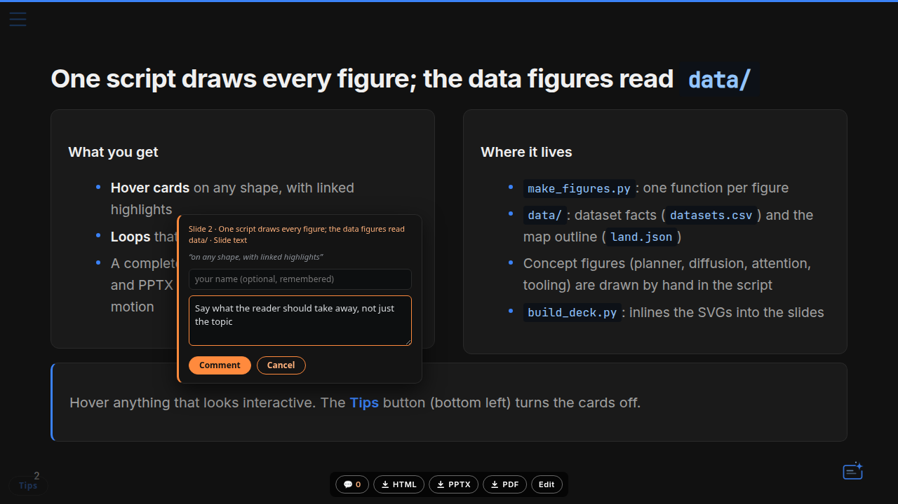
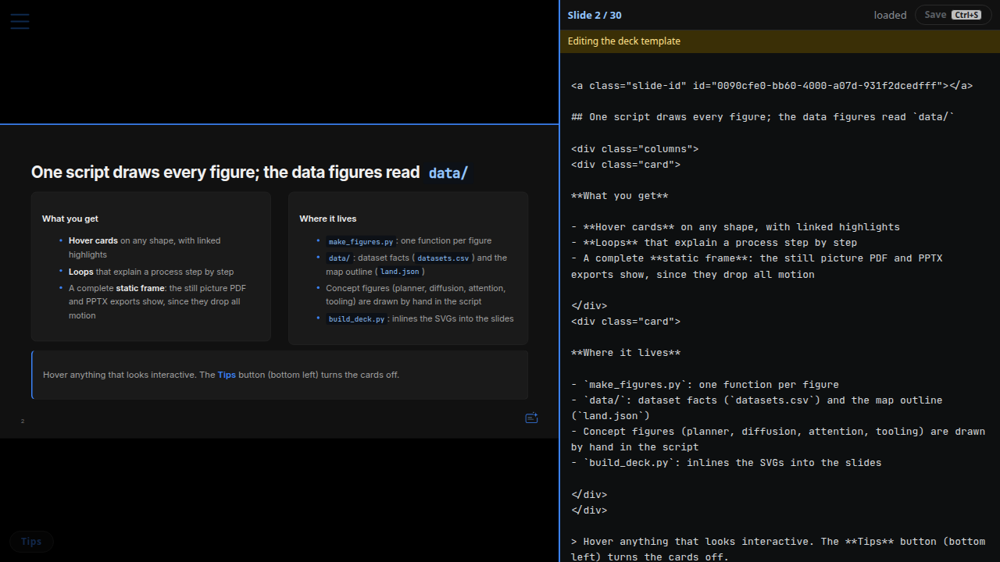

<a class="slide-id" id="83f9c514-b263-4092-9513-127d484c490c"></a>

<!-- paginate: true -->

<!--
  DECK BRIEF
  Audience: an engineer who has never seen agentic-slides and wants to know what it
  is, why it exists, how to use it in 10 minutes, and how it works inside.
  Reader promise: they can set it up, run the review loop with an agent, and know
  which file to open for the server, the build, the fact-check, the exports and Pages.
  Story mode: repo-intro (references/deck-repo-intro.md).
  Source of truth: https://github.com/a-nau/agentic-slides, links at main.
  Build: python3 make_figures.py && python3 build_deck.py
-->

<!-- HOVER TOOLKIT — body-level tooltip card + affordance styles. Keep this block;
     it is inert until an element carries data-tip. Usage:
       term:      <span class="term" data-tiphead="Flow matching" data-tip="Plain-language explanation.">flow matching</span>
       forensics: <span class="finfo" data-tiphead="Figure forensics" data-tip="No error bars; log axis compresses divergence.">ⓘ forensics</span>
       SVG box:   <g data-tiphead="Codec encoder" data-tip="What this component does.">…</g>
       figure overlay: transparent absolutely-positioned <span data-tip=…> over an  region.
     Rules: no double quotes inside data-tip values; the card must stay appended to
     document.body — reveal.js scales the slide container with a CSS transform, where
     position:fixed and CSS-only popovers break. -->
<style>
.term { border-bottom: 1px dashed #3d5a8c; cursor: help; }
.finfo { display: inline-block; margin-left: 12px; padding: 1px 12px 2px; border: 1px solid #1e3a66; border-radius: 999px; color: #3b82f6; font-size: 0.42em; font-weight: 600; letter-spacing: 0.06em; vertical-align: middle; cursor: help; }
.finfo:hover { border-color: #3b82f6; background: rgba(59,130,246,0.08); }
</style>
<script>
(function () {
  if (document.getElementById('tipcard')) return;
  const css = document.createElement('style');
  css.textContent = `
    #tipcard { position: fixed; display: none; max-width: 460px; background: #0a0e17; border: 1px solid #2a2a2a; border-left: 3px solid #3b82f6; border-radius: 10px; padding: 12px 16px; z-index: 9999; box-shadow: 0 10px 30px rgba(0,0,0,0.65); pointer-events: none; font-family: 'Segoe UI', Roboto, Helvetica, Arial, sans-serif; }
    #tipcard .tip-head { color: #3b82f6; font-size: 12px; font-weight: 700; letter-spacing: 0.09em; text-transform: uppercase; margin-bottom: 5px; }
    #tipcard .tip-body { color: #d6d9dc; font-size: 15px; line-height: 1.5; font-weight: 400; }
    body.tips-off #tipcard { display: none !important; }
    body.tips-off [data-tip] { border-bottom-color: transparent !important; text-decoration: none !important; cursor: default !important; }
    #tip-toggle { position: fixed; top: 12px; left: 56px; z-index: 9999; font: 600 12px/1 system-ui, sans-serif; letter-spacing: 0.05em; padding: 7px 14px; border-radius: 999px; border: 1px solid #2a2a2a; background: rgba(17,17,17,0.92); color: #3b82f6; cursor: pointer; opacity: 0.3; transition: opacity 0.15s ease; }
    #tip-toggle:hover { opacity: 1; }
    #tip-toggle.tips-off { text-decoration: line-through; }
    @media print { #tip-toggle { display: none !important; } }`;
  document.head.appendChild(css);
  const card = document.createElement('div');
  card.id = 'tipcard';
  card.innerHTML = '<div class="tip-head"></div><div class="tip-body"></div>';
  document.body.appendChild(card);
  const btn = document.createElement('button');
  btn.id = 'tip-toggle'; btn.type = 'button'; btn.textContent = 'Tips';
  btn.title = 'Hover tooltips are on — click to disable';
  btn.addEventListener('click', () => {
    const off = document.body.classList.toggle('tips-off');
    btn.classList.toggle('tips-off', off);
    btn.textContent = off ? 'Tips off' : 'Tips';
    btn.title = off ? 'Hover tooltips are off — click to enable' : 'Hover tooltips are on — click to disable';
  });
  document.body.appendChild(btn);
  const head = card.firstChild, body = card.lastChild;
  const place = (ev) => {
    const pad = 16, r = card.getBoundingClientRect();
    let x = ev.clientX + pad, y = ev.clientY + pad;
    if (x + r.width > innerWidth - 10) x = ev.clientX - r.width - pad;
    if (y + r.height > innerHeight - 10) y = ev.clientY - r.height - pad;
    card.style.left = Math.max(8, x) + 'px'; card.style.top = Math.max(8, y) + 'px';
  };
  document.addEventListener('mousemove', (ev) => {
    const t = ev.target.closest && ev.target.closest('[data-tip]');
    if (t) {
      head.textContent = t.getAttribute('data-tiphead') || 'Explanation';
      body.textContent = t.getAttribute('data-tip');
      card.style.display = 'block';
      place(ev);
    } else {
      card.style.display = 'none';
    }
  });
})();
</script>

<!-- _class: title repo -->

<p class="kicker">Repo tour</p>

# agentic-**slides**

## Coding agents write the decks; you review them on the slides, and your comments go back to the agent as a file

<p class="byline">Quarto (reveal.js) decks · agent skills · a live deck server · MIT</p>

<p class="links"><a class="repo-link" href="https://github.com/a-nau/agentic-slides">a-nau/agentic-slides</a><a class="website" href="https://github.com/a-nau/agentic-slides/blob/main/README.md">README</a><a class="link" href="https://github.com/a-nau/agentic-slides/tree/main/docs">docs</a></p>

---

<a class="slide-id" id="f865044f-6f62-455e-905a-ce69739adafa"></a>

<!-- _class: gives -->

## What this deck gives you in ten minutes

<style>
.reveal .slides section.slide.gives .gv-lead { font-size: 30px; line-height: 1.4; color: #d6d9dc; margin: 0 0 30px; max-width: 1060px; }
.reveal .slides section.slide.gives .gv-lead b { color: #fff; }
.reveal .slides section.slide.gives .gv-grid { display: grid; grid-template-columns: repeat(4, 1fr); gap: 22px; }
.reveal .slides section.slide.gives a.gv-card { display: flex; flex-direction: column; gap: 12px; padding: 24px 22px 26px; min-height: 250px; background: #1a1a1a; border: 1px solid #2a2a2a; border-top: 4px solid var(--c); border-radius: 14px; text-decoration: none; color: inherit; transition: border-color .15s, transform .15s; }
.reveal .slides section.slide.gives a.gv-card:hover { border-color: var(--c); transform: translateY(-3px); }
.reveal .slides section.slide.gives .gv-top { display: flex; align-items: center; justify-content: space-between; }
.reveal .slides section.slide.gives .gv-ico { width: 46px; height: 46px; padding: 9px; border-radius: 12px; color: var(--c); background: color-mix(in srgb, var(--c) 14%, transparent); }
.reveal .slides section.slide.gives .gv-n { font: 700 18px/1 'JetBrains Mono', monospace; color: #666; }
.reveal .slides section.slide.gives .gv-t { font-size: 29px; font-weight: 700; color: #f0f0f0; line-height: 1.15; }
.reveal .slides section.slide.gives .gv-b { font-size: 21px; line-height: 1.4; color: #a0a0a0; }
.reveal .slides section.slide.gives .gv-foot { margin-top: 30px; font-size: 19px; color: #8b8f94; }
.reveal .slides section.slide.gives .gv-foot a { color: #93c5fd; }
</style>

<p class="gv-lead"><b>agentic-slides</b> is a repo where coding agents write slide decks and people review them in the browser.</p>

<div class="gv-grid">
<a class="gv-card" href="#4" style="--c:var(--accent)"><span class="gv-top"><svg class="gv-ico" viewBox="0 0 24 24" fill="none" stroke="currentColor" stroke-width="1.8" stroke-linecap="round" stroke-linejoin="round"><path d="M9 18h6M10 21h4M12 3a6 6 0 0 0-3.5 10.9c.6.5 1 1.2 1 2V16h5v-.1c0-.8.4-1.5 1-2A6 6 0 0 0 12 3z"/></svg><span class="gv-n">01</span></span><span class="gv-t">What it is</span><span class="gv-b">Markdown + SVG decks an agent writes, one local server renders</span></a>
<a class="gv-card" href="#8" style="--c:var(--accent-green)"><span class="gv-top"><svg class="gv-ico" viewBox="0 0 24 24" fill="none" stroke="currentColor" stroke-width="1.8" stroke-linecap="round" stroke-linejoin="round"><rect x="3" y="4" width="18" height="16" rx="2.5"/><path d="M7 9l3 3-3 3M12.5 15H17"/></svg><span class="gv-n">02</span></span><span class="gv-t">How to run it</span><span class="gv-b">Four commands from a fresh clone to your own deck</span></a>
<a class="gv-card" href="#10" style="--c:var(--accent-purple)"><span class="gv-top"><svg class="gv-ico" viewBox="0 0 24 24" fill="none" stroke="currentColor" stroke-width="1.8" stroke-linecap="round" stroke-linejoin="round"><path d="M20 12a8 8 0 0 1-14.3 4.9M4 12a8 8 0 0 1 14.3-4.9"/><path d="M18.5 3.5v3.9h-3.9M5.5 20.5v-3.9h3.9"/></svg><span class="gv-n">03</span></span><span class="gv-t">The review loop</span><span class="gv-b">You comment on the slide; you ask the agent to fold it in</span></a>
<a class="gv-card" href="#14" style="--c:var(--accent-orange)"><span class="gv-top"><svg class="gv-ico" viewBox="0 0 24 24" fill="none" stroke="currentColor" stroke-width="1.8" stroke-linecap="round" stroke-linejoin="round"><circle cx="12" cy="12" r="3"/><path d="M12 2.5v3M12 18.5v3M2.5 12h3M18.5 12h3M5.3 5.3l2.1 2.1M16.6 16.6l2.1 2.1M5.3 18.7l2.1-2.1M16.6 7.4l2.1-2.1"/></svg><span class="gv-n">04</span></span><span class="gv-t">What is inside</span><span class="gv-b">Server, build, figures, fact-check, exports and Pages</span></a>
</div>

<p class="gv-foot">Every diagram box and file name links into <a href="https://github.com/a-nau/agentic-slides"><code>a-nau/agentic-slides</code></a> on <code>main</code> (2026-10-16): check any claim in the code.</p>

---

<a class="slide-id" id="2fb969b4-8749-4709-b2ac-afd74d5f3d12"></a>

## Agenda

<div class="columns">
<div>

1. [**The idea**](#4) — what it is and why it exists
2. [**Use it**](#7) — setup, skills, the review loop
3. [**How it works**](#13) — server, build, figures, Marp, fact-check

</div>
<div>

4. [**Ship it**](#19) — exports and GitHub Pages
5. [**Where to look**](#22) — example decks, a task index
6. [**Appendix**](#25) — ports, tests, known gaps

</div>
</div>

---

<a class="slide-id" id="33a31e03-3d8c-4585-a945-303b5b6faab8"></a>

## An agent writes the deck; you only read it and point at what is wrong

> **agentic-slides** is a slide-deck repo built for coding agents. The agent turns source material (a repo, a merge request, a paper) into a <span class="term" data-tiphead="Quarto" data-tip="An open-source publishing system; here it renders Markdown into reveal.js HTML slides. Setup downloads its release into quarto/.dist and checks the hash, no system install.">Quarto</span> deck with SVG figures it writes itself. You review the rendered slides, and each comment reaches the agent as a JSON record.

<div class="columns">
<div>

### Why build it this way

- **Text in, text out**: a deck is Markdown plus SVG, which an agent edits like code and git diffs like code
- **Feedback with an address**: a comment carries its quote, slide and heading; no chat transcript needed
- **One source, three outputs**: the same deck becomes a web page, a PDF, or an editable PowerPoint

</div>
<div>

### What ships in the repo

- [`.agents/skills/`](https://github.com/a-nau/agentic-slides/tree/main/.agents/skills): five agent skills
- [`quarto/`](https://github.com/a-nau/agentic-slides/tree/main/quarto): deck server, <span class="term" data-tiphead="Marp" data-tip="Marp is a Markdown slide tool. The repo started on it; its decks still render unchanged through a compatibility layer in quarto/.">Marp</span>-style rendering
- [`scripts/`](https://github.com/a-nau/agentic-slides/tree/main/scripts): setup, exports, fact-check, Pages
- [`decks/`](https://github.com/a-nau/agentic-slides/tree/main/decks): five example decks

</div>
</div>

---

<a class="slide-id" id="7c29b5c6-8653-4e95-92f4-074481ee0c9b"></a>

## The agent writes files; one local server renders them for you

Your comments travel the other way: the server writes them next to the deck, where the agent reads them.

<div style="display:flex;justify-content:center;margin-top:0.2rem">
<svg xmlns="http://www.w3.org/2000/svg" viewBox="0 0 1160 600" width="860" height="445" style="max-width:100%" font-family="Inter, sans-serif">
<style>.t{fill:#f0f0f0;font-weight:700}.d{fill:#a0a0a0}.mu{fill:#666666}.m{font-family:'JetBrains Mono',monospace;fill:#93c5fd}.bx{cursor:help}.bx:hover rect{stroke:#fff}</style>
<rect x="0" y="0" width="1160" height="600" fill="#111111"/><defs><marker id="ah-b" markerWidth="10" markerHeight="10" refX="7" refY="4" orient="auto"><path d="M0,0 L8,4 L0,8 z" fill="#3b82f6"/></marker><marker id="ah-g" markerWidth="10" markerHeight="10" refX="7" refY="4" orient="auto"><path d="M0,0 L8,4 L0,8 z" fill="#3fb950"/></marker><marker id="ah-m" markerWidth="10" markerHeight="10" refX="7" refY="4" orient="auto"><path d="M0,0 L8,4 L0,8 z" fill="#666666"/></marker></defs><text x="30" y="28" font-size="13" font-weight="700" letter-spacing="2" fill="#bc8cff">AUTHOR</text><text x="400" y="28" font-size="13" font-weight="700" letter-spacing="2" fill="#3b82f6">DECK SERVER · ONE PROCESS</text><text x="880" y="28" font-size="13" font-weight="700" letter-spacing="2" fill="#3fb950">READER</text><a href="https://github.com/a-nau/agentic-slides/tree/main/.agents/skills" target="_blank"><g class="bx" data-tiphead="Coding agent" data-tip="Reads AGENTS.md and the skills in .agents/skills/, then writes and rebuilds decks. Nothing to install beyond the repo."><rect x="30" y="44" width="310" height="112" rx="12" fill="#1a1a1a" stroke="#bc8cff" stroke-width="2"/><text x="46" y="74" class="t" font-size="19">coding agent</text><text x="46" y="98" class="d" font-size="14">Claude Code, Codex, any agent</text><text x="46" y="119" class="m" font-size="13">AGENTS.md · .agents/skills/</text></g></a><a href="https://github.com/a-nau/agentic-slides/tree/main/decks" target="_blank"><g class="bx" data-tiphead="Deck folder" data-tip="One folder per deck under decks/&lt;category&gt;/&lt;deck&gt;/. The server renders it in place: slides.html sits next to its source."><rect x="30" y="226" width="310" height="300" rx="12" fill="#1a1a1a" stroke="#2a2a2a" stroke-width="2"/><text x="46" y="256" class="t" font-size="19">deck folder</text><text x="46" y="278" class="m" font-size="13">decks/&lt;category&gt;/&lt;deck&gt;/</text></g></a><rect x="44" y="291" width="282" height="28" rx="6" fill="#0d1117"/><text x="56" y="310" font-family="JetBrains Mono, monospace" font-size="14" fill="#f0f0f0">slides.tpl.qmd</text><text x="314" y="310" text-anchor="end" class="mu" font-size="13">source</text><rect x="44" y="325" width="282" height="28" rx="6" fill="#0d1117"/><text x="56" y="344" font-family="JetBrains Mono, monospace" font-size="14" fill="#f0f0f0">images/*.svg</text><text x="314" y="344" text-anchor="end" class="mu" font-size="13">figures</text><rect x="44" y="359" width="282" height="28" rx="6" fill="#0d1117"/><text x="56" y="378" font-family="JetBrains Mono, monospace" font-size="14" fill="#f0f0f0">build_deck.py</text><text x="314" y="378" text-anchor="end" class="mu" font-size="13">assembles</text><rect x="44" y="393" width="282" height="28" rx="6" fill="#0d1117"/><text x="56" y="412" font-family="JetBrains Mono, monospace" font-size="14" fill="#a0a0a0">slides.qmd</text><text x="314" y="412" text-anchor="end" class="mu" font-size="13">generated</text><rect x="44" y="427" width="282" height="28" rx="6" fill="#0d1117"/><text x="56" y="446" font-family="JetBrains Mono, monospace" font-size="14" fill="#a0a0a0">slides.html</text><text x="314" y="446" text-anchor="end" class="mu" font-size="13">rendered</text><rect x="44" y="461" width="282" height="28" rx="6" fill="#0d1117"/><text x="56" y="480" font-family="JetBrains Mono, monospace" font-size="14" fill="#3fb950">comments.json</text><text x="314" y="480" text-anchor="end" class="mu" font-size="13">feedback</text><path d="M270,158 L270,222" stroke="#3b82f6" stroke-width="2.5" fill="none" marker-end="url(#ah-b)"/><text x="282" y="196" class="d" font-size="13">writes</text><path d="M80,224 L80,160" stroke="#3fb950" stroke-width="2.5" fill="none" stroke-dasharray="6 5" marker-end="url(#ah-g)"/><text x="92" y="196" class="d" font-size="13">reads comments when you ask</text><rect x="392" y="44" width="430" height="482" rx="16" fill="none" stroke="#3b82f6" stroke-opacity=".45" stroke-dasharray="7 6"/><a href="https://github.com/a-nau/agentic-slides/blob/main/quarto/scripts/serve.py#L89-L136" target="_blank"><g class="bx" data-tiphead="Watcher" data-tip="Compares each deck's newest source mtime with slides.html and renders only the stale deck, one at a time under .quarto/render.lock. It renders slides.qmd as it is: it does not run build_deck.py. A Marp slides.md is converted to slides.qmd first."><rect x="412" y="62" width="390" height="132" rx="12" fill="#1a1a1a" stroke="#3b82f6" stroke-width="2"/><text x="428" y="92" class="t" font-size="19">watcher</text><text x="428" y="116" class="d" font-size="14">polls deck sources every second</text><text x="428" y="137" class="d" font-size="14">quarto render → slides.html, ~2 s</text><text x="428" y="158" class="m" font-size="13">serve.py · watch() / scan()</text></g></a><a href="https://github.com/a-nau/agentic-slides/blob/main/quarto/scripts/serve.py#L214-L241" target="_blank"><g class="bx" data-tiphead="Deck port" data-tip="A page load is a plain file read. The URL ends in slides.md, the Marp-era path, so old links keep working; it returns slides.html. Open pages poll /__stamp and swap in re-rendered slides without a reload."><rect x="412" y="214" width="390" height="132" rx="12" fill="#1a1a1a" stroke="#3b82f6" stroke-width="2"/><text x="428" y="244" class="t" font-size="19">:8093  decks</text><text x="428" y="268" class="d" font-size="14">/&lt;category&gt;/&lt;deck&gt;/slides.md → slides.html</text><text x="428" y="289" class="d" font-size="14">landing pages · /__stamp for live update</text><text x="428" y="310" class="m" font-size="13">serve.py · Handler.do_GET</text></g></a><a href="https://github.com/a-nau/agentic-slides/blob/main/scripts/pptx_export/export_server.py" target="_blank"><g class="bx" data-tiphead="Comments and export API" data-tip="Same process, second port; :8093 answers these routes too, but deck pages and exported HTML call :8094. Writes comments.json and the edited source, renders an edited slide with pandoc for the live preview, and runs scripts/export.sh for downloads (cached until the deck changes)."><rect x="412" y="366" width="390" height="140" rx="12" fill="#1a1a1a" stroke="#3fb950" stroke-width="2"/><text x="428" y="396" class="t" font-size="19">:8094  API</text><text x="428" y="420" class="d" font-size="14">comments · edit (raw, preview)</text><text x="428" y="441" class="d" font-size="14">HTML · PPTX · PDF downloads</text><text x="428" y="462" class="m" font-size="13">scripts/pptx_export/export_server.py</text></g></a><path d="M344,262 C372,262 380,128 408,128" stroke="#666666" stroke-width="2.5" fill="none" marker-end="url(#ah-m)"/><path d="M410,440 L344,440" stroke="#3fb950" stroke-width="2.5" fill="none" marker-end="url(#ah-g)"/><a href="https://github.com/a-nau/agentic-slides/blob/main/quarto/scripts/gen_client.py" target="_blank"><g class="bx" data-tiphead="Browser layers" data-tip="quarto/scripts/gen_client.py bundles the control bar, edit mode and comments into every deck; they hide themselves when the API is not reachable."><rect x="880" y="44" width="250" height="482" rx="12" fill="#1a1a1a" stroke="#3fb950" stroke-width="2"/><text x="896" y="74" class="t" font-size="19">browser</text><text x="896" y="96" class="d" font-size="14">the deck, plus layers</text></g></a><rect x="896" y="122" width="218" height="62" rx="8" fill="#0d1117" stroke="#2a2a2a"/><text x="910" y="148" class="t" font-size="15">live update</text><text x="910" y="170" class="d" font-size="13">swaps changed slides</text><rect x="896" y="200" width="218" height="62" rx="8" fill="#0d1117" stroke="#2a2a2a"/><text x="910" y="226" class="t" font-size="15">Edit pane</text><text x="910" y="248" class="d" font-size="13">slide source, Ctrl+S</text><rect x="896" y="278" width="218" height="62" rx="8" fill="#0d1117" stroke="#2a2a2a"/><text x="910" y="304" class="t" font-size="15">💬 Comment</text><text x="910" y="326" class="d" font-size="13">select text, write a note</text><rect x="896" y="356" width="218" height="62" rx="8" fill="#0d1117" stroke="#2a2a2a"/><text x="910" y="382" class="t" font-size="15">downloads</text><text x="910" y="404" class="d" font-size="13">HTML · PPTX · PDF</text><rect x="896" y="434" width="218" height="62" rx="8" fill="#0d1117" stroke="#2a2a2a"/><text x="910" y="460" class="t" font-size="15">Tips</text><text x="910" y="482" class="d" font-size="13">hover cards on/off</text><path d="M806,280 L874,280" stroke="#3b82f6" stroke-width="2.5" fill="none" marker-end="url(#ah-b)"/><path d="M878,440 L808,440" stroke="#3fb950" stroke-width="2.5" fill="none" marker-end="url(#ah-g)"/><line x1="30" y1="566" x2="62" y2="566" stroke="#3b82f6" stroke-width="2.5"/><text x="70" y="571" class="d" font-size="14">deck goes out</text><line x1="200" y1="566" x2="232" y2="566" stroke="#3fb950" stroke-width="2.5"/><text x="240" y="571" class="d" font-size="14">feedback comes back</text><text x="1130" y="571" text-anchor="end" class="mu" font-size="13">binds 127.0.0.1; SLIDES_HOST=0.0.0.0 opens it to the network, no login</text>
</svg>
</div>

---

<a class="slide-id" id="62d3d936-07bc-429f-9c29-e8d01a0123af"></a>

## Six terms carry the rest of the deck

<div class="columns">
<div class="card">

### Deck
A folder `decks/<category>/<deck>/`: `images/` and `slides.qmd`, the file you edit, written in the style of <span class="term" data-tiphead="Marp" data-tip="A Markdown slide tool. The repo started on it and kept its conventions; Quarto renders them through a compatibility layer in quarto/.">Marp</span>, the slide tool the repo started on.

### Template deck
Has a `slides.tpl.qmd`: edit it and `images/`; its [`build_deck.py`](https://github.com/a-nau/agentic-slides/blob/main/.agents/skills/slide-deck/template/build_deck.py) generates `slides.qmd`. The `slide-deck` skill makes these.

### FIG token
<code style="font-variant-ligatures:none">&lt;!--FIG:loop--&gt;</code> in the template; the build inlines `images/loop.svg` there.

</div>
<div class="card">

### Skill
A Markdown playbook under [`.agents/skills/`](https://github.com/a-nau/agentic-slides/tree/main/.agents/skills) that tells the agent how to do one job, start to finish.

### comments.json
Per-deck file of open and resolved slide comments; the hand-off from you to the agent. Gitignored.

### Deck server
[`quarto/scripts/serve.py`](https://github.com/a-nau/agentic-slides/blob/main/quarto/scripts/serve.py), one process: open decks on **:8093**; pages call the comments/export API on **:8094**.

</div>
</div>

---

<a class="slide-id" id="688a5dcb-a7d6-423c-a856-b576d37ec97f"></a>

<!-- _class: invert -->

# Use **it**

setup, skills, and the review loop

---

<a class="slide-id" id="bef8a41f-a63c-4d94-8950-0146e8cc53fd"></a>

## Four commands take you from clone to your own deck

```bash
git clone https://github.com/a-nau/agentic-slides && cd agentic-slides
scripts/setup.sh                    # once: .venv, Quarto + MathJax into quarto/, git hooks
scripts/start.sh                    # decks on :8093, comments/export API on :8094
scripts/new_deck.sh tools/my-topic  # a plain deck: edit decks/tools/my-topic/slides.qmd
```

<div class="columns">
<div>

### What you need

- Required: **Python 3** and **npm** (setup fetches MathJax with it); **Google Chrome** only for PDF and PPTX export
- No Docker, no system packages: setup downloads Quarto into `quarto/.dist` and checks its hash ([`setup.sh`](https://github.com/a-nau/agentic-slides/blob/main/quarto/scripts/setup.sh))
- The first start renders every deck once, which takes a few minutes ([`start.sh`](https://github.com/a-nau/agentic-slides/blob/main/scripts/start.sh))

</div>
<div>

### Then

- Open `http://localhost:8093/` for the index of every deck
- A deck lives at `/<category>/<deck>/slides.md`, the Marp-era path; it serves the rendered page
- Or ask your agent: *"make a deck introducing the repo at ~/code/foo"*; it builds a template deck
- Optional: [`install_services.sh`](https://github.com/a-nau/agentic-slides/blob/main/scripts/install_services.sh) keeps the server up as a systemd user unit

</div>
</div>

---

<a class="slide-id" id="f5517248-66ea-4fe7-9cb4-6b714da8b48d"></a>

## Five skills cover the agent's side, from first draft to export

| Skill | The agent uses it to… |
|---|---|
| [`slide-deck`](https://github.com/a-nau/agentic-slides/blob/main/.agents/skills/slide-deck/SKILL.md) | build a deck: research, storyboard, SVG figures, build, layout check |
| [`deck-feedback`](https://github.com/a-nau/agentic-slides/blob/main/.agents/skills/deck-feedback/SKILL.md) | run three fresh reviewer agents (one Codex, two Claude) that read **only** the built deck; their question lists go to files, and gaps two of them share get fixed |
| [`address-feedback`](https://github.com/a-nau/agentic-slides/blob/main/.agents/skills/address-feedback/SKILL.md) | fold open comments into the slides, then resolve them |
| [`onboarding`](https://github.com/a-nau/agentic-slides/blob/main/.agents/skills/onboarding/SKILL.md) | walk a newcomer from setup to a first deck |
| [`export-all-html`](https://github.com/a-nau/agentic-slides/blob/main/.agents/skills/export-all-html/SKILL.md) | export every deck as one self-contained HTML file each |

`slide-deck` knows five deck types, each with its own slide arc in [`references/`](https://github.com/a-nau/agentic-slides/tree/main/.agents/skills/slide-deck/references): **repo tour** (this deck), **MR review**, **tool demo**, **research overview**, **paper deep dive**.

> Start the agent in your checkout: it reads [`AGENTS.md`](https://github.com/a-nau/agentic-slides/blob/main/AGENTS.md) and `.agents/skills/`, no plugin to install. Ask in plain words or name the skill.

---

<a class="slide-id" id="c110a036-e83f-4d5c-861b-6578a0df2837"></a>

## Review is a loop: you comment, then ask the agent to fix it

<div style="display:flex;justify-content:center;margin-top:0.4rem">
<svg xmlns="http://www.w3.org/2000/svg" viewBox="0 0 1160 600" width="980" height="507" style="max-width:100%" font-family="Inter, sans-serif">
<style>.t{fill:#f0f0f0;font-weight:700}.d{fill:#a0a0a0}.mu{fill:#666666}.m{font-family:'JetBrains Mono',monospace;fill:#93c5fd}.lp-b{cursor:help}.lp-b:hover rect.lp-f{stroke:#fff}.lp-dot{animation:lp-dot 12s linear infinite}@keyframes lp-dot{0.00%{transform:translate(0.0px,0.0px)}1.67%{transform:translate(37.6px,1.1px)}3.33%{transform:translate(74.8px,4.5px)}5.00%{transform:translate(111.2px,10.0px)}6.67%{transform:translate(146.4px,17.7px)}8.33%{transform:translate(180.0px,27.5px)}10.00%{transform:translate(211.6px,39.2px)}11.67%{transform:translate(240.9px,52.7px)}13.33%{transform:translate(267.5px,67.8px)}15.00%{transform:translate(291.2px,84.5px)}16.67%{transform:translate(311.8px,102.5px)}18.33%{transform:translate(328.9px,121.6px)}20.00%{transform:translate(342.4px,141.7px)}21.67%{transform:translate(352.1px,162.4px)}23.33%{transform:translate(358.0px,183.6px)}25.00%{transform:translate(360.0px,205.0px)}26.67%{transform:translate(358.0px,226.4px)}28.33%{transform:translate(352.1px,247.6px)}30.00%{transform:translate(342.4px,268.3px)}31.67%{transform:translate(328.9px,288.4px)}33.33%{transform:translate(311.8px,307.5px)}35.00%{transform:translate(291.2px,325.5px)}36.67%{transform:translate(267.5px,342.2px)}38.33%{transform:translate(240.9px,357.3px)}40.00%{transform:translate(211.6px,370.8px)}41.67%{transform:translate(180.0px,382.5px)}43.33%{transform:translate(146.4px,392.3px)}45.00%{transform:translate(111.2px,400.0px)}46.67%{transform:translate(74.8px,405.5px)}48.33%{transform:translate(37.6px,408.9px)}50.00%{transform:translate(0.0px,410.0px)}51.67%{transform:translate(-37.6px,408.9px)}53.33%{transform:translate(-74.8px,405.5px)}55.00%{transform:translate(-111.2px,400.0px)}56.67%{transform:translate(-146.4px,392.3px)}58.33%{transform:translate(-180.0px,382.5px)}60.00%{transform:translate(-211.6px,370.8px)}61.67%{transform:translate(-240.9px,357.3px)}63.33%{transform:translate(-267.5px,342.2px)}65.00%{transform:translate(-291.2px,325.5px)}66.67%{transform:translate(-311.8px,307.5px)}68.33%{transform:translate(-328.9px,288.4px)}70.00%{transform:translate(-342.4px,268.3px)}71.67%{transform:translate(-352.1px,247.6px)}73.33%{transform:translate(-358.0px,226.4px)}75.00%{transform:translate(-360.0px,205.0px)}76.67%{transform:translate(-358.0px,183.6px)}78.33%{transform:translate(-352.1px,162.4px)}80.00%{transform:translate(-342.4px,141.7px)}81.67%{transform:translate(-328.9px,121.6px)}83.33%{transform:translate(-311.8px,102.5px)}85.00%{transform:translate(-291.2px,84.5px)}86.67%{transform:translate(-267.5px,67.8px)}88.33%{transform:translate(-240.9px,52.7px)}90.00%{transform:translate(-211.6px,39.2px)}91.67%{transform:translate(-180.0px,27.5px)}93.33%{transform:translate(-146.4px,17.7px)}95.00%{transform:translate(-111.2px,10.0px)}96.67%{transform:translate(-74.8px,4.5px)}98.33%{transform:translate(-37.6px,1.1px)}100.00%{transform:translate(-0.0px,0.0px)}}.lp-g0{animation:lp-g0 12s infinite}@keyframes lp-g0{0%,16%{opacity:1}20%,96%{opacity:0}100%{opacity:1}}.lp-g1{animation:lp-g1 12s infinite}@keyframes lp-g1{0%,16%{opacity:0}20%,36%{opacity:1}40%,100%{opacity:0}}.lp-g2{animation:lp-g2 12s infinite}@keyframes lp-g2{0%,36%{opacity:0}40%,56%{opacity:1}60%,100%{opacity:0}}.lp-g3{animation:lp-g3 12s infinite}@keyframes lp-g3{0%,56%{opacity:0}60%,76%{opacity:1}80%,100%{opacity:0}}.lp-g4{animation:lp-g4 12s infinite}@keyframes lp-g4{0%,76%{opacity:0}80%,96%{opacity:1}100%,100%{opacity:0}}</style>
<rect x="0" y="0" width="1160" height="600" fill="#111111"/><ellipse cx="580" cy="290" rx="360" ry="205" fill="none" stroke="#2a2a2a" stroke-width="3" stroke-dasharray="2 10" stroke-linecap="round"/><g class="lp-dot"><circle cx="580" cy="85" r="9" fill="#3b82f6"/><circle cx="580" cy="85" r="17" fill="#3b82f6" opacity=".25"/></g><a href="https://github.com/a-nau/agentic-slides/blob/main/.agents/skills/slide-deck/SKILL.md" target="_blank"><g class="lp-b" data-tiphead="build" data-tip="The agent follows the slide-deck skill: research, storyboard, SVG figures, build, check the layout."><rect class="lp-f" x="440" y="39" width="280" height="92" rx="14" fill="#1a1a1a" stroke="#bc8cff" stroke-width="2"/><rect class="lp-g0" x="440" y="39" width="280" height="92" rx="14" fill="#3b82f6" fill-opacity=".10" stroke="#3b82f6" stroke-width="3" opacity="0"/><text x="458" y="69" class="t" font-size="20">1 · build</text><text x="704" y="68" text-anchor="end" font-size="13" font-weight="700" fill="#bc8cff">AGENT</text><text x="458" y="94" class="d" font-size="15">writes the deck from sources</text><text x="458" y="117" class="m" font-size="13">slide-deck skill</text></g></a><a href="https://github.com/a-nau/agentic-slides/blob/main/quarto/scripts/serve.py" target="_blank"><g class="lp-b" data-tiphead="look" data-tip="The server re-renders a saved deck in a few seconds (about 2 s per deck, quarto/README.md); the open page swaps in the changed slides."><rect class="lp-f" x="782" y="181" width="280" height="92" rx="14" fill="#1a1a1a" stroke="#3fb950" stroke-width="2"/><rect class="lp-g1" x="782" y="181" width="280" height="92" rx="14" fill="#3b82f6" fill-opacity=".10" stroke="#3b82f6" stroke-width="3" opacity="0"/><text x="800" y="211" class="t" font-size="20">2 · look</text><text x="1046" y="210" text-anchor="end" font-size="13" font-weight="700" fill="#3fb950">YOU</text><text x="800" y="236" class="d" font-size="15">the open page updates itself</text><text x="800" y="259" class="m" font-size="13">serve.py · /__stamp</text></g></a><a href="https://github.com/a-nau/agentic-slides/blob/main/scripts/comments.js" target="_blank"><g class="lp-b" data-tiphead="comment" data-tip="Each note is saved with its quote, slide, heading and stable slide id in the deck folder."><rect class="lp-f" x="652" y="410" width="280" height="92" rx="14" fill="#1a1a1a" stroke="#3fb950" stroke-width="2"/><rect class="lp-g2" x="652" y="410" width="280" height="92" rx="14" fill="#3b82f6" fill-opacity=".10" stroke="#3b82f6" stroke-width="3" opacity="0"/><text x="670" y="440" class="t" font-size="20">3 · comment</text><text x="916" y="439" text-anchor="end" font-size="13" font-weight="700" fill="#3fb950">YOU</text><text x="670" y="465" class="d" font-size="15">select text → 💬 Comment</text><text x="670" y="488" class="m" font-size="13">comments.json</text></g></a><a href="https://github.com/a-nau/agentic-slides/blob/main/.agents/skills/address-feedback/SKILL.md" target="_blank"><g class="lp-b" data-tiphead="address" data-tip="Starts when you ask it, e.g. address the open comments: the agent does not watch comments.json. It fixes the cause for a fresh reader, never echoes the comment, then rebuilds."><rect class="lp-f" x="228" y="410" width="280" height="92" rx="14" fill="#1a1a1a" stroke="#bc8cff" stroke-width="2"/><rect class="lp-g3" x="228" y="410" width="280" height="92" rx="14" fill="#3b82f6" fill-opacity=".10" stroke="#3b82f6" stroke-width="3" opacity="0"/><text x="246" y="440" class="t" font-size="20">4 · address</text><text x="492" y="439" text-anchor="end" font-size="13" font-weight="700" fill="#bc8cff">AGENT</text><text x="246" y="465" class="d" font-size="15">folds each note into the slide</text><text x="246" y="488" class="m" font-size="13">address-feedback skill</text></g></a><a href="https://github.com/a-nau/agentic-slides/blob/main/docs/comments-and-edit-mode.md" target="_blank"><g class="lp-b" data-tiphead="resolve" data-tip="Resolve via the API with expected_updated: a stale write returns 409, so nobody's edit is lost."><rect class="lp-f" x="98" y="181" width="280" height="92" rx="14" fill="#1a1a1a" stroke="#bc8cff" stroke-width="2"/><rect class="lp-g4" x="98" y="181" width="280" height="92" rx="14" fill="#3b82f6" fill-opacity=".10" stroke="#3b82f6" stroke-width="3" opacity="0"/><text x="116" y="211" class="t" font-size="20">5 · resolve</text><text x="362" y="210" text-anchor="end" font-size="13" font-weight="700" fill="#bc8cff">AGENT</text><text x="116" y="236" class="d" font-size="15">closes it, history kept</text><text x="116" y="259" class="m" font-size="13">POST /comments/&lt;deck&gt;</text></g></a><defs><marker id="lp-h" markerWidth="10" markerHeight="10" refX="7" refY="4" orient="auto"><path d="M0,0 L8,4 L0,8 z" fill="#bc8cff"/></marker></defs><path d="M790,506 L790,540 L370,540 L370,512" stroke="#3fb950" stroke-width="2.5" fill="none" stroke-dasharray="6 5" marker-end="url(#lp-h)"/><a href="https://github.com/a-nau/agentic-slides/blob/main/.agents/skills/address-feedback/SKILL.md" target="_blank"><g class="lp-b" data-tiphead="Hand-off" data-tip="Nothing watches comments.json. When you are done commenting, tell the agent, e.g. address the open comments; that request loads the address-feedback skill."><rect x="372" y="521" width="416" height="38" rx="19" fill="#111111" stroke="#3fb950" stroke-width="2"/><text x="580" y="546" text-anchor="middle" font-size="17" fill="#f0f0f0"><tspan font-weight="700" fill="#3fb950">you ask: </tspan>“address the open comments”</text></g></a><text x="580" y="280" text-anchor="middle" class="t" font-size="24">one deck, many rounds</text><text x="580" y="310" text-anchor="middle" class="d" font-size="16">until no comment is open</text><text x="40" y="584" font-size="13" font-weight="700" fill="#3fb950">YOU</text><text x="76" y="584" class="d" font-size="13">read and comment in the browser</text><text x="330" y="584" font-size="13" font-weight="700" fill="#bc8cff">AGENT</text><text x="384" y="584" class="d" font-size="13">edits files, never the rendered page</text>
</svg>
</div>

---

<a class="slide-id" id="8b879279-40d1-4611-8fa1-b72cb136c9ef"></a>

## Comments are a file the agent reads, not a chat it has to remember

<div class="columns">
<div>

```json
{ "id": "c-…", "status": "open",
  "quote": "exact slide text",
  "comment": "make this punchier",
  "page": 4, "occurrence": 1,
  "prefix": "…", "suffix": "…",
  "anchor": { "kind": "slide",
              "slide_id": "…", "heading": "…" },
  "source_file": "slides.tpl.qmd",
  "slide_src": "## …", "commit": "…",
  "updated": "…", "history": [] }
```

One record per note in `decks/<category>/<deck>/comments.json` ([format](https://github.com/a-nau/agentic-slides/blob/main/docs/comments-and-edit-mode.md#comments)).

</div>
<div>

- **Find the spot**: `slide_id` survives reordering; `quote`, `prefix`, `suffix`, `occurrence` pin the words
- **Know the context**: `commit`, `source_file`, `slide_src` snapshot the slide as commented
- **Resolve via the API**, history kept: `POST :8094/comments/<category>/<deck>`, `expected_updated` = the `updated` it read; changed since → **409**
- **From elsewhere**: exported HTML posts to `COMMENTS_HOST` (default `localhost`), queued in the browser until reachable; [`ingest_pdf_comments.py`](https://github.com/a-nau/agentic-slides/blob/main/scripts/ingest_pdf_comments.py) adds PDF notes

</div>
</div>

---

<a class="slide-id" id="88c74c6c-ecab-414a-9f5f-d11abe7a51c0"></a>

## Comments and edits happen on the slide, not in a chat window

<div class="columns">
<div>

{width=560}

**Comment**: select text, write the note; open comments show as orange highlights, and a 💬 badge counts them.

</div>
<div>

{width=560}

**Edit**: the slide's source in a side pane, previewed on every keystroke. **Ctrl+S** writes `slides.tpl.qmd` on a template deck (then runs `build_deck.py`), else `slides.qmd`. If the file changed on disk meanwhile, say the agent wrote it, the save is refused and the pane offers a reload.

</div>
</div>

---

<a class="slide-id" id="f583a55f-73ab-4c50-8f0a-5f6d91426561"></a>

<!-- _class: invert -->

# How it **works**

the server, the build, figures, Marp, the fact-check

---

<a class="slide-id" id="d3b8c02f-472d-462b-80e3-e78ca3358cf0"></a>

## Page loads only read files; a watcher does all the rendering

| URL | What [`serve.py`](https://github.com/a-nau/agentic-slides/blob/main/quarto/scripts/serve.py) returns |
|---|---|
| `/` and `/<category>/` | landing pages, written by [`gen_index.py`](https://github.com/a-nau/agentic-slides/blob/main/quarto/scripts/gen_index.py) after each render |
| `/<category>/<deck>/slides.md` | the rendered `slides.html` (`.html` works too); the `.md` path keeps old Marp-era links working |
| `/<deck>/slides.md` | a redirect to the deck's category path |
| `/__stamp?p=…` | the page's mtime; open pages poll it and swap in changed slides |
| `/comments/` `/raw/` `/preview/` `/html/` `/pptx/` `/pdf/` | the API ([`export_server.py`](https://github.com/a-nau/agentic-slides/blob/main/scripts/pptx_export/export_server.py)); both ports answer it, pages call **:8094** |

The watcher polls deck sources every second and renders `slides.qmd` of a deck whose sources are newer than its `slides.html`; it does not run `build_deck.py`. A failed render is logged and the old page stays.

> One render at a time (`.quarto/render.lock`), in place: never hand-edit `slides.html`, the next save overwrites it.

---

<a class="slide-id" id="ae7c07f1-f33b-4a34-a58a-0ec8ac5fbba0"></a>

## Markdown plus SVG in; `build_deck.py` and Quarto do the rest

<div style="display:flex;justify-content:center;margin-top:0.4rem">
<svg xmlns="http://www.w3.org/2000/svg" viewBox="0 0 1160 600" width="980" height="507" style="max-width:100%" font-family="Inter, sans-serif">
<style>.t{fill:#f0f0f0;font-weight:700}.d{fill:#a0a0a0}.mu{fill:#666666}.m{font-family:'JetBrains Mono',monospace;fill:#93c5fd}.bx{cursor:help}.bx:hover rect{stroke:#fff}</style>
<rect x="0" y="0" width="1160" height="600" fill="#111111"/><defs><marker id="pp-b" markerWidth="10" markerHeight="10" refX="7" refY="4" orient="auto"><path d="M0,0 L8,4 L0,8 z" fill="#3b82f6"/></marker><marker id="pp-m" markerWidth="10" markerHeight="10" refX="7" refY="4" orient="auto"><path d="M0,0 L8,4 L0,8 z" fill="#666666"/></marker><marker id="pp-g" markerWidth="10" markerHeight="10" refX="7" refY="4" orient="auto"><path d="M0,0 L8,4 L0,8 z" fill="#3fb950"/></marker></defs><a href="https://github.com/a-nau/agentic-slides/blob/main/decks/repos/agentic-slides/slides.tpl.qmd" target="_blank"><g class="bx" data-tiphead="Deck source" data-tip="Marp-style Markdown with FIG tokens where figures go; the SVGs sit in images/. This deck's own source is linked."><rect x="30" y="52" width="190" height="116" rx="12" fill="#1a1a1a" stroke="#3b82f6" stroke-width="2"/><text x="46" y="82" class="t" font-size="18">slides.tpl.qmd</text><text x="46" y="106" class="m" font-size="13">+ images/*.svg</text><text x="46" y="127" class="d" font-size="14">you and the agent</text><text x="46" y="148" class="d" font-size="14">edit these</text></g></a><a href="https://github.com/a-nau/agentic-slides/blob/main/.agents/skills/slide-deck/template/build_deck.py" target="_blank"><g class="bx" data-tiphead="build_deck.py" data-tip="Lives in each deck folder: python3 build_deck.py. Replaces each FIG token with the SVG file inline, so links and hover cards keep working, and adds permalinks. The server watcher never runs it; the agent does, and the Edit pane does after a save."><rect x="262" y="52" width="190" height="116" rx="12" fill="#1a1a1a" stroke="#3b82f6" stroke-width="2"/><text x="278" y="82" class="t" font-size="18">build_deck.py</text><text x="278" y="106" class="m" font-size="13">FIG token → &lt;svg&gt;</text><text x="278" y="127" class="d" font-size="14">run by the agent, or</text><text x="278" y="148" class="d" font-size="14">the Edit pane on save</text></g></a><a href="https://github.com/a-nau/agentic-slides/blob/main/decks/repos/agentic-slides/slides.qmd" target="_blank"><g class="bx" data-tiphead="slides.qmd" data-tip="What Quarto renders. It is committed, because GitHub Pages and a fresh clone render it as is; the pre-commit hook rebuilds and stages it for every deck with staged changes, so it never lags the template."><rect x="494" y="52" width="190" height="116" rx="12" fill="#1a1a1a" stroke="#2a2a2a" stroke-width="2"/><text x="510" y="82" class="t" font-size="18">slides.qmd</text><text x="510" y="106" class="m" font-size="13">generated</text><text x="510" y="127" class="d" font-size="14">never edit by hand;</text><text x="510" y="148" class="d" font-size="14">committed, kept in sync</text></g></a><a href="https://github.com/a-nau/agentic-slides/blob/main/_quarto.yml" target="_blank"><g class="bx" data-tiphead="Quarto render" data-tip="Slides split on --- only (slide-level 0), CommonMark like Marp; quarto/filters/marp-compat.lua and quarto/shim/ keep Marp behaviour; quarto/themes/ styles it."><rect x="726" y="52" width="190" height="116" rx="12" fill="#1a1a1a" stroke="#3b82f6" stroke-width="2"/><text x="742" y="82" class="t" font-size="18">quarto render</text><text x="742" y="106" class="m" font-size="13">_quarto.yml</text><text x="742" y="127" class="d" font-size="14">the watcher runs it</text><text x="742" y="148" class="d" font-size="14">on every change</text></g></a><a href="https://github.com/a-nau/agentic-slides/blob/main/quarto/scripts/serve.py" target="_blank"><g class="bx" data-tiphead="slides.html" data-tip="Rendered in place, gitignored. The deck server serves it as /&lt;category&gt;/&lt;deck&gt;/slides.md."><rect x="958" y="52" width="190" height="116" rx="12" fill="#1a1a1a" stroke="#3fb950" stroke-width="2"/><text x="974" y="82" class="t" font-size="18">slides.html</text><text x="974" y="106" class="m" font-size="13">reveal.js deck</text><text x="974" y="127" class="d" font-size="14">served on :8093,</text><text x="974" y="148" class="d" font-size="14">next to the source</text></g></a><path d="M224,110.0 L258,110.0" stroke="#3b82f6" stroke-width="2.5" fill="none" marker-end="url(#pp-b)"/><path d="M456,110.0 L490,110.0" stroke="#3b82f6" stroke-width="2.5" fill="none" marker-end="url(#pp-b)"/><path d="M688,110.0 L722,110.0" stroke="#3b82f6" stroke-width="2.5" fill="none" marker-end="url(#pp-b)"/><path d="M920,110.0 L954,110.0" stroke="#3b82f6" stroke-width="2.5" fill="none" marker-end="url(#pp-b)"/><a href="https://github.com/a-nau/agentic-slides/blob/main/docs/decks.md" target="_blank"><g class="bx" data-tiphead="Marp deck" data-tip="Drop a Marp slides.md into a deck folder: it stays the source, converted on every change."><rect x="30" y="232" width="190" height="92" rx="12" fill="#1a1a1a" stroke="#666666" stroke-width="2" stroke-dasharray="6 5"/><text x="46" y="262" class="t" font-size="18">slides.md</text><text x="46" y="286" class="d" font-size="14">a Marp deck</text></g></a><a href="https://github.com/a-nau/agentic-slides/blob/main/quarto/scripts/marp2qmd.py" target="_blank"><g class="bx" data-tiphead="marp2qmd.py" data-tip="Rewrites only what pandoc cannot read the Marp way: front matter, image sizing, separators. Without --keep it migrates the deck for good."><rect x="262" y="232" width="238" height="92" rx="12" fill="#1a1a1a" stroke="#666666" stroke-width="2" stroke-dasharray="6 5"/><text x="278" y="262" class="t" font-size="18">marp2qmd.py --keep</text><text x="278" y="286" class="d" font-size="14">converts it on change</text></g></a><path d="M224,278 L258,278" stroke="#666666" stroke-width="2.5" fill="none" stroke-dasharray="6 5" marker-end="url(#pp-m)"/><path d="M504,278 C566,278 589,230 589,174" stroke="#666666" stroke-width="2.5" fill="none" stroke-dasharray="6 5" marker-end="url(#pp-m)"/><path d="M1053,170 L1053,384 L155,384" stroke="#3fb950" stroke-width="2.5" fill="none"/><path d="M155,384 L155,416" stroke="#3fb950" stroke-width="2.5" fill="none" marker-end="url(#pp-g)"/><path d="M445,384 L445,416" stroke="#3fb950" stroke-width="2.5" fill="none" marker-end="url(#pp-g)"/><path d="M735,384 L735,416" stroke="#3fb950" stroke-width="2.5" fill="none" marker-end="url(#pp-g)"/><path d="M1025,384 L1025,416" stroke="#3fb950" stroke-width="2.5" fill="none" marker-end="url(#pp-g)"/><text x="1040" y="372" text-anchor="end" class="d" font-size="14">scripts/export.sh &lt;category/deck&gt; html | pdf | pptx</text><a href="https://github.com/a-nau/agentic-slides/blob/main/scripts/export.sh" target="_blank"><g class="bx" data-tiphead="HTML export" data-tip="Quarto embed-resources plus MathJax inlined: mail it anywhere. Comments post back to the API when it is reachable."><rect x="30" y="420" width="250" height="116" rx="12" fill="#1a1a1a" stroke="#3fb950" stroke-width="2"/><text x="46" y="450" class="t" font-size="18">HTML</text><text x="46" y="474" class="m" font-size="13">export.sh … html</text><text x="46" y="495" class="d" font-size="14">one self-contained file,</text><text x="46" y="516" class="d" font-size="14">MathJax inlined</text></g></a><a href="https://github.com/a-nau/agentic-slides/blob/main/scripts/export.sh" target="_blank"><g class="bx" data-tiphead="PDF export" data-tip="One page per slide at 1280 by 720. Animated figures show their static frame."><rect x="320" y="420" width="250" height="116" rx="12" fill="#1a1a1a" stroke="#3fb950" stroke-width="2"/><text x="336" y="450" class="t" font-size="18">PDF</text><text x="336" y="474" class="m" font-size="13">export.sh … pdf</text><text x="336" y="495" class="d" font-size="14">reveal.js print view,</text><text x="336" y="516" class="d" font-size="14">printed by Chrome</text></g></a><a href="https://github.com/a-nau/agentic-slides/tree/main/scripts/pptx_export" target="_blank"><g class="bx" data-tiphead="Editable PPTX" data-tip="extract.py reads every element's geometry and style from headless Chrome; build.py writes native PowerPoint objects with python-pptx."><rect x="610" y="420" width="250" height="116" rx="12" fill="#1a1a1a" stroke="#3fb950" stroke-width="2"/><text x="626" y="450" class="t" font-size="18">editable PPTX</text><text x="626" y="474" class="m" font-size="13">scripts/pptx_export/</text><text x="626" y="495" class="d" font-size="14">native text boxes,</text><text x="626" y="516" class="d" font-size="14">SVG-picture figures</text></g></a><a href="https://github.com/a-nau/agentic-slides/blob/main/scripts/build_site.sh" target="_blank"><g class="bx" data-tiphead="GitHub Pages" data-tip="On every push to main, .github/workflows/pages.yml builds the read-only site: every deck; prebuilt HTML, PPTX and PDF only when run by hand with exports on."><rect x="900" y="420" width="250" height="116" rx="12" fill="#1a1a1a" stroke="#3fb950" stroke-width="2"/><text x="916" y="450" class="t" font-size="18">GitHub Pages</text><text x="916" y="474" class="m" font-size="13">scripts/build_site.sh</text><text x="916" y="495" class="d" font-size="14">every deck; downloads</text><text x="916" y="516" class="d" font-size="14">opt-in</text></g></a>
</svg>
</div>

---

<a class="slide-id" id="7b5f8ed4-78ee-4b15-9b7c-aa18c352036f"></a>

## Figures are SVG files placed by one token, so links and hover cards survive

<div class="columns">
<div>

### The contract

| Token | Size on the slide |
|---|---|
| `FIG` | 980 × 507 px, title + figure |
| `FIGSM` | 860 × 445 px, room for a line of text |
| `FIGFULL` | edge to edge, on a `bleed` slide: no padding, logo or page number |

- Root element exactly `viewBox="0 0 1160 600"`, no blank lines in the file ([`svg-figures.md`](https://github.com/a-nau/agentic-slides/blob/main/.agents/skills/slide-deck/references/svg-figures.md))
- Boxes are `<a>` links; `data-tip` on a group gives it a hover card
- [`check_layout.py`](https://github.com/a-nau/agentic-slides/blob/main/.agents/skills/slide-deck/scripts/check_layout.py) flags text past its box, off-canvas shapes, and slide overflow

</div>
<div>

### Motion, where motion is the mechanism

- CSS keyframes inside the SVG, class names prefixed per figure ([`animating-figures.md`](https://github.com/a-nau/agentic-slides/blob/main/.agents/skills/slide-deck/references/animating-figures.md))
- The **static frame** is the complete, labelled picture: PDF and PPTX show only that
- The review loop on [slide 10](#10) is one: a dot walks the stages, each card lights up in turn

> Draw the static frame first, then animate toward it.

</div>
</div>

---

<a class="slide-id" id="8bf04dee-4947-47fb-a7bd-00e9af84eb66"></a>

## Marp decks render unchanged; one script migrates them for good

<div class="columns-wide-left">
<div>

### How Marp parity works ([`quarto/README.md`](https://github.com/a-nau/agentic-slides/blob/main/quarto/README.md#how-marp-parity-works))

- **Slides split on `---` only**: `slide-level: 0` in [`_quarto.yml`](https://github.com/a-nau/agentic-slides/blob/main/_quarto.yml)
- **Raw HTML and SVG stay raw**: CommonMark input, like Marp's markdown-it
- **<code style="font-variant-ligatures:none">&lt;!-- _class: … --&gt;</code> directives**: applied at load by [`shim/marp-compat.html`](https://github.com/a-nau/agentic-slides/blob/main/quarto/shim/marp-compat.html)
- **Theme**: [`port_theme.py`](https://github.com/a-nau/agentic-slides/blob/main/quarto/scripts/port_theme.py) rescopes `themes/agentic.css` to reveal.js slides
- **Structure**: [`marp-compat.lua`](https://github.com/a-nau/agentic-slides/blob/main/quarto/filters/marp-compat.lua) keeps a `<div>` a `<div>`

</div>
<div>

### Migrating

- **Keep Marp as the source**: drop a `slides.md` into a deck folder; the server converts it to `slides.qmd` on every change
- **Convert for good**:

```bash
python3 quarto/scripts/marp2qmd.py <deck dir>
```

Template decks get `slides.tpl.qmd` and a rewritten `build_deck.py`. The remaining gaps are in the [appendix](#28).

</div>
</div>

---

<a class="slide-id" id="f9a56aa1-e0f7-4f78-a6e3-5c96741237bc"></a>

## Paper decks are checked claim by claim against the source PDF

<div style="display:flex;justify-content:center;margin-top:0.2rem">
<svg xmlns="http://www.w3.org/2000/svg" viewBox="0 0 1160 600" width="860" height="445" style="max-width:100%" font-family="Inter, sans-serif">
<style>.t{fill:#f0f0f0;font-weight:700}.d{fill:#a0a0a0}.mu{fill:#666666}.m{font-family:'JetBrains Mono',monospace;fill:#93c5fd}.bx{cursor:help}.bx:hover rect{stroke:#fff}</style>
<rect x="0" y="0" width="1160" height="600" fill="#111111"/><defs><marker id="fc-b" markerWidth="10" markerHeight="10" refX="7" refY="4" orient="auto"><path d="M0,0 L8,4 L0,8 z" fill="#3b82f6"/></marker><marker id="fc-p" markerWidth="10" markerHeight="10" refX="7" refY="4" orient="auto"><path d="M0,0 L8,4 L0,8 z" fill="#bc8cff"/></marker></defs><a href="https://github.com/a-nau/agentic-slides/blob/main/decks/paper-reviews/attention/slides.tpl.qmd" target="_blank"><g class="bx" data-tiphead="sources:" data-tip="A YAML list in the deck's front matter, e.g. the arXiv PDF of the paper the deck explains."><rect x="40" y="60" width="310" height="120" rx="12" fill="#1a1a1a" stroke="#3b82f6" stroke-width="2"/><text x="56" y="90" class="t" font-size="19">sources:</text><text x="56" y="114" class="m" font-size="13">front matter of the deck</text><text x="56" y="135" class="d" font-size="14">paper PDF or blog HTML URLs</text></g></a><a href="https://github.com/a-nau/agentic-slides/blob/main/.agents/skills/slide-deck/scripts/annotate/fetch.py" target="_blank"><g class="bx" data-tiphead="fetch.py" data-tip="Downloads each source once into the per-deck scratch folder and dumps its text, so quotes can be copied exactly."><rect x="425" y="60" width="310" height="120" rx="12" fill="#1a1a1a" stroke="#3b82f6" stroke-width="2"/><text x="441" y="90" class="t" font-size="19">fetch.py</text><text x="441" y="114" class="m" font-size="13">source.pdf + dump.txt</text><text x="441" y="135" class="d" font-size="14">one workdir per source</text></g></a><a href="https://github.com/a-nau/agentic-slides/blob/main/source-review/CONTRACT.md" target="_blank"><g class="bx" data-tiphead="Agent step" data-tip="The agent pairs each claim on a slide with the verbatim passage that backs it and picks the verdict. review.sh stops with exit code 2 until this file exists; run it again afterwards."><rect x="810" y="60" width="310" height="120" rx="12" fill="#1a1a1a" stroke="#bc8cff" stroke-width="2"/><text x="826" y="90" class="t" font-size="19">agent: claims</text><text x="826" y="114" class="m" font-size="13">annotations.json</text><text x="826" y="135" class="d" font-size="14">deck text, source quote, verdict</text></g></a><a href="https://github.com/a-nau/agentic-slides/blob/main/.agents/skills/slide-deck/scripts/annotate/annotate_pdf.py" target="_blank"><g class="bx" data-tiphead="Annotate" data-tip="Finds each quoted passage in the source and highlights it; a paraphrased quote does not match."><rect x="810" y="270" width="310" height="120" rx="12" fill="#1a1a1a" stroke="#3b82f6" stroke-width="2"/><text x="826" y="300" class="t" font-size="19">annotate_*.py</text><text x="826" y="324" class="m" font-size="13">annotate_pdf.py / _html.py</text><text x="826" y="345" class="d" font-size="14">highlights each quote</text></g></a><a href="https://github.com/a-nau/agentic-slides/blob/main/source-review/ingest.py" target="_blank"><g class="bx" data-tiphead="ingest.py" data-tip="Writes review.json (the contract in source-review/CONTRACT.md) and the annotated sources into the deck folder."><rect x="425" y="270" width="310" height="120" rx="12" fill="#1a1a1a" stroke="#3b82f6" stroke-width="2"/><text x="441" y="300" class="t" font-size="19">ingest.py</text><text x="441" y="324" class="m" font-size="13">review.json + annotated.*</text><text x="441" y="345" class="d" font-size="14">claims, tally, page jumps</text></g></a><a href="https://github.com/a-nau/agentic-slides/blob/main/source-review/README.md" target="_blank"><g class="bx" data-tiphead="In-deck viewer" data-tip="Highlights the claims on the current slide; selecting one opens the annotated source at that page in a side pane."><rect x="40" y="270" width="310" height="120" rx="12" fill="#1a1a1a" stroke="#3fb950" stroke-width="2"/><text x="56" y="300" class="t" font-size="19">Review button</text><text x="56" y="324" class="m" font-size="13">decks/_assets/review.js</text><text x="56" y="345" class="d" font-size="14">slide claim ↔ source page</text></g></a><path d="M354,120 L419,120" stroke="#3b82f6" stroke-width="2.5" fill="none" marker-end="url(#fc-b)"/><path d="M739,120 L804,120" stroke="#bc8cff" stroke-width="2.5" fill="none" marker-end="url(#fc-p)"/><path d="M965,184 L965,264" stroke="#3b82f6" stroke-width="2.5" fill="none" marker-end="url(#fc-b)"/><path d="M806,330 L741,330" stroke="#3b82f6" stroke-width="2.5" fill="none" marker-end="url(#fc-b)"/><path d="M421,330 L356,330" stroke="#3b82f6" stroke-width="2.5" fill="none" marker-end="url(#fc-b)"/><text x="40" y="32" class="d" font-size="16" letter-spacing="0.5">scripts/review.sh &lt;category&gt;/&lt;deck&gt;, TWICE: RUN 1 STOPS (EXIT 2) FOR THE AGENT STEP, RUN 2 FINISHES</text><text x="40" y="448" class="mu" font-size="13" letter-spacing="1.5">VERDICT PER CLAIM</text><rect x="40" y="462" width="200" height="40" rx="20" fill="#1a1a1a" stroke="#3fb950" stroke-width="2"/><text x="140" y="488" text-anchor="middle" font-family="JetBrains Mono, monospace" font-size="14" fill="#3fb950">supported</text><text x="44" y="530" class="d" font-size="17">the source backs it</text><rect x="260" y="462" width="200" height="40" rx="20" fill="#1a1a1a" stroke="#f85149" stroke-width="2"/><text x="360" y="488" text-anchor="middle" font-family="JetBrains Mono, monospace" font-size="14" fill="#f85149">contradicted</text><text x="264" y="530" class="d" font-size="17">fix the slide, re-run</text><rect x="480" y="462" width="200" height="40" rx="20" fill="#1a1a1a" stroke="#f0883e" stroke-width="2"/><text x="580" y="488" text-anchor="middle" font-family="JetBrains Mono, monospace" font-size="14" fill="#f0883e">not_found</text><text x="484" y="530" class="d" font-size="17">fine if it is context</text><rect x="700" y="462" width="200" height="40" rx="20" fill="#1a1a1a" stroke="#a0a0a0" stroke-width="2"/><text x="800" y="488" text-anchor="middle" font-family="JetBrains Mono, monospace" font-size="14" fill="#a0a0a0">unverifiable</text><text x="704" y="530" class="d" font-size="17">check it yourself</text><rect x="920" y="462" width="200" height="40" rx="20" fill="#1a1a1a" stroke="#666666" stroke-width="2"/><text x="1020" y="488" text-anchor="middle" font-family="JetBrains Mono, monospace" font-size="14" fill="#666666">reference</text><text x="924" y="530" class="d" font-size="17">terminology, no check</text><text x="40" y="580" font-size="19" fill="#f0f0f0">The agent grades its own claims: check them in the Review pane, where a claim opens its source quote.</text>
</svg>
</div>

Papers and web pages only: a repo deck like this one is checked by hand, through its code links ([how-to](https://github.com/a-nau/agentic-slides/blob/main/docs/source-review.md)).

---

<a class="slide-id" id="939625fd-6544-4322-945f-b3f5b15d0517"></a>

<!-- _class: invert -->

# Ship **it**

exports and GitHub Pages

---

<a class="slide-id" id="64371f61-baf3-4be0-bd9b-f35c5cab1721"></a>

## One command turns a deck into HTML, an editable PowerPoint, or a PDF

```bash
scripts/export.sh templates/visual-gallery pdf,pptx   # → exports/templates/visual-gallery.{pdf,editable.pptx}
```

| Format | How [`export.sh`](https://github.com/a-nau/agentic-slides/blob/main/scripts/export.sh) builds it | What survives |
|---|---|---|
| `html` | Quarto `embed-resources`, MathJax inlined: one file | everything: links, hover cards, motion, the comment layer |
| `pptx` | [`pptx_export/`](https://github.com/a-nau/agentic-slides/tree/main/scripts/pptx_export) reads each element's geometry in headless Chrome, writes native objects | native text boxes and links; each figure is one SVG picture (right-click → **Group → Ungroup** makes it PowerPoint shapes); hover texts go to speaker notes |
| `pdf` | reveal.js print view, printed by Chrome | static frames and text links |

PPTX limits: raster images, gradients and clipping land in a non-editable backdrop, links inside figures are dropped, animations keep their static frame. On the deck server all three are buttons in the bottom bar, cached until the deck changes ([docs](https://github.com/a-nau/agentic-slides/blob/main/docs/exporting.md)).

---

<a class="slide-id" id="a58fd93e-0252-4d4c-9af2-3a40e8bcc1ea"></a>

## A push to main publishes every deck; the site is read-only

<div class="columns">
<div>

### What the build does

1. [`pages.yml`](https://github.com/a-nau/agentic-slides/blob/main/.github/workflows/pages.yml) runs on <span class="term" data-tiphead="Locked down" data-tip="Only the deploy job gets write access to Pages, and every action is pinned to a commit hash (pages.yml), so a changed third-party action cannot publish to the site.">every push to `main`</span>
2. [`build_site.sh`](https://github.com/a-nau/agentic-slides/blob/main/scripts/build_site.sh) renders every deck and the landing pages
3. Downloads are opt-in: run the workflow by hand with **exports** ticked and `export.sh` prebuilds HTML, PDF and PPTX for the download buttons

One-time: **Settings → Pages → Source: GitHub Actions**.

</div>
<div>

### What is not on the site

- **No comments, no edit mode**: both need the local server, so they hide
- **No `comments.json`**: local review state, gitignored and excluded
- **No fact-check pane**: `review.json` (verbatim paper quotes) and the annotated papers stay local

Preview locally: `scripts/build_site.sh` writes `_site/`; serve it with `python3 -m http.server -d _site`.

</div>
</div>

---

<a class="slide-id" id="63b7bb75-cd47-4a68-a00a-bbbe6eef07b2"></a>

## Five decks in the repo show what each technique looks like

<div class="columns">
<div class="card">

### [Visual gallery](../../templates/visual-gallery/slides.html)
Title pages for all five deck types, hover maps, a timeline, charts, and animated mechanisms, every figure generated by one [`make_figures.py`](https://github.com/a-nau/agentic-slides/blob/main/decks/templates/visual-gallery/make_figures.py). Start here to copy a figure.

</div>
<div class="card">

### Paper deep dives
[AlexNet](../../paper-reviews/alexnet/slides.html) · [ResNet](../../paper-reviews/resnet/slides.html) · [Attention Is All You Need](../../paper-reviews/attention/slides.html) · [NeRF](../../paper-reviews/nerf/slides.html)

SVG figures, written by the agent, linked to the paper sections they explain, each fact-checked locally with `scripts/review.sh`.

</div>
</div>

This deck is the sixth: its source is [`decks/repos/agentic-slides/`](https://github.com/a-nau/agentic-slides/tree/main/decks/repos/agentic-slides), figures from its own [`make_figures.py`](https://github.com/a-nau/agentic-slides/blob/main/decks/repos/agentic-slides/make_figures.py).

---

<a class="slide-id" id="ca880ac1-2ae3-4ca9-adca-7388aa8d6853"></a>

## You want to… start here

| You want to… | Open |
|---|---|
| make or change a deck | ask the agent (`slide-deck`), or [`new_deck.sh`](https://github.com/a-nau/agentic-slides/blob/main/scripts/new_deck.sh) |
| change the look | [`themes/agentic.css`](https://github.com/a-nau/agentic-slides/blob/main/themes/agentic.css), then [`port_theme.py`](https://github.com/a-nau/agentic-slides/blob/main/quarto/scripts/port_theme.py) |
| change serving or live re-render | [`quarto/scripts/serve.py`](https://github.com/a-nau/agentic-slides/blob/main/quarto/scripts/serve.py) |
| change comments or edit mode | [`comments.js`](https://github.com/a-nau/agentic-slides/blob/main/scripts/comments.js), [`edit-mode.js`](https://github.com/a-nau/agentic-slides/blob/main/scripts/edit-mode.js), [`export_server.py`](https://github.com/a-nau/agentic-slides/blob/main/scripts/pptx_export/export_server.py) |
| change an export | [`export.sh`](https://github.com/a-nau/agentic-slides/blob/main/scripts/export.sh), [`pptx_export/`](https://github.com/a-nau/agentic-slides/tree/main/scripts/pptx_export) |
| fact-check a paper deck | [`review.sh`](https://github.com/a-nau/agentic-slides/blob/main/scripts/review.sh), [`source-review/`](https://github.com/a-nau/agentic-slides/tree/main/source-review) |
| change publishing | [`build_site.sh`](https://github.com/a-nau/agentic-slides/blob/main/scripts/build_site.sh), [`pages.yml`](https://github.com/a-nau/agentic-slides/blob/main/.github/workflows/pages.yml) |
| fix a Marp rendering difference | [`marp-compat.lua`](https://github.com/a-nau/agentic-slides/blob/main/quarto/filters/marp-compat.lua), [`quarto/shim/`](https://github.com/a-nau/agentic-slides/tree/main/quarto/shim) |

---

<a class="slide-id" id="47f41ea8-19af-4003-9e20-c4f57ee77075"></a>

<!-- _class: lead -->

# Run setup, start the server, ask for a deck

`scripts/setup.sh && scripts/start.sh`, then: *"make a deck introducing the repo at ~/code/foo"*. Comment on what is wrong, ask the agent to address the open comments, repeat.

**Done when** no comment is open, [`check_layout.py`](https://github.com/a-nau/agentic-slides/blob/main/.agents/skills/slide-deck/scripts/check_layout.py) finds no overflow, a paper deck's Review pane shows no `contradicted` claim, and the HTML, PDF and PPTX downloads open.

[`a-nau/agentic-slides`](https://github.com/a-nau/agentic-slides) · [docs](https://github.com/a-nau/agentic-slides/tree/main/docs)

---

<a class="slide-id" id="1afee253-2d3f-43bf-a7df-286bfb05d825"></a>

<!-- _class: invert -->

# Appendix

ports and hosts, tests, Marp gaps

---

<a class="slide-id" id="fd155d41-087f-446d-a188-2c3e860e7999"></a>

## Four variables decide where the server listens and where comments go

| Variable | Default | Effect |
|---|---|---|
| `SLIDES_HOST` | `127.0.0.1` | bind address; `0.0.0.0` lets anyone who reaches the host open, comment and **edit**, with no login: trusted networks only |
| port argument / `SLIDES_PORT` | `8093` | deck port: `scripts/start.sh 9093` |
| `SLIDES_EXPORT_PORT` | `8094` | the comments/export API port |
| `COMMENTS_HOST` | `localhost` | where exported HTML posts comments; empty drops the comment layer |

A second checkout runs next to the first on its own ports, and stops the same way:

```bash
SLIDES_EXPORT_PORT=9094 scripts/start.sh 9093
SLIDES_EXPORT_PORT=9094 scripts/stop.sh 9093
```

Browser requests to the API are accepted only from a deck page on the same host ([details](https://github.com/a-nau/agentic-slides/blob/main/docs/comments-and-edit-mode.md#access)).

---

<a class="slide-id" id="17d9c1cf-e41d-4f07-a976-17662e6ca057"></a>

## Three test suites guard the exporter, the browser layers, and the live server

```bash
.venv/bin/python -m pytest scripts/pptx_export/tests   # PPTX exporter + export server
node --test scripts/*.test.js                          # comments, edit mode
.venv/bin/python quarto/scripts/e2e_check.py http://localhost:8093 http://localhost:8094
```

- The first two run in CI on every push and pull request ([`ci.yml`](https://github.com/a-nau/agentic-slides/blob/main/.github/workflows/ci.yml))
- [`e2e_check.py`](https://github.com/a-nau/agentic-slides/blob/main/quarto/scripts/e2e_check.py) needs the running server: it stages a throwaway deck, then drives the control bar, a comment, an edit with live preview and save, and the HTML, PPTX and PDF downloads in a real browser
- A [`pre-commit`](https://github.com/a-nau/agentic-slides/blob/main/scripts/git-hooks/pre-commit) hook rebuilds and stages each template deck's `slides.qmd`, since Pages and fresh clones render the committed file as is

---

<a class="slide-id" id="d8828fa9-c157-46ad-804c-883f03021d26"></a>

## Four Marp behaviours still differ under Quarto

| Marp | Under Quarto |
|---|---|
| `<style scoped>` | kept, but unscoped; `![bg]` backgrounds become plain images |
| headerless tables | pandoc drops the empty header row: no top rule, a few px higher |
| code blocks | pandoc syntax colours; Marp's fitting can shrink a block further than the shim does |
| edit-pane live preview | rendered by pandoc + the Lua filter, not full Quarto, until you save |

Source: the *Known gaps* in [`quarto/README.md`](https://github.com/a-nau/agentic-slides/blob/main/quarto/README.md#known-gaps).


<script>
(function () {
  var CSS = [
    ".slide-permalink{position:absolute;left:2.4rem;bottom:1.6rem;width:3.4rem;",
    "height:1.9rem;z-index:50;cursor:pointer;text-decoration:none}",
    ".slide-permalink::after{content:'\\1F517';position:absolute;left:3rem;",
    "bottom:.1rem;font-size:.8rem;opacity:0;transition:opacity .15s}",
    ".slide-permalink:hover::after{opacity:.6}",
    "#slide-permalink-toast{position:fixed;left:50%;top:1.4rem;",
    "transform:translateX(-50%);background:rgba(18,18,18,.94);color:#fff;",
    "border:1px solid #3b82f6;border-radius:6px;padding:.4rem .85rem;",
    "z-index:10000;font:500 .8rem/1 system-ui,sans-serif;opacity:0;",
    "transition:opacity .2s;pointer-events:none}",
    "#slide-permalink-toast.show{opacity:1}"
  ].join("");
  function permalink(uuid) {
    return location.origin + location.pathname + location.search + "#" + uuid;
  }
  function toast(msg) {
    var t = document.getElementById("slide-permalink-toast");
    if (!t) {
      t = document.createElement("div");
      t.id = "slide-permalink-toast";
      document.body.appendChild(t);
    }
    t.textContent = msg;
    t.classList.add("show");
    clearTimeout(t._h);
    t._h = setTimeout(function () { t.classList.remove("show"); }, 1600);
  }
  function copy(text) {
    if (navigator.clipboard && navigator.clipboard.writeText) {
      return navigator.clipboard.writeText(text).then(
        function () { return true; }, function () { return false; });
    }
    try {
      var ta = document.createElement("textarea");
      ta.value = text; ta.style.position = "fixed"; ta.style.opacity = "0";
      document.body.appendChild(ta); ta.select();
      var ok = document.execCommand("copy");
      document.body.removeChild(ta);
      return Promise.resolve(ok);
    } catch (e) { return Promise.resolve(false); }
  }
  function onClick(e, uuid) {
    e.preventDefault();
    e.stopPropagation();
    var url = permalink(uuid);
    // replaceState (not location.hash=) so reveal.js doesn't re-navigate. This
    // alone puts the permalink in the address bar, so feedback shouldn't wait on
    // the clipboard (which can hang without permission).
    history.replaceState(null, "", url);
    toast("Permalink copied");
    copy(url);
  }
  function init() {
    var style = document.createElement("style");
    style.textContent = CSS;
    document.head.appendChild(style);
    var sections = document.querySelectorAll("section.slide");
    for (var i = 0; i < sections.length; i += 1) {
      var sec = sections[i];
      var anchor = sec.querySelector("a.slide-id");
      if (!anchor) continue;
      var hot = document.createElement("a");
      hot.className = "slide-permalink";
      hot.href = "#" + anchor.id;  // right-click "Copy link" + no-JS fallback
      hot.title = "Copy a permanent link to this slide";
      hot.addEventListener("click", (function (id) {
        return function (e) { onClick(e, id); };
      })(anchor.id));
      sec.appendChild(hot);
    }
  }
  if (document.readyState === "loading") {
    document.addEventListener("DOMContentLoaded", init);
  } else {
    init();
  }
})();
</script>
