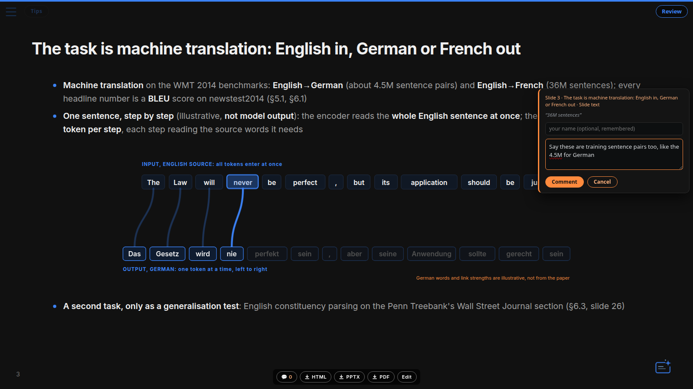

# Comments and edit mode

Both need the local deck server started by `scripts/start.sh` (and the one-time
`scripts/setup.sh`): decks on :8093, the comments/export API on :8094, one
process. On the published GitHub Pages site both are off.

## Access

The server listens on **127.0.0.1** only, so nothing is reachable from other
machines. To open decks from another machine (LAN, VPN, a laptop viewing a
remote workstation), start with `SLIDES_HOST=0.0.0.0 scripts/start.sh`.

**Token login** (on by default): every page and API call needs the server's
token, kept in `.quarto/server-token` (owner-only, created on first start).
`scripts/start.sh` prints the login URL (`…/?token=…`); opening it once sets a
cookie for that host. Agents and curl send `X-Deck-Token: $(cat .quarto/server-token)`.
`SLIDES_AUTH=off scripts/start.sh` turns the login off. Do that only on a
single-user machine bound to 127.0.0.1: without it, anyone who can reach the
server can edit decks, and an edited deck can pull any file your user can read
into its rendered page and exports.

Browser requests with an Origin are accepted only from the server's own pages
(same hostname, `http`, the deck or API port). The server speaks plain HTTP and
the cookie reaches every port of the hostname: see [SECURITY.md](../SECURITY.md)
for what that leaves open.

To run a second checkout next to another one (ports 8093/8094 taken), give
it its own ports; stop it with the same port and variable:

```bash
SLIDES_EXPORT_PORT=8194 scripts/start.sh 8193      # decks :8193, API :8194
SLIDES_EXPORT_PORT=8194 scripts/stop.sh 8193
```

`scripts/install_services.sh` makes the default instance a per-user systemd
unit (`slides-server`) that restarts on any exit and survives the shell that
started it; as a plain `nohup` child it dies whenever that shell's process
group is reaped, and deck comments then queue in the browser unsaved. Exit
reasons land in `journalctl --user -u slides-server`.

## Edit mode

Served decks (`:8093`) get an **Edit** button in the bottom hover bar (next to
HTML/PPTX/PDF; requires the :8094 API). It opens a side pane with the
current slide's markdown. Typing previews instantly: the API's
`POST /preview/<deck>` renders the edited slide with pandoc and it is patched
in place on every keystroke, no reload.
Saving is explicit — **Ctrl+S** (⌘S) or the Save
button; the pane shows an "unsaved changes" status while dirty. Navigating to
another slide or closing the pane saves automatically; closing the tab with
unsaved changes warns. After a save the deck server re-renders the deck and
swaps the changed slides in place. Notes:

- Decks generated from `slides.tpl.qmd` edit the **tpl** (FIG tokens, not
  inlined SVG); each save reruns the deck's `build_deck.py` to regenerate
  `slides.qmd`. Marp-sourced decks edit their `slides.md` (or `slides.tpl.md`).
- Concurrent external writes are detected (etag): the pane shows a conflict
  instead of clobbering, click the status line to reload from disk.
- If the pane's slide count can't be matched to the rendered deck (exotic
  `***`/`___` slide separators), it falls back to whole-file editing.

## Comments



Select text on any served slide and a **💬 Comment** chip appears — write a
note and it persists to `decks/<deck>/comments.json`. Open comments render as
orange highlights; click one to read, **edit**, or resolve it. The chip stays
near the end of your drag; **Ctrl/⌘ + Alt + M** opens the same editor from a
keyboard selection. A 💬 badge in the bottom control bar counts open comments
and offers **Open / Resolved / All** lists. Click an item to jump to its slide
and open the comment, even if its quote no longer appears. Resolved comments
can be edited or reopened. Each comment's **History** retains earlier text
and creation, edit, resolve, and reopen timestamps (with timezone);
comments carry an optional author name (remembered locally), and exported
HTML opened without server reach queues comments in the browser and syncs
them on the next load that can connect (with token login on, a file opened
from disk can't: see below). The JSON file is the
agent handoff:

```json
{ "comments": [ { "id": "c-…", "page": 4, "quote": "exact slide text",
    "comment": "make this punchier", "status": "open", "created": "…",
    "occurrence": 1, "prefix": "…text before…", "suffix": "…text after…" } ] }
```

Hover tooltips pause while selecting text or composing a comment. Select a
tooltip's trigger text, click **Comment**, then choose **Tooltip explanation**
under **Comment on** to address the explanation itself. The editor shows the
exact target; ordinary text on a tooltip trigger can still be commented on.
New comments record `anchor.kind` (`slide` or `tooltip`), the slide heading,
an existing stable `.slide-id` when available, and tooltip trigger/text for
tooltip comments. Existing decks and comments need no migration.

Each saved comment also snapshots its context for playback / prompt tuning:
`commit` (HEAD at comment time), `dirty` (source had uncommitted changes),
`source_file`, and `slide_src` (the slide's markdown as it looked when the
comment was made).

Agents: read the file, use `anchor.slide_id` when present, then locate `quote`
with `page`, `occurrence`, `prefix`, and `suffix` in `slides.qmd` (or the tpl).
For tooltip comments, `quote` is the explanation and `anchor.tooltip_trigger`
identifies the visible label; edit the corresponding `data-tip`. Page and
heading describe the original target; a stable slide ID survives reordering.
Read `history` in array order for each comment's chronology, or merge events
by `at` across comments. Each event records `action`, `at`, `comment`, `status`,
and an optional acting `author`. `created` and the top-level author/source
snapshot remain original; `updated` identifies the latest revision.
`client_created` records browser submission time (including offline comments),
while `created` records server receipt time. Browser time depends on its clock.
Legacy comments retain their known creation time; unknown past status-change
times are `null`, and unavailable past edits cannot be reconstructed.

Use `POST :8094/comments/<deck>` for changes so history is preserved:

```json
{"action":"edit","id":"c-…","comment":"revised instruction","author":"Alex","expected_updated":"…"}
{"action":"resolve","id":"c-…","author":"agent","expected_updated":"…"}
{"action":"reopen","id":"c-…","expected_updated":"…"}
```

Set `expected_updated` to the last-read `updated` (or legacy `created`);
a stale update returns **409**. This field is optional for existing clients.
Direct JSON edits still work but bypass revision history and conflict checks.
Failed UI edits keep the draft open; a conflict requires reviewing the latest
comment before retrying. New offline comments retain the existing browser queue.

Comments also work outside the dev server:

- **Exported HTML** (`scripts/export.sh <deck> html`) embeds the comment
  layer, pointed at `localhost:8094`, so comments land when the file is opened
  on the machine running the server — with token login off only (a file opened
  from disk carries no login cookie). To collect comments from other machines,
  export with `COMMENTS_HOST=<reachable host>` (that name is embedded in the
  file) and run the server with `SLIDES_HOST=0.0.0.0` and `SLIDES_AUTH=off`,
  which [SECURITY.md](../SECURITY.md) advises against outside a trusted
  network; set `COMMENTS_HOST=` to skip the layer.
- **PDF**: annotate in any reader (sticky notes, highlights with notes), then
  `.venv/bin/python scripts/ingest_pdf_comments.py <annotated.pdf> <deck>`
  pulls every annotation with text into the same `comments.json`.
