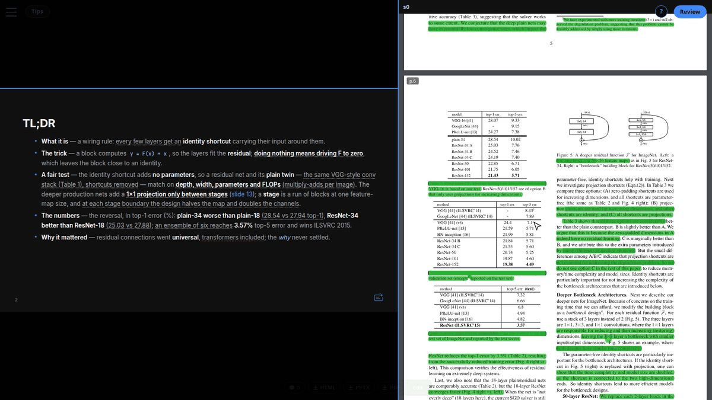

# Source review

## Source review

Reading-group decks can be fact-checked against their PDF/HTML source. The
machinery lives in [`source-review/`](../source-review/) (ingest + in-deck viewer)
and the `slide-deck` skill's annotate scripts
([`references/annotate-source.md`](../.agents/skills/slide-deck/references/annotate-source.md)
has the one-time venv setup; override its path with `ANNOTATE_PY`).
Generate a deck's review with:

```bash
scripts/review.sh <category>/<deck>      # e.g. reading-groups/my-paper
```

The deck's `slides.qmd` front-matter must carry a `sources:` list pointing at the
paper PDF or blog HTML. Output lands in `decks/<category>/<deck>/review.json`
plus the annotated sources; the deck's **Review** button opens them side by
side (`decks/_assets/review.js`, a copy of `source-review/viewer/`).


